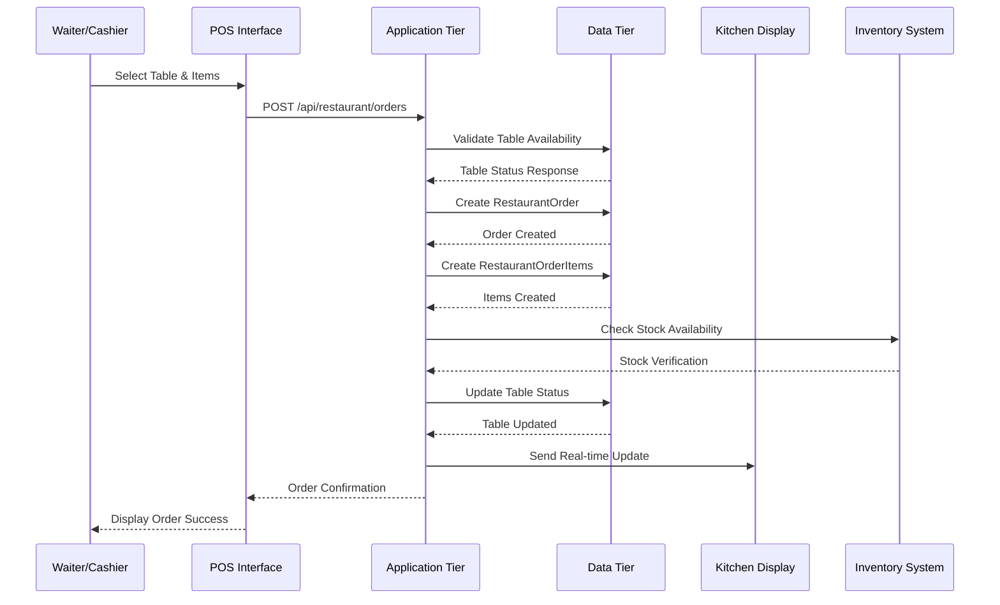
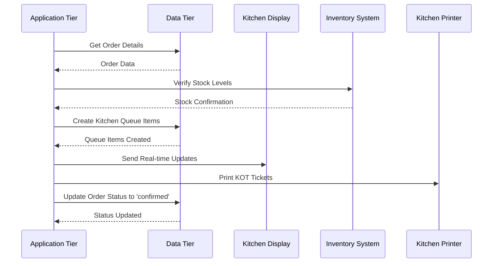
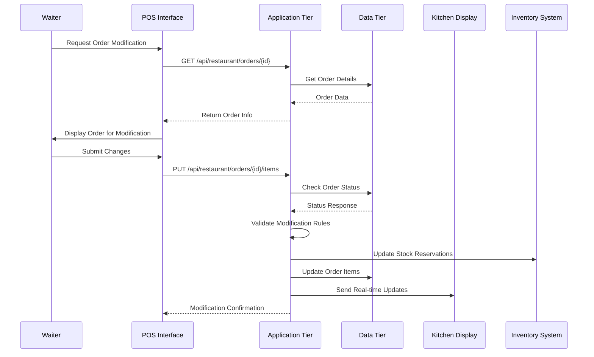
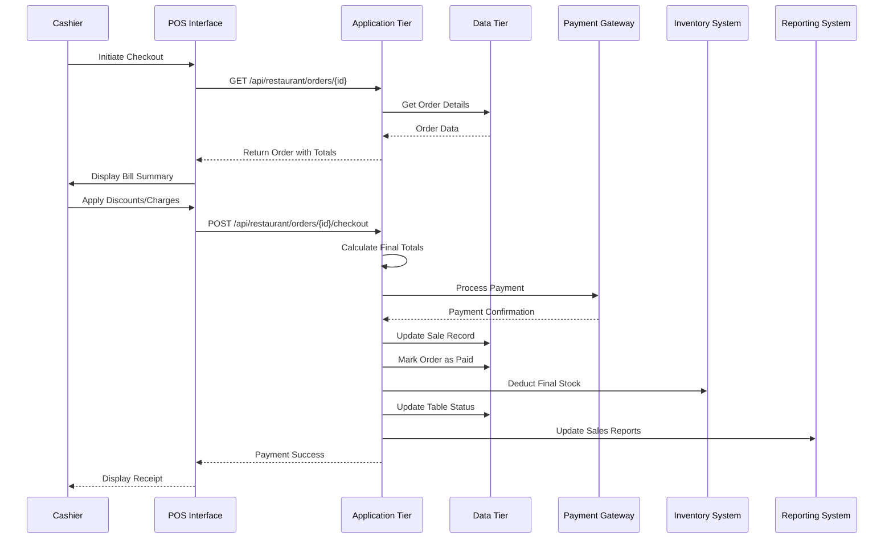

# Restaurant POS Data Flow Architecture

## Overview
This document outlines the comprehensive data flow architecture for the restaurant POS order lifecycle, covering all stages from order entry to payment processing. The architecture ensures smooth data flow throughout the entire order lifecycle while maintaining data integrity and providing real-time updates to all relevant interfaces.

## System Architecture Overview

### Three-Tier Architecture
```
┌─────────────────────────────────────────────────────────────────────────┐
│                    Presentation Tier (Frontend)                        │
├─────────────────────────────────────────────────────────────────────────┤
│  • POS Interface (Waiter/Cashier)                                   │
│  • Kitchen Display System (KDS)                                      │
│  • Management Dashboard                                                │
│  • Customer Display (Optional)                                        │
└─────────────────────────────────────────────────────────────────────────┘
                                    ↕
┌─────────────────────────────────────────────────────────────────────────┐
│                    Application Tier (Backend)                           │
├─────────────────────────────────────────────────────────────────────────┤
│  • Order Management Service                                          │
│  • Kitchen Queue Service                                              │
│  • Payment Processing Service                                         │
│  • Inventory Management Service                                         │
│  • Real-time Notification Service                                      │
└─────────────────────────────────────────────────────────────────────────┘
                                    ↕
┌─────────────────────────────────────────────────────────────────────────┐
│                      Data Tier (Database)                             │
├─────────────────────────────────────────────────────────────────────────┤
│  • Restaurant Orders & Items                                         │
│  • Kitchen Queue                                                    │
│  • Sales & Transactions                                             │
│  • Inventory Stock                                                   │
│  • Tables & Reservations                                             │
└─────────────────────────────────────────────────────────────────────────┘
```

## 1. Order Entry Data Flow

### 1.1 Process Flow Diagram


### 1.2 API Endpoints and Responsibilities

#### Primary Endpoint: `POST /api/restaurant/orders`
**Controller**: [`OrderController@store`](app/Http/Controllers/OrderController.php:118)

**Request Payload**:
```json
{
  "table_id": 5,
  "order_type": "dine_in",
  "customer_count": 4,
  "waiter_id": 12,
  "contact_id": 123,
  "special_instructions": "No onions please",
  "items": [
    {
      "product_id": 45,
      "batch_id": 78,
      "quantity": 2,
      "unit_price": 15.99,
      "unit_cost": 8.50,
      "special_instructions": "Well done",
      "modifiers": [
        {
          "modifier_id": 15,
          "quantity": 1,
          "price_adjustment": 2.50
        }
      ]
    }
  ]
}
```

**Business Logic Validation Rules**:
1. Table availability check
2. Product availability verification
3. Stock level validation
4. Order time restrictions
5. User permission validation

**Response**:
```json
{
  "success": true,
  "message": "Order created successfully",
  "data": {
    "order_id": 12345,
    "order_number": "ORD202512140001",
    "status": "pending",
    "table_id": 5,
    "total_amount": 36.48
  }
}
```

### 1.3 Database Transaction Pattern

```php
DB::transaction(function () {
    // 1. Create restaurant order
    $order = RestaurantOrder::create([
        'order_number' => $this->generateOrderNumber(),
        'table_id' => $request->table_id,
        'order_type' => $request->order_type,
        'customer_count' => $request->customer_count,
        'waiter_id' => Auth::id(),
        'status' => 'pending',
        'store_id' => $storeId,
        'created_by' => Auth::id(),
    ]);

    // 2. Update table status
    if ($request->order_type === 'dine_in') {
        $table = RestaurantTable::find($request->table_id);
        $table->markAsOccupied($order->id);
    }

    // 3. Create order items
    foreach ($request->items as $item) {
        $orderItem = RestaurantOrderItem::create([
            'order_id' => $order->id,
            'product_id' => $item['product_id'],
            'quantity' => $item['quantity'],
            'unit_price' => $item['unit_price'],
            'status' => 'pending',
        ]);

        // 4. Add modifiers
        if (isset($item['modifiers'])) {
            foreach ($item['modifiers'] as $modifier) {
                RestaurantOrderItemModifier::create([
                    'order_item_id' => $orderItem->id,
                    'modifier_id' => $modifier['modifier_id'],
                    'quantity' => $modifier['quantity'],
                    'price_adjustment' => $modifier['price_adjustment'],
                ]);
            }
        }
    }

    // 5. Create linked sale record
    $sale = Sale::create([
        'store_id' => $storeId,
        'restaurant_order_id' => $order->id,
        'order_type' => 'restaurant',
        'status' => 'pending',
        'payment_status' => 'pending',
    ]);

    $order->sale_id = $sale->id;
    $order->save();
});
```

### 1.4 Error Handling and Rollback

**Error Scenarios**:
1. **Table Not Available**: Return 422 with table status
2. **Insufficient Stock**: Return 422 with available quantities
3. **Invalid Product**: Return 404 for non-existent products
4. **Permission Denied**: Return 403 for unauthorized operations

**Rollback Mechanism**:
- All database operations wrapped in DB::transaction()
- Automatic rollback on any exception
- Inventory reservations rolled back on failure
- Table status reverted on order creation failure

## 2. KOT Generation and Stock Verification

### 2.1 Process Flow Diagram


### 2.2 KOT Generation Process

#### Endpoint: `POST /api/restaurant/orders/{id}/confirm`
**Controller**: [`OrderController@updateStatus`](app/Http/Controllers/OrderController.php:328)

**Stock Verification Logic**:
```php
public function verifyStockAvailability($orderItems)
{
    $stockIssues = [];
    
    foreach ($orderItems as $item) {
        $availableStock = ProductStock::where('product_id', $item->product_id)
            ->where('store_id', $this->storeId)
            ->sum('quantity');
            
        if ($availableStock < $item->quantity) {
            $stockIssues[] = [
                'product_id' => $item->product_id,
                'product_name' => $item->product->name,
                'requested' => $item->quantity,
                'available' => $availableStock,
                'shortage' => $item->quantity - $availableStock
            ];
        }
    }
    
    return $stockIssues;
}
```

#### Kitchen Queue Creation:
```php
foreach ($order->items as $orderItem) {
    // Get preparation stations for this product
    $stations = $orderItem->product->kitchenStations;
    
    foreach ($stations as $station) {
        KitchenOrderQueue::create([
            'order_item_id' => $orderItem->id,
            'station_id' => $station->id,
            'status' => 'queued',
            'priority' => $order->priority,
            'estimated_time' => $station->pivot->preparation_time,
        ]);
    }
}
```

### 2.3 Real-time Update Mechanism

#### WebSocket Events:
```javascript
// Order confirmed event
socket.emit('order.confirmed', {
    order_id: 12345,
    table_id: 5,
    items: [...],
    timestamp: '2025-12-14T06:19:00.000Z'
});

// Kitchen queue update
socket.emit('kitchen.queue.updated', {
    station_id: 3,
    queue_items: [...],
    timestamp: '2025-12-14T06:19:00.000Z'
});
```

## 3. Order Modification Data Flow

### 3.1 Process Flow Diagram


### 3.2 Business Logic Validation Rules

#### Order Modification Permissions:
```php
public function canBeModified()
{
    return in_array($this->status, [
        'pending',           // Can modify any pending order
        'confirmed'         // Can modify confirmed orders not yet in preparation
    ]);
}
```

#### Item Addition Rules:
1. **Time Restriction**: Items can be added within 5 minutes of order confirmation
2. **Kitchen Status**: Cannot add items if kitchen preparation has started
3. **Stock Availability**: Must verify stock before adding items
4. **Price Consistency**: Use current product prices, not historical prices

#### Item Modification Rules:
1. **Quantity Changes**: Can increase/decrease within stock limits
2. **Price Changes**: Only managers can modify prices
3. **Void Rules**: Requires manager approval for high-value items
4. **Modifier Changes**: Can add/remove modifiers before preparation starts

### 3.3 API Endpoints for Order Modification

#### Add Item: `POST /api/restaurant/orders/{id}/items`
**Controller**: [`OrderController@addItem`](app/Http/Controllers/OrderController.php:396)

#### Update Item: `PUT /api/restaurant/orders/{orderId}/items/{itemId}`
**Controller**: [`OrderController@updateItem`](app/Http/Controllers/OrderController.php:483)

#### Remove Item: `DELETE /api/restaurant/orders/{orderId}/items/{itemId}`
**Controller**: [`OrderController@removeItem`](app/Http/Controllers/OrderController.php:548)

## 4. Billing and Payment Processing Data Flow

### 4.1 Process Flow Diagram


### 4.2 Billing Calculation Logic

#### Total Calculation Algorithm:
```php
public function calculateFinalTotals($order, $discounts = [], $charges = [])
{
    // 1. Calculate subtotal from items
    $subtotal = $order->items->sum(function($item) {
        return ($item->quantity * $item->unit_price) + 
               $item->modifiers->sum('price_adjustment') - 
               $item->discount;
    });
    
    // 2. Apply item-level discounts
    $totalDiscount = collect($discounts)->sum('amount');
    
    // 3. Calculate taxable amount
    $taxableAmount = $subtotal - $totalDiscount;
    
    // 4. Calculate tax
    $taxAmount = $this->calculateTax($taxableAmount);
    
    // 5. Calculate service charge (for dine-in only)
    $serviceCharge = $order->order_type === 'dine_in' 
        ? $taxableAmount * 0.10  // 10% service charge
        : 0;
    
    // 6. Apply additional charges
    $additionalCharges = collect($charges)->sum('amount');
    
    // 7. Calculate final total
    $totalAmount = $taxableAmount + $taxAmount + $serviceCharge + $additionalCharges;
    
    return [
        'subtotal' => $subtotal,
        'discount_amount' => $totalDiscount,
        'taxable_amount' => $taxableAmount,
        'tax_amount' => $taxAmount,
        'service_charge' => $serviceCharge,
        'additional_charges' => $additionalCharges,
        'total_amount' => $totalAmount
    ];
}
```

### 4.3 Payment Processing Integration

#### Endpoint: `POST /api/restaurant/orders/{id}/checkout`
**Controller**: [`POSController@restaurantCheckout`](app/Http/Controllers/POSController.php:758)

#### Payment Methods Support:
```php
$paymentMethods = [
    'cash' => [
        'processor' => 'CashProcessor',
        'requires_gateway' => false,
        'tip_handling' => 'manual'
    ],
    'card' => [
        'processor' => 'CardProcessor',
        'requires_gateway' => true,
        'tip_handling' => 'terminal'
    ],
    'account' => [
        'processor' => 'AccountProcessor',
        'requires_gateway' => false,
        'tip_handling' => 'manual'
    ],
    'split' => [
        'processor' => 'SplitProcessor',
        'requires_gateway' => true,
        'tip_handling' => 'distributed'
    ]
];
```

#### Split Billing Logic:
```php
public function processSplitPayment($order, $splitData)
{
    $splits = [];
    
    switch ($splitData['split_type']) {
        case 'equal':
            $perPersonAmount = $order->total_amount / $splitData['split_count'];
            for ($i = 1; $i <= $splitData['split_count']; $i++) {
                $splits[] = [
                    'split_number' => $i,
                    'amount' => $perPersonAmount,
                    'contact_id' => $splitData['contacts'][$i - 1] ?? null
                ];
            }
            break;
            
        case 'item_based':
            foreach ($splitData['items'] as $splitNumber => $items) {
                $splitAmount = collect($items)->sum(function($item) {
                    return $item['quantity'] * $item['unit_price'];
                });
                $splits[] = [
                    'split_number' => $splitNumber,
                    'amount' => $splitAmount,
                    'items' => $items
                ];
            }
            break;
            
        case 'amount_based':
            foreach ($splitData['amounts'] as $splitNumber => $amount) {
                $splits[] = [
                    'split_number' => $splitNumber,
                    'amount' => $amount
                ];
            }
            break;
    }
    
    return $splits;
}
```

## 5. Real-time Update Mechanisms

### 5.1 WebSocket Architecture

#### Connection Management:
```javascript
// Kitchen Display Connection
const kitchenSocket = io('/kitchen-display', {
    auth: {
        token: authToken,
        station_id: currentStationId,
        store_id: currentStoreId
    }
});

// POS Interface Connection
const posSocket = io('/pos-interface', {
    auth: {
        token: authToken,
        user_id: currentUserId,
        store_id: currentStoreId
    }
});
```

#### Event Types:
```javascript
// Order Events
socket.on('order.created', (data) => {
    updateOrderList(data.order);
    notifyKitchen(data.order);
});

socket.on('order.updated', (data) => {
    updateOrderDisplay(data.order);
    updateKitchenQueue(data.order);
});

socket.on('order.status_changed', (data) => {
    updateOrderStatus(data.order_id, data.new_status);
    updateTableStatus(data.table_id, data.new_status);
});

// Kitchen Queue Events
socket.on('kitchen.item_queued', (data) => {
    addToStationQueue(data.station_id, data.item);
    playNotificationSound();
});

socket.on('kitchen.item_started', (data) => {
    updateItemStatus(data.queue_id, 'in_progress');
    startPreparationTimer(data.queue_id);
});

socket.on('kitchen.item_ready', (data) => {
    updateItemStatus(data.queue_id, 'ready');
    notifyWaiter(data.order_id);
});

// Table Status Events
socket.on('table.status_changed', (data) => {
    updateTableDisplay(data.table_id, data.new_status);
    updateFloorPlan();
});
```

### 5.2 Push Notification System

#### Notification Channels:
```php
class RestaurantNotificationService
{
    public function notifyKitchen($order)
    {
        // Send to specific kitchen stations
        foreach ($order->items as $item) {
            $stations = $item->product->kitchenStations;
            foreach ($stations as $station) {
                $this->broadcastToChannel("kitchen.station.{$station->id}", [
                    'event' => 'new_order_item',
                    'data' => [
                        'order_id' => $order->id,
                        'order_number' => $order->order_number,
                        'item' => $item->load('product'),
                        'priority' => $order->priority
                    ]
                ]);
            }
        }
    }
    
    public function notifyWaiter($orderId, $message)
    {
        $order = RestaurantOrder::find($orderId);
        $this->broadcastToChannel("waiter.{$order->waiter_id}", [
            'event' => 'order_notification',
            'data' => [
                'order_id' => $orderId,
                'message' => $message,
                'timestamp' => now()
            ]
        ]);
    }
}
```

## 6. Error Handling and Rollback Mechanisms

### 6.1 Comprehensive Error Handling Strategy

#### Error Classification:
```php
class RestaurantErrorHandler
{
    private const ERROR_CATEGORIES = [
        'validation' => [
            'response_code' => 422,
            'rollback' => false,
            'notify_user' => true
        ],
        'business_logic' => [
            'response_code' => 400,
            'rollback' => true,
            'notify_user' => true
        ],
        'inventory' => [
            'response_code' => 409,
            'rollback' => true,
            'notify_user' => true
        ],
        'payment' => [
            'response_code' => 402,
            'rollback' => true,
            'notify_user' => true
        ],
        'system' => [
            'response_code' => 500,
            'rollback' => true,
            'notify_user' => false,
            'log_level' => 'critical'
        ]
    ];
}
```

#### Transaction Rollback Patterns:
```php
public function processOrderWithRollback($orderData)
{
    $checkpoint = $this->createTransactionCheckpoint();
    
    try {
        DB::beginTransaction();
        
        // Phase 1: Create order
        $order = $this->createOrder($orderData);
        
        // Phase 2: Reserve inventory
        $this->reserveInventory($order->items);
        
        // Phase 3: Update table status
        $this->updateTableStatus($order);
        
        // Phase 4: Create kitchen queue items
        $this->createKitchenQueue($order);
        
        // Phase 5: Send notifications
        $this->sendOrderNotifications($order);
        
        DB::commit();
        $this->clearCheckpoint($checkpoint);
        
        return $this->successResponse($order);
        
    } catch (InventoryException $e) {
        DB::rollBack();
        $this->rollbackToCheckpoint($checkpoint);
        return $this->errorResponse('Inventory issue: ' . $e->getMessage(), 409);
        
    } catch (PaymentException $e) {
        DB::rollBack();
        $this->rollbackToCheckpoint($checkpoint);
        return $this->errorResponse('Payment failed: ' . $e->getMessage(), 402);
        
    } catch (Exception $e) {
        DB::rollBack();
        $this->rollbackToCheckpoint($checkpoint);
        $this->logCriticalError($e);
        return $this->errorResponse('System error occurred', 500);
    }
}
```

### 6.2 Data Consistency Mechanisms

#### Optimistic Locking:
```php
class RestaurantOrder extends Model
{
    protected $casts = [
        'version' => 'integer'
    ];
    
    public function updateWithLock($data)
    {
        $currentVersion = $this->version;
        
        $updated = $this->where('id', $this->id)
            ->where('version', $currentVersion)
            ->update(array_merge($data, ['version' => $currentVersion + 1]));
            
        if (!$updated) {
            throw new OptimisticLockException('Order was modified by another user');
        }
        
        $this->refresh();
        return $this;
    }
}
```

#### Inventory Reservation System:
```php
class InventoryReservationService
{
    public function reserveItems($orderItems, $orderId)
    {
        $reservations = [];
        
        foreach ($orderItems as $item) {
            // Create reservation record
            $reservation = InventoryReservation::create([
                'order_id' => $orderId,
                'product_id' => $item->product_id,
                'quantity_reserved' => $item->quantity,
                'expires_at' => now()->addMinutes(30), // 30-minute reservation
                'status' => 'active'
            ]);
            
            // Update available stock
            ProductStock::where('product_id', $item->product_id)
                ->where('store_id', $this->storeId)
                ->decrement('available_quantity', $item->quantity);
                
            $reservations[] = $reservation;
        }
        
        return $reservations;
    }
    
    public function releaseReservations($orderId)
    {
        $reservations = InventoryReservation::where('order_id', $orderId)
            ->where('status', 'active')
            ->get();
            
        foreach ($reservations as $reservation) {
            // Restore available stock
            ProductStock::where('product_id', $reservation->product_id)
                ->where('store_id', $this->storeId)
                ->increment('available_quantity', $reservation->quantity_reserved);
                
            // Mark reservation as released
            $reservation->status = 'released';
            $reservation->save();
        }
    }
}
```

## 7. API Endpoints Summary

### 7.1 Order Management Endpoints

| Method | Endpoint | Controller | Responsibility |
|--------|----------|------------|----------------|
| POST | `/api/restaurant/orders` | [`OrderController@store`](app/Http/Controllers/OrderController.php:118) | Create new order |
| GET | `/api/restaurant/orders` | [`OrderController@index`](app/Http/Controllers/OrderController.php:28) | List orders with filters |
| GET | `/api/restaurant/orders/{id}` | [`OrderController@show`](app/Http/Controllers/OrderController.php:61) | Get order details |
| PUT | `/api/restaurant/orders/{id}` | [`OrderController@update`](app/Http/Controllers/OrderController.php:269) | Update order info |
| PUT | `/api/restaurant/orders/{id}/status` | [`OrderController@updateStatus`](app/Http/Controllers/OrderController.php:328) | Update order status |
| POST | `/api/restaurant/orders/{id}/items` | [`OrderController@addItem`](app/Http/Controllers/OrderController.php:396) | Add item to order |
| PUT | `/api/restaurant/orders/{orderId}/items/{itemId}` | [`OrderController@updateItem`](app/Http/Controllers/OrderController.php:483) | Update order item |
| DELETE | `/api/restaurant/orders/{orderId}/items/{itemId}` | [`OrderController@removeItem`](app/Http/Controllers/OrderController.php:548) | Remove order item |
| POST | `/api/restaurant/orders/{id}/split` | [`OrderController@splitOrder`](app/Http/Controllers/OrderController.php:594) | Split order |
| POST | `/api/restaurant/orders/{id}/cancel` | [`OrderController@cancel`](app/Http/Controllers/OrderController.php:675) | Cancel order |

### 7.2 Kitchen Management Endpoints

| Method | Endpoint | Controller | Responsibility |
|--------|----------|------------|----------------|
| GET | `/api/kitchen/dashboard` | [`KitchenController@dashboard`](app/Http/Controllers/KitchenController.php:24) | Kitchen dashboard |
| GET | `/api/kitchen/stations/{id}` | [`KitchenController@station`](app/Http/Controllers/KitchenController.php:78) | Station-specific view |
| POST | `/api/kitchen/queue/{id}/start` | [`KitchenController@startPreparation`](app/Http/Controllers/KitchenController.php:125) | Start preparation |
| PUT | `/api/kitchen/queue/{id}/ready` | [`KitchenController@markAsReady`](app/Http/Controllers/KitchenController.php:165) | Mark as ready |
| PUT | `/api/kitchen/queue/{id}/complete` | [`KitchenController@complete`](app/Http/Controllers/KitchenController.php:205) | Complete item |
| POST | `/api/kitchen/queue` | [`KitchenController@addToQueue`](app/Http/Controllers/KitchenController.php:253) | Add to queue |
| PUT | `/api/kitchen/queue/{id}/priority` | [`KitchenController@updatePriority`](app/Http/Controllers/KitchenController.php:323) | Update priority |
| GET | `/api/kitchen/queue/status` | [`KitchenController@getQueueStatus`](app/Http/Controllers/KitchenController.php:446) | Real-time status |

### 7.3 POS Checkout Endpoints

| Method | Endpoint | Controller | Responsibility |
|--------|----------|------------|----------------|
| GET | `/api/restaurant/pos` | [`POSController@restaurantIndex`](app/Http/Controllers/POSController.php:687) | POS interface data |
| POST | `/api/restaurant/pos/checkout` | [`POSController@restaurantCheckout`](app/Http/Controllers/POSController.php:758) | Process checkout |
| GET | `/api/restaurant/pos/orders/{id}/edit` | [`POSController@editRestaurantOrder`](app/Http/Controllers/POSController.php:984) | Edit order |

## 8. Database Transaction Patterns

### 8.1 Order Creation Transaction Pattern

```sql
-- Transaction Pattern for Order Creation
BEGIN;

-- 1. Create restaurant order
INSERT INTO restaurant_orders (
    order_number, table_id, order_type, customer_count, 
    waiter_id, status, store_id, created_by, created_at
) VALUES (
    'ORD202512140001', 5, 'dine_in', 4, 
    12, 'pending', 1, 12, NOW()
);

-- 2. Update table status
UPDATE restaurant_tables 
SET status = 'occupied', current_order_id = LAST_INSERT_ID()
WHERE id = 5;

-- 3. Create order items
INSERT INTO restaurant_order_items (
    order_id, product_id, quantity, unit_price, status
) VALUES 
    (LAST_INSERT_ID(), 45, 2, 15.99, 'pending'),
    (LAST_INSERT_ID(), 67, 1, 8.50, 'pending');

-- 4. Create sale record
INSERT INTO sales (
    restaurant_order_id, store_id, order_type, status, 
    payment_status, created_at
) VALUES (
    LAST_INSERT_ID(), 1, 'restaurant', 'pending', 
    'pending', NOW()
);

-- 5. Create kitchen queue items
INSERT INTO kitchen_order_queue (
    order_item_id, station_id, status, priority, created_at
) VALUES 
    ((SELECT id FROM restaurant_order_items WHERE order_id = LAST_INSERT_ID() LIMIT 1), 
     3, 'queued', 'normal', NOW());

COMMIT;
```

### 8.2 Payment Processing Transaction Pattern

```sql
-- Transaction Pattern for Payment Processing
BEGIN;

-- 1. Update order totals
UPDATE restaurant_orders 
SET subtotal = 40.48, tax_amount = 4.05, 
    service_charge = 4.05, total_amount = 48.58,
    status = 'paid'
WHERE id = 12345;

-- 2. Update sale record
UPDATE sales 
SET total_amount = 48.58, status = 'completed', 
    payment_status = 'completed', amount_received = 48.58
WHERE restaurant_order_id = 12345;

-- 3. Create transaction records
INSERT INTO transactions (
    sales_id, store_id, contact_id, transaction_date, 
    amount, payment_method, transaction_type
) VALUES 
    ((SELECT id FROM sales WHERE restaurant_order_id = 12345), 
     1, 123, NOW(), 48.58, 'card', 'sale');

-- 4. Update inventory
UPDATE product_stocks ps
JOIN restaurant_order_items roi ON roi.batch_id = ps.batch_id
SET ps.quantity = ps.quantity - roi.quantity
WHERE roi.order_id = 12345;

-- 5. Update table status
UPDATE restaurant_tables 
SET status = 'available', current_order_id = NULL
WHERE id = (SELECT table_id FROM restaurant_orders WHERE id = 12345);

COMMIT;
```

## 9. Integration Points Between Components

### 9.1 Restaurant Order to Sale Conversion

```php
class OrderToSaleService
{
    public function convertOrderToSale($restaurantOrder)
    {
        // Create or update sale record
        $sale = Sale::updateOrCreate(
            ['restaurant_order_id' => $restaurantOrder->id],
            [
                'store_id' => $restaurantOrder->store_id,
                'contact_id' => $restaurantOrder->contact_id,
                'sale_date' => $restaurantOrder->order_date,
                'sale_time' => $restaurantOrder->order_time,
                'total_amount' => $restaurantOrder->total_amount,
                'discount' => $restaurantOrder->discount_amount,
                'tax_amount' => $restaurantOrder->tax_amount,
                'service_charge_amount' => $restaurantOrder->service_charge,
                'status' => $restaurantOrder->status === 'paid' ? 'completed' : 'pending',
                'payment_status' => $restaurantOrder->status === 'paid' ? 'completed' : 'pending',
                'note' => "Restaurant Order #{$restaurantOrder->order_number}",
                'created_by' => $restaurantOrder->created_by,
            ]
        );
        
        // Convert order items to sale items
        foreach ($restaurantOrder->items as $orderItem) {
            SaleItem::updateOrCreate(
                ['restaurant_order_item_id' => $orderItem->id],
                [
                    'sale_id' => $sale->id,
                    'product_id' => $orderItem->product_id,
                    'batch_id' => $orderItem->batch_id,
                    'quantity' => $orderItem->quantity,
                    'unit_price' => $orderItem->unit_price,
                    'unit_cost' => $orderItem->unit_cost,
                    'discount' => $orderItem->discount,
                    'description' => $orderItem->special_instructions,
                    'course_number' => $orderItem->course_number,
                ]
            );
        }
        
        return $sale;
    }
}
```

### 9.2 Inventory Management Integration

```php
class RestaurantInventoryService
{
    public function reserveInventoryForOrder($order)
    {
        foreach ($order->items as $item) {
            // Check current stock
            $currentStock = ProductStock::where('product_id', $item->product_id)
                ->where('store_id', $order->store_id)
                ->first();
                
            if ($currentStock->quantity < $item->quantity) {
                throw new InsufficientStockException(
                    "Insufficient stock for product: {$item->product->name}"
                );
            }
            
            // Create inventory reservation
            InventoryReservation::create([
                'order_id' => $order->id,
                'product_id' => $item->product_id,
                'batch_id' => $item->batch_id,
                'quantity_reserved' => $item->quantity,
                'expires_at' => now()->addMinutes(30),
                'status' => 'active'
            ]);
            
            // Update available quantity
            $currentStock->available_quantity -= $item->quantity;
            $currentStock->save();
        }
    }
    
    public function commitInventoryForOrder($order)
    {
        foreach ($order->items as $item) {
            // Convert reservations to actual deductions
            InventoryReservation::where('order_id', $order->id)
                ->where('product_id', $item->product_id)
                ->update(['status' => 'committed']);
                
            // Deduct from actual stock
            ProductStock::where('product_id', $item->product_id)
                ->where('batch_id', $item->batch_id)
                ->where('store_id', $order->store_id)
                ->decrement('quantity', $item->quantity);
        }
    }
}
```

## 10. Performance Optimization Considerations

### 10.1 Database Indexing Strategy

```sql
-- Critical indexes for order performance
CREATE INDEX idx_orders_store_status_date ON restaurant_orders(store_id, status, order_date);
CREATE INDEX idx_orders_table_status ON restaurant_orders(table_id, status);
CREATE INDEX idx_order_items_order_product ON restaurant_order_items(order_id, product_id);
CREATE INDEX idx_kitchen_queue_station_status ON kitchen_order_queue(station_id, status, priority);
CREATE INDEX idx_kitchen_queue_created_at ON kitchen_order_queue(created_at);

-- Composite indexes for common queries
CREATE INDEX idx_orders_active_restaurant ON restaurant_orders(store_id, status) 
WHERE status IN ('pending', 'confirmed', 'preparing', 'ready');
```

### 10.2 Caching Strategy

```php
class RestaurantCacheService
{
    public function cacheActiveOrders($storeId)
    {
        $cacheKey = "restaurant.active_orders.{$storeId}";
        $orders = RestaurantOrder::with(['table', 'items.product'])
            ->forStore($storeId)
            ->active()
            ->get();
            
        Cache::put($cacheKey, $orders, now()->addMinutes(5));
        return $orders;
    }
    
    public function cacheKitchenQueue($stationId)
    {
        $cacheKey = "kitchen.queue.{$stationId}";
        $queue = KitchenOrderQueue::with(['orderItem.order', 'orderItem.product'])
            ->where('station_id', $stationId)
            ->whereIn('status', ['queued', 'in_progress'])
            ->orderBy('priority', 'desc')
            ->orderBy('created_at', 'asc')
            ->get();
            
        Cache::put($cacheKey, $queue, now()->addMinutes(1));
        return $queue;
    }
}
```

## 11. Monitoring and Analytics

### 11.1 Order Lifecycle Metrics

```php
class RestaurantAnalyticsService
{
    public function getOrderMetrics($storeId, $dateRange)
    {
        return [
            'total_orders' => RestaurantOrder::forStore($storeId)
                ->whereBetween('order_date', $dateRange)
                ->count(),
            'average_order_value' => RestaurantOrder::forStore($storeId)
                ->whereBetween('order_date', $dateRange)
                ->avg('total_amount'),
            'order_completion_rate' => $this->calculateCompletionRate($storeId, $dateRange),
            'average_preparation_time' => $this->calculateAveragePreparationTime($storeId, $dateRange),
            'table_turnover_rate' => $this->calculateTableTurnover($storeId, $dateRange),
        ];
    }
    
    public function getKitchenPerformanceMetrics($storeId, $dateRange)
    {
        return KitchenOrderQueue::with(['station', 'orderItem.order'])
            ->whereHas('orderItem.order', function($query) use ($storeId, $dateRange) {
                $query->where('store_id', $storeId)
                      ->whereBetween('order_date', $dateRange);
            })
            ->selectRaw('
                station_id,
                COUNT(*) as total_items,
                AVG(TIMESTAMPDIFF(MINUTE, created_at, completed_at)) as avg_preparation_time,
                SUM(CASE WHEN status = "completed" THEN 1 ELSE 0 END) as completed_items
            ')
            ->groupBy('station_id')
            ->get();
    }
}
```

## 12. Security Considerations

### 12.1 Data Access Control

```php
class RestaurantPolicy
{
    public function createOrder(User $user)
    {
        return $user->can_take_orders || $user->hasRole('manager');
    }
    
    public function modifyOrder(User $user, RestaurantOrder $order)
    {
        if ($user->hasRole('manager')) {
            return true;
        }
        
        return $user->id === $order->waiter_id && 
               $order->canBeModified();
    }
    
    public function accessKitchen(User $user)
    {
        return $user->hasRole('kitchen') || $user->hasRole('manager');
    }
    
    public function processPayment(User $user)
    {
        return $user->can_process_payments || $user->hasRole('manager');
    }
}
```

### 12.2 Data Validation and Sanitization

```php
class RestaurantOrderRequest extends FormRequest
{
    public function rules()
    {
        return [
            'table_id' => 'required|exists:restaurant_tables,id',
            'order_type' => 'required|in:dine_in,takeaway,delivery',
            'customer_count' => 'required|integer|min:1|max:50',
            'items' => 'required|array|min:1',
            'items.*.product_id' => 'required|exists:products,id',
            'items.*.quantity' => 'required|numeric|min:0.01|max:999.99',
            'items.*.unit_price' => 'required|numeric|min:0|max:9999.99',
            'special_instructions' => 'nullable|string|max:1000',
            'payment_method' => 'required|in:cash,card,account',
        ];
    }
    
    public function sanitize()
    {
        $input = $this->all();
        
        // Sanitize special instructions
        if (isset($input['special_instructions'])) {
            $input['special_instructions'] = strip_tags($input['special_instructions']);
        }
        
        // Validate monetary values
        if (isset($input['items'])) {
            foreach ($input['items'] as &$item) {
                $item['quantity'] = round($item['quantity'], 2);
                $item['unit_price'] = round($item['unit_price'], 2);
            }
        }
        
        return $input;
    }
}
```

This comprehensive data flow architecture ensures smooth, reliable, and efficient operation of the restaurant POS system while maintaining data integrity, providing real-time updates, and supporting all business requirements for a full-service restaurant environment.