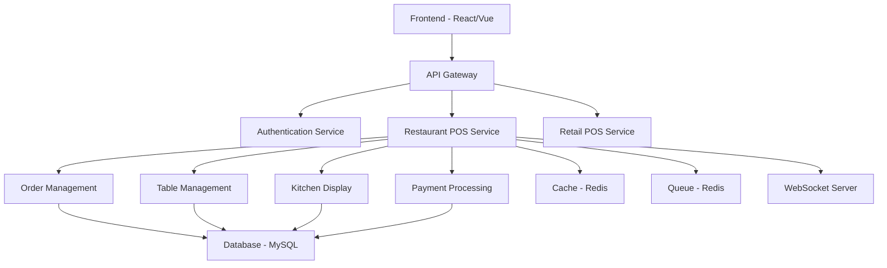

# Restaurant POS Implementation Roadmap and Technical Specifications

## Overview
This document provides a comprehensive implementation roadmap for transforming the existing InfoShop POS system into a full-featured restaurant POS system, including technical specifications, timeline, and resource requirements.

## 1. Implementation Phases

### Phase 1: Foundation and Core Infrastructure (Weeks 1-4)

#### 1.1 Database Schema Implementation
**Timeline**: Week 1
**Priority**: Critical
**Dependencies**: None

**Tasks**:
- Create restaurant-specific database tables
- Extend existing tables with restaurant fields
- Implement database migrations
- Set up foreign key relationships
- Create indexes for performance optimization

**Technical Specifications**:
```sql
-- Core restaurant tables to implement
- restaurant_tables
- table_sections  
- restaurant_orders
- restaurant_order_items
- menu_modifiers
- menu_modifier_groups
- kitchen_stations
- kitchen_order_queue
```

**Acceptance Criteria**:
- All migrations run successfully
- Foreign key constraints properly defined
- Indexes created for performance
- Database passes integrity checks

#### 1.2 Model and Relationship Implementation
**Timeline**: Week 2
**Priority**: Critical
**Dependencies**: Database schema

**Tasks**:
- Create restaurant-specific Eloquent models
- Implement model relationships
- Add scopes and methods
- Create model observers
- Implement soft deletes where needed

**Technical Specifications**:
```php
// Key models to implement
- RestaurantTable
- TableSection
- RestaurantOrder
- RestaurantOrderItem
- MenuModifier
- KitchenStation
- KitchenOrderQueue
```

**Acceptance Criteria**:
- All models created with proper relationships
- Scopes working correctly
- Observers handling events properly
- Model validation rules implemented

#### 1.3 Core Service Layer
**Timeline**: Weeks 2-3
**Priority**: Critical
**Dependencies**: Models

**Tasks**:
- Create restaurant service classes
- Implement business logic
- Add validation rules
- Create error handling
- Implement logging

**Technical Specifications**:
```php
// Core services to implement
- RestaurantOrderService
- TableManagementService
- KitchenQueueService
- ReservationService
- ModifierService
```

**Acceptance Criteria**:
- Services handle all business logic
- Proper error handling implemented
- Validation rules working
- Logging functional

#### 1.4 Basic API Endpoints
**Timeline**: Week 4
**Priority**: High
**Dependencies**: Services

**Tasks**:
- Create restaurant API routes
- Implement controller methods
- Add request validation
- Create API responses
- Add authentication middleware

**Technical Specifications**:
```php
// API endpoints to implement
GET /api/restaurant/tables
POST /api/restaurant/orders
PUT /api/restaurant/orders/{id}
GET /api/restaurant/kitchen/queue
```

**Acceptance Criteria**:
- All endpoints functional
- Proper validation implemented
- Authentication working
- API documentation created

### Phase 2: Table Management and Reservations (Weeks 5-8)

#### 2.1 Table Management Interface
**Timeline**: Weeks 5-6
**Priority**: High
**Dependencies**: Core infrastructure

**Tasks**:
- Create table management UI components
- Implement floor plan editor
- Add table status management
- Create table assignment workflow
- Implement table status updates

**Technical Specifications**:
```jsx
// React components to implement
- FloorPlanView
- TableComponent
- TableDetailsModal
- TableAssignmentDialog
- TableStatusIndicator
```

**Acceptance Criteria**:
- Floor plan displays correctly
- Table status updates in real-time
- Assignment workflow functional
- Mobile responsive design

#### 2.2 Reservation System
**Timeline**: Weeks 6-7
**Priority**: High
**Dependencies**: Table management

**Tasks**:
- Create reservation management interface
- Implement reservation calendar
- Add conflict detection
- Create reservation workflow
- Implement notification system

**Technical Specifications**:
```jsx
// Reservation components
- ReservationManagement
- ReservationCalendar
- CreateReservationDialog
- ReservationDetailsModal
- ConflictDetection
```

**Acceptance Criteria**:
- Calendar displays reservations
- Conflict detection working
- Reservation workflow complete
- Notifications functional

#### 2.3 Host/Hostess Interface
**Timeline**: Week 8
**Priority**: Medium
**Dependencies**: Table management, reservations

**Tasks**:
- Create host dashboard
- Implement seating management
- Add waitlist functionality
- Create guest notification system
- Implement table turnover tracking

**Technical Specifications**:
```jsx
// Host interface components
- HostDashboard
- SeatingManagement
- WaitlistManager
- GuestNotification
- TurnoverTracker
```

**Acceptance Criteria**:
- Host dashboard functional
- Seating workflow complete
- Waitlist management working
- Turnover tracking accurate

### Phase 3: Order Management and Kitchen Operations (Weeks 9-12)

#### 3.1 Order Taking Interface
**Timeline**: Weeks 9-10
**Priority**: Critical
**Dependencies**: Table management

**Tasks**:
- Create order taking interface
- Implement menu browsing
- Add modifier selection
- Create special instructions handling
- Implement order validation

**Technical Specifications**:
```jsx
// Order taking components
- OrderTakingInterface
- MenuBrowser
- ProductCard
- ModifierSelectionModal
- SpecialInstructionsInput
```

**Acceptance Criteria**:
- Order interface user-friendly
- Menu browsing functional
- Modifier selection working
- Validation rules enforced

#### 3.2 Kitchen Display System
**Timeline**: Weeks 10-11
**Priority**: Critical
**Dependencies**: Order management

**Tasks**:
- Create kitchen display interface
- Implement order queue management
- Add station-based routing
- Create status tracking
- Implement timer functionality

**Technical Specifications**:
```jsx
// Kitchen display components
- KitchenDisplaySystem
- OrderQueue
- KitchenOrderItem
- StatusIndicator
- PreparationTimer
```

**Acceptance Criteria**:
- Kitchen display real-time
- Order management functional
- Station routing working
- Status tracking accurate

#### 3.3 Order Status Tracking
**Timeline**: Week 12
**Priority**: High
**Dependencies**: Order management, kitchen display

**Tasks**:
- Implement order status workflow
- Create status update notifications
- Add order history tracking
- Implement delay management
- Create completion tracking

**Technical Specifications**:
```php
// Status tracking implementation
- OrderStatusWorkflow
- StatusNotificationService
- OrderHistoryTracker
- DelayManagementService
- CompletionTracker
```

**Acceptance Criteria**:
- Status workflow complete
- Notifications working
- History tracking accurate
- Delay management functional

### Phase 4: Payment Processing and Checkout (Weeks 13-16)

#### 4.1 Restaurant Checkout Interface
**Timeline**: Weeks 13-14
**Priority**: Critical
**Dependencies**: Order management

**Tasks**:
- Create restaurant checkout interface
- Implement order summary display
- Add discount and charge application
- Create tip management
- Implement payment method selection

**Technical Specifications**:
```jsx
// Checkout components
- RestaurantCheckout
- OrderSummary
- DiscountApplication
- TipManagement
- PaymentMethodSelection
```

**Acceptance Criteria**:
- Checkout interface user-friendly
- Order summary accurate
- Discount application working
- Tip management functional

#### 4.2 Split Billing System
**Timeline**: Weeks 14-15
**Priority**: High
**Dependencies**: Checkout interface

**Tasks**:
- Implement split billing logic
- Create split types (equal, item-based, amount-based)
- Add split payment processing
- Create split receipt generation
- Implement tip distribution

**Technical Specifications**:
```php
// Split billing implementation
- SplitBillingService
- EqualSplitCalculator
- ItemSplitCalculator
- AmountSplitCalculator
- TipDistributionService
```

**Acceptance Criteria**:
- Split billing logic working
- All split types functional
- Payment processing accurate
- Receipt generation correct

#### 4.3 Payment Integration
**Timeline**: Week 16
**Priority**: Critical
**Dependencies**: Checkout interface, split billing

**Tasks**:
- Integrate with existing payment system
- Add restaurant-specific payment features
- Implement tip processing
- Create receipt generation
- Add payment confirmation workflow

**Technical Specifications**:
```php
// Payment integration
- RestaurantPaymentService
- TipProcessingService
- ReceiptGenerationService
- PaymentConfirmationService
```

**Acceptance Criteria**:
- Payment integration seamless
- Tip processing working
- Receipt generation functional
- Confirmation workflow complete

### Phase 5: Advanced Features and Optimization (Weeks 17-20)

#### 5.1 Reporting and Analytics
**Timeline**: Weeks 17-18
**Priority**: Medium
**Dependencies**: Core functionality

**Tasks**:
- Create restaurant-specific reports
- Implement analytics dashboard
- Add performance metrics
- Create sales analysis
- Implement staff performance tracking

**Technical Specifications**:
```php
// Reporting implementation
- RestaurantReportService
- AnalyticsService
- PerformanceMetricsService
- SalesAnalysisService
- StaffPerformanceService
```

**Acceptance Criteria**:
- Reports comprehensive
- Analytics insightful
- Metrics accurate
- Performance tracking functional

#### 5.2 Real-time Features
**Timeline**: Weeks 18-19
**Priority**: Medium
**Dependencies**: Core functionality

**Tasks**:
- Implement WebSocket connections
- Add real-time updates
- Create push notifications
- Implement live status tracking
- Add real-time inventory updates

**Technical Specifications**:
```javascript
// Real-time implementation
- WebSocketServer
- RealTimeUpdateService
- PushNotificationService
- LiveStatusTracker
- RealTimeInventoryService
```

**Acceptance Criteria**:
- Real-time updates working
- Push notifications functional
- Live status tracking accurate
- Inventory updates real-time

#### 5.3 Performance Optimization
**Timeline**: Week 20
**Priority**: High
**Dependencies**: All features

**Tasks**:
- Optimize database queries
- Implement caching strategies
- Add performance monitoring
- Create load balancing
- Implement error tracking

**Technical Specifications**:
```php
// Performance optimization
- QueryOptimizationService
- CacheService
- PerformanceMonitoringService
- LoadBalancingService
- ErrorTrackingService
```

**Acceptance Criteria**:
- Queries optimized
- Caching effective
- Monitoring functional
- Load balancing working
- Error tracking comprehensive

## 2. Technical Architecture

### 2.1 System Architecture Overview


### 2.2 Technology Stack

#### Backend
- **Framework**: Laravel 9+
- **Database**: MySQL 8.0+
- **Cache**: Redis 6+
- **Queue**: Redis/Beanstalkd
- **WebSocket**: Laravel WebSockets/Pusher
- **Search**: Elasticsearch (optional)

#### Frontend
- **Framework**: React 18+ with Material-UI
- **State Management**: Context API/Redux
- **Real-time**: WebSocket/Pusher
- **Charts**: Chart.js/D3.js
- **Mobile**: React Native/PWA

#### Infrastructure
- **Server**: Linux (Ubuntu 20.04+)
- **Web Server**: Nginx
- **PHP**: 8.1+
- **Node.js**: 16+ (for WebSocket server)
- **SSL**: Let's Encrypt

### 2.3 Database Design Patterns

#### Table Partitioning
```sql
-- Partition large tables by date for performance
CREATE TABLE restaurant_orders (
    -- columns
) PARTITION BY RANGE (YEAR(order_date)) (
    PARTITION p2023 VALUES LESS THAN (2024),
    PARTITION p2024 VALUES LESS THAN (2025),
    PARTITION p2025 VALUES LESS THAN (2026)
);
```

#### Indexing Strategy
```sql
-- Composite indexes for common queries
CREATE INDEX idx_orders_table_status ON restaurant_orders(table_id, status);
CREATE INDEX idx_kitchen_queue_station_status ON kitchen_order_queue(station_id, status);
CREATE INDEX idx_items_order_product ON restaurant_order_items(order_id, product_id);
```

### 2.4 API Design Patterns

#### RESTful API Structure
```php
// Resource controllers with consistent patterns
Route::apiResource('restaurant/orders', OrderController::class);
Route::apiResource('restaurant/tables', TableController::class);
Route::apiResource('restaurant/reservations', ReservationController::class);
```

#### Response Format Standardization
```php
// Consistent API response format
class ApiResponse
{
    public static function success($data, $message = 'Success')
    {
        return response()->json([
            'success' => true,
            'message' => $message,
            'data' => $data,
            'timestamp' => now()->toISOString(),
        ]);
    }
    
    public static function error($message, $code = 400)
    {
        return response()->json([
            'success' => false,
            'message' => $message,
            'timestamp' => now()->toISOString(),
        ], $code);
    }
}
```

### 2.5 Security Implementation

#### Authentication and Authorization
```php
// Role-based access control
class RestaurantPolicy
{
    public function manageTables(User $user)
    {
        return $user->can_manage_tables || $user->hasRole('manager');
    }
    
    public function takeOrders(User $user)
    {
        return $user->can_take_orders || $user->hasRole('waiter');
    }
    
    public function accessKitchen(User $user)
    {
        return $user->hasRole('kitchen') || $user->hasRole('manager');
    }
}
```

#### Data Validation
```php
// Request validation classes
class CreateRestaurantOrderRequest extends FormRequest
{
    public function rules()
    {
        return [
            'table_id' => 'required|exists:restaurant_tables,id',
            'items' => 'required|array|min:1',
            'items.*.product_id' => 'required|exists:products,id',
            'items.*.quantity' => 'required|numeric|min:0.01',
            'customer_count' => 'required|integer|min:1|max:20',
        ];
    }
}
```

## 3. Resource Requirements

### 3.1 Development Team

#### Core Team (6-8 people)
- **Project Manager**: 1 person
- **Backend Developer**: 2-3 people
- **Frontend Developer**: 2-3 people
- **UI/UX Designer**: 1 person
- **QA Engineer**: 1 person

#### Extended Team (Optional)
- **Database Administrator**: 1 person (part-time)
- **DevOps Engineer**: 1 person (part-time)
- **Mobile Developer**: 1 person (if mobile app needed)

### 3.2 Infrastructure Requirements

#### Development Environment
- **Development Server**: 4 CPU, 8GB RAM, 100GB SSD
- **Database Server**: 2 CPU, 4GB RAM, 50GB SSD
- **Staging Server**: Same as production (see below)

#### Production Environment
- **Application Server**: 8 CPU, 16GB RAM, 200GB SSD
- **Database Server**: 4 CPU, 8GB RAM, 100GB SSD
- **Load Balancer**: 2 CPU, 4GB RAM, 20GB SSD
- **Redis Server**: 2 CPU, 4GB RAM, 20GB SSD

### 3.3 Software and Tools

#### Development Tools
- **IDE**: PhpStorm/VS Code
- **Version Control**: Git
- **Project Management**: Jira/Trello
- **Communication**: Slack/Teams
- **Design**: Figma/Sketch

#### Testing Tools
- **Unit Testing**: PHPUnit
- **Frontend Testing**: Jest/Cypress
- **API Testing**: Postman/Insomnia
- **Performance Testing**: JMeter/Loader.io

#### Monitoring Tools
- **Application Monitoring**: New Relic/DataDog
- **Error Tracking**: Sentry
- **Log Management**: ELK Stack
- **Uptime Monitoring**: Pingdom/UptimeRobot

## 4. Risk Management and Mitigation

### 4.1 Technical Risks

#### Database Performance
**Risk**: Large data volumes affecting performance
**Mitigation**: 
- Implement proper indexing
- Use table partitioning
- Optimize queries
- Implement caching

#### Real-time Updates
**Risk**: WebSocket connection issues
**Mitigation**:
- Implement fallback polling
- Use reliable WebSocket service
- Add connection retry logic
- Monitor connection health

#### Integration Complexity
**Risk**: Complex integration with existing system
**Mitigation**:
- Phased implementation
- Comprehensive testing
- Feature flags for gradual rollout
- Rollback procedures

### 4.2 Business Risks

#### User Adoption
**Risk**: Staff resistance to new system
**Mitigation**:
- Comprehensive training program
- User-friendly interface
- Gradual rollout with support
- Feedback collection and iteration

#### Data Migration
**Risk**: Data loss during migration
**Mitigation**:
- Comprehensive backup strategy
- Staged migration process
- Data validation procedures
- Rollback capabilities

#### Performance Issues
**Risk**: System slowdown during peak hours
**Mitigation**:
- Load testing
- Performance monitoring
- Scalable infrastructure
- Optimization procedures

## 5. Testing Strategy

### 5.1 Testing Phases

#### Unit Testing
- **Coverage Goal**: 90%+ for backend, 80%+ for frontend
- **Tools**: PHPUnit, Jest
- **Focus**: Business logic, data validation, API endpoints

#### Integration Testing
- **Coverage Goal**: All critical workflows
- **Tools**: Cypress, Postman
- **Focus**: API integration, database operations, third-party services

#### Performance Testing
- **Load Testing**: 1000 concurrent users
- **Stress Testing**: Peak load + 50%
- **Tools**: JMeter, Loader.io
- **Focus**: Response times, throughput, resource usage

#### User Acceptance Testing
- **Participants**: Restaurant staff, managers
- **Duration**: 2 weeks
- **Focus**: Usability, workflow efficiency, feature completeness

### 5.2 Test Data Management

#### Test Data Strategy
- **Synthetic Data**: Generated for testing
- **Anonymized Data**: Realistic but anonymized
- **Data Cleanup**: Automated cleanup after tests
- **Data Consistency**: Maintain referential integrity

## 6. Deployment Strategy

### 6.1 Deployment Phases

#### Phase 1: Staging Deployment
- **Timeline**: Week 19
- **Environment**: Staging server
- **Data**: Anonymized production data
- **Testing**: Full system testing

#### Phase 2: Pilot Deployment
- **Timeline**: Week 20
- **Environment**: Production with limited users
- **Users**: 1-2 restaurant locations
- **Monitoring**: Intensive monitoring and support

#### Phase 3: Full Rollout
- **Timeline**: Week 21-22
- **Environment**: Production
- **Users**: All restaurant locations
- **Support**: Extended support hours

### 6.2 Rollback Procedures

#### Database Rollback
- **Backup Strategy**: Automated daily backups
- **Rollback Time**: < 30 minutes
- **Data Validation**: Post-rollback verification
- **Communication**: User notification procedures

#### Application Rollback
- **Version Control**: Git-based rollback
- **Deployment Time**: < 10 minutes
- **Configuration**: Environment-specific settings
- **Testing**: Post-deployment smoke tests

## 7. Success Metrics and KPIs

### 7.1 Technical Metrics

#### Performance Metrics
- **Response Time**: < 200ms for API calls
- **Uptime**: > 99.9% availability
- **Error Rate**: < 0.1% of requests
- **Database Performance**: < 100ms query time

#### User Experience Metrics
- **Page Load Time**: < 3 seconds
- **Mobile Responsiveness**: 100% compatibility
- **Accessibility**: WCAG 2.1 AA compliance
- **Browser Support**: Chrome, Firefox, Safari, Edge

### 7.2 Business Metrics

#### Operational Efficiency
- **Order Processing Time**: < 2 minutes per order
- **Table Turnover**: 20% improvement
- **Order Accuracy**: > 99%
- **Staff Productivity**: 15% improvement

#### Financial Impact
- **Revenue Increase**: 10% within 6 months
- **Cost Reduction**: 5% in operational costs
- **Tip Accuracy**: 100% tracking
- **Inventory Accuracy**: 98% or better

This comprehensive implementation roadmap provides a structured approach to transforming the InfoShop POS system into a full-featured restaurant POS system while maintaining system stability and ensuring successful adoption.