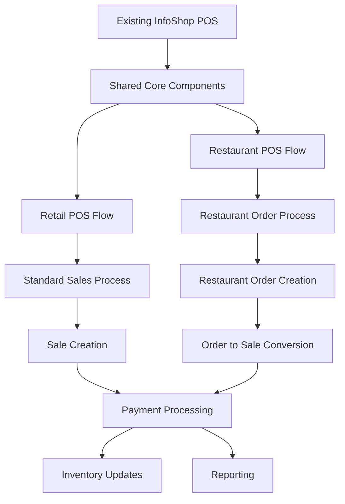

# Restaurant POS Integration Plan with Existing InfoShop System

## Overview
This document outlines how the restaurant POS system integrates with the existing InfoShop POS foundation, ensuring seamless operation while adding restaurant-specific functionality.

## 1. Integration Architecture

### 1.1 System Integration Flow


### 1.2 Integration Strategy
- **Shared Foundation**: Leverage existing product, customer, inventory, and payment systems
- **Extended Models**: Add restaurant-specific models while maintaining compatibility
- **Unified Controllers**: Extend existing controllers with restaurant-specific methods
- **Common Services**: Share services for payments, receipts, and reporting
- **Conditional Logic**: Use order_type field to differentiate workflows

## 2. Database Integration Points

### 2.1 Existing Table Extensions

#### Sales Table Integration
```sql
-- Existing sales table with restaurant extensions
ALTER TABLE sales ADD COLUMN restaurant_order_id BIGINT UNSIGNED NULL;
ALTER TABLE sales ADD COLUMN order_type ENUM('retail', 'restaurant') DEFAULT 'retail';
ALTER TABLE sales ADD COLUMN tip_amount DECIMAL(10,2) DEFAULT 0;
ALTER TABLE sales ADD COLUMN service_charge_amount DECIMAL(10,2) DEFAULT 0;
```

**Integration Logic:**
- Retail sales: `order_type = 'retail'`, `restaurant_order_id = NULL`
- Restaurant sales: `order_type = 'restaurant'`, `restaurant_order_id` references restaurant_orders.id
- Both share same payment processing, inventory updates, and reporting

#### Products Table Integration
```sql
-- Existing products table with restaurant extensions
ALTER TABLE products ADD COLUMN product_category ENUM('food', 'beverage', 'merchandise', 'service') DEFAULT 'food';
ALTER TABLE products ADD COLUMN preparation_time INT DEFAULT 0;
ALTER TABLE products ADD COLUMN is_kitchen_item BOOLEAN DEFAULT TRUE;
ALTER TABLE products ADD COLUMN is_available BOOLEAN DEFAULT TRUE;
```

**Integration Logic:**
- Retail products: `product_category = 'merchandise'`, `is_kitchen_item = FALSE`
- Restaurant products: `product_category IN ('food', 'beverage')`, `is_kitchen_item = TRUE`
- Shared inventory management for all product types

#### Users Table Integration
```sql
-- Existing users table with restaurant extensions
ALTER TABLE users ADD COLUMN employee_role ENUM('manager', 'waiter', 'kitchen', 'host', 'cashier', 'bartender') NULL;
ALTER TABLE users ADD COLUMN can_take_orders BOOLEAN DEFAULT FALSE;
ALTER TABLE users ADD COLUMN can_process_payments BOOLEAN DEFAULT FALSE;
ALTER TABLE users ADD COLUMN can_manage_tables BOOLEAN DEFAULT FALSE;
```

**Integration Logic:**
- Retail users: `employee_role = 'cashier'` or `NULL`
- Restaurant users: Various roles with specific permissions
- Shared authentication and authorization system

### 2.2 Data Flow Integration

#### Order to Sale Conversion Process
```php
// RestaurantOrderObserver.php
public function completed(RestaurantOrder $order)
{
    // Convert restaurant order to sale when payment is processed
    $sale = Sale::create([
        'restaurant_order_id' => $order->id,
        'order_type' => 'restaurant',
        'store_id' => $order->store_id,
        'contact_id' => $order->contact_id,
        'sale_date' => $order->order_date,
        'total_amount' => $order->total_amount,
        'tip_amount' => $order->tip_amount,
        'service_charge_amount' => $order->service_charge,
        'payment_status' => 'completed',
        'status' => 'completed',
        'created_by' => $order->created_by,
    ]);

    // Convert restaurant order items to sale items
    foreach ($order->items as $orderItem) {
        SaleItem::create([
            'sale_id' => $sale->id,
            'restaurant_order_item_id' => $orderItem->id,
            'product_id' => $orderItem->product_id,
            'quantity' => $orderItem->quantity,
            'unit_price' => $orderItem->unit_price,
            'unit_cost' => $orderItem->unit_cost,
            'discount' => $orderItem->discount,
            'special_instructions' => $orderItem->special_instructions,
        ]);
    }

    // Process payments using existing payment system
    $this->processRestaurantPayments($order, $sale);
}
```

## 3. Controller Integration

### 3.1 Extended POSController
```php
// POSController.php - Extended with restaurant methods
class POSController extends Controller
{
    // Existing retail methods...
    
    // Restaurant-specific methods
    public function restaurantIndex()
    {
        // Load restaurant-specific data
        $tables = RestaurantTable::with(['section', 'currentOrder'])->get();
        $sections = TableSection::all();
        $reservations = TableReservation::whereDate('reservation_date', today())->get();
        
        // Load shared data
        $products = $this->getRestaurantProducts();
        $contacts = Contact::customers()->get();
        $currentStore = Store::find(session('store_id'));
        
        return Inertia::render('RestaurantPOS/RestaurantPOS', [
            // Shared data
            'products' => $products,
            'customers' => $contacts,
            'currentStore' => $currentStore,
            'default_charges' => $this->getDefaultCharges(),
            
            // Restaurant-specific data
            'tables' => $tables,
            'sections' => $sections,
            'reservations' => $reservations,
        ]);
    }
    
    public function getRestaurantProducts()
    {
        // Extend existing getProducts method for restaurant use
        $query = Product::query()
            ->select([
                'products.id',
                'products.name',
                'products.image_url',
                'products.description',
                'products.product_category',
                'products.preparation_time',
                'products.is_kitchen_item',
                'products.is_available',
                'pb.price',
                'pb.cost',
                'pb.id AS batch_id',
            ])
            ->leftJoin('product_batches AS pb', 'products.id', '=', 'pb.product_id')
            ->where('products.is_active', true)
            ->where('products.is_available', true)
            ->where('pb.is_active', true);
            
        // Filter by restaurant categories
        $query->whereIn('products.product_category', ['food', 'beverage']);
        
        return $query->get();
    }
    
    public function createRestaurantOrder(Request $request)
    {
        DB::beginTransaction();
        try {
            // Create restaurant order
            $order = RestaurantOrder::create([
                'table_id' => $request->table_id,
                'order_type' => $request->order_type,
                'customer_count' => $request->customer_count,
                'waiter_id' => Auth::id(),
                'order_date' => now()->toDateString(),
                'order_time' => now()->toTimeString(),
                'store_id' => session('store_id'),
                'created_by' => Auth::id(),
            ]);
            
            // Add items to order
            foreach ($request->items as $item) {
                $orderItem = RestaurantOrderItem::create([
                    'order_id' => $order->id,
                    'product_id' => $item['product_id'],
                    'quantity' => $item['quantity'],
                    'unit_price' => $item['unit_price'],
                    'special_instructions' => $item['special_instructions'] ?? null,
                ]);
                
                // Add modifiers
                if (!empty($item['modifiers'])) {
                    foreach ($item['modifiers'] as $modifier) {
                        RestaurantOrderItemModifier::create([
                            'order_item_id' => $orderItem->id,
                            'modifier_id' => $modifier['modifier_id'],
                            'quantity' => $modifier['quantity'],
                            'price_adjustment' => $modifier['price_adjustment'],
                        ]);
                    }
                }
                
                // Add to kitchen queue
                $orderItem->addToKitchenQueue($item['station_id']);
            }
            
            // Update table status
            $table = RestaurantTable::find($request->table_id);
            $table->markAsOccupied($order->id);
            
            DB::commit();
            
            return response()->json([
                'message' => 'Order created successfully!',
                'order_id' => $order->id,
            ]);
        } catch (\Exception $e) {
            DB::rollBack();
            return response()->json(['error' => $e->getMessage()], 500);
        }
    }
    
    public function processRestaurantCheckout(Request $request)
    {
        DB::beginTransaction();
        try {
            $order = RestaurantOrder::findOrFail($request->order_id);
            
            // Calculate totals
            $order->calculateTotals();
            
            // Process payments using existing payment system
            $paymentResult = $this->processPayments($request, $order->total_amount);
            
            if ($paymentResult['success']) {
                // Convert to sale
                $sale = $this->convertOrderToSale($order, $request);
                
                // Update inventory using existing system
                $this->updateInventory($order->items);
                
                // Mark order as completed
                $order->markAsCompleted();
                
                DB::commit();
                
                return response()->json([
                    'message' => 'Payment processed successfully!',
                    'sale_id' => $sale->id,
                    'receipt' => $this->generateReceipt($sale),
                ]);
            }
        } catch (\Exception $e) {
            DB::rollBack();
            return response()->json(['error' => $e->getMessage()], 500);
        }
    }
}
```

### 3.2 Shared Service Integration

#### Payment Service Integration
```php
// PaymentService.php - Extended for restaurant use
class PaymentService
{
    // Existing payment methods...
    
    public function processRestaurantPayment($order, $paymentData)
    {
        // Use existing payment processing logic
        $result = $this->processPayment([
            'amount' => $order->total_amount + ($paymentData['tip_amount'] ?? 0),
            'payment_method' => $paymentData['payment_method'],
            'customer_id' => $order->contact_id,
            'store_id' => $order->store_id,
        ]);
        
        if ($result['success']) {
            // Handle restaurant-specific payment features
            if (isset($paymentData['tip_amount'])) {
                $this->recordTip($order, $paymentData['tip_amount'], $paymentData['tip_method']);
            }
            
            if (isset($paymentData['splits'])) {
                $this->processSplitPayments($order, $paymentData['splits']);
            }
        }
        
        return $result;
    }
    
    private function recordTip($order, $tipAmount, $tipMethod)
    {
        // Record tip distribution
        TipDistribution::create([
            'order_id' => $order->id,
            'waiter_id' => $order->waiter_id,
            'amount' => $tipAmount,
            'method' => $tipMethod,
            'date' => now(),
        ]);
    }
}
```

#### Inventory Service Integration
```php
// InventoryService.php - Extended for restaurant use
class InventoryService
{
    // Existing inventory methods...
    
    public function updateRestaurantInventory($orderItems)
    {
        foreach ($orderItems as $item) {
            // Use existing inventory update logic
            $this->updateStock([
                'product_id' => $item->product_id,
                'batch_id' => $item->batch_id,
                'quantity' => -$item->quantity,
                'store_id' => $item->order->store_id,
                'reason' => 'restaurant_sale',
                'reference_id' => $item->order_id,
            ]);
        }
    }
    
    public function checkRestaurantItemAvailability($productId, $quantity)
    {
        // Use existing stock checking logic
        return $this->checkAvailability([
            'product_id' => $productId,
            'quantity' => $quantity,
            'store_id' => session('store_id'),
        ]);
    }
}
```

## 4. Frontend Integration

### 4.1 Route Integration
```php
// routes/web.php - Extended with restaurant routes
Route::middleware(['auth', 'store.selected'])->group(function () {
    // Existing POS routes
    Route::get('/pos', [POSController::class, 'index'])->name('pos.index');
    Route::post('/pos/checkout', [POSController::class, 'checkout'])->name('pos.checkout');
    
    // Restaurant POS routes
    Route::get('/restaurant-pos', [POSController::class, 'restaurantIndex'])->name('restaurant.pos.index');
    Route::post('/restaurant-pos/order', [POSController::class, 'createRestaurantOrder'])->name('restaurant.pos.order.create');
    Route::post('/restaurant-pos/checkout', [POSController::class, 'processRestaurantCheckout'])->name('restaurant.pos.checkout');
    Route::get('/restaurant-pos/tables', [TableController::class, 'index'])->name('restaurant.tables.index');
    Route::post('/restaurant-pos/tables/{table}/assign', [TableController::class, 'assign'])->name('restaurant.tables.assign');
    Route::get('/restaurant-pos/reservations', [ReservationController::class, 'index'])->name('restaurant.reservations.index');
});
```

### 4.2 Component Integration Strategy
```jsx
// Shared POS Components
// Existing components can be reused with restaurant-specific props

// CartSummary Component - Extended for restaurant use
const CartSummary = ({ orderType, orderData, ...props }) => {
  if (orderType === 'restaurant') {
    return <RestaurantCartSummary order={orderData} {...props} />;
  }
  
  // Original retail cart summary
  return <RetailCartSummary {...props} />;
};

// ProductItem Component - Extended for restaurant use
const ProductItem = ({ product, context, ...props }) => {
  if (context === 'restaurant') {
    return <RestaurantProductItem product={product} {...props} />;
  }
  
  // Original retail product item
  return <RetailProductItem product={product} {...props} />;
};

// Payment Component - Extended for restaurant use
const PaymentProcessor = ({ orderType, orderData, ...props }) => {
  if (orderType === 'restaurant') {
    return <RestaurantPayment order={orderData} {...props} />;
  }
  
  // Original retail payment processor
  return <RetailPayment {...props} />;
};
```

### 4.3 Context Integration
```jsx
// SalesContext.js - Extended for restaurant use
const SalesContext = createContext();

export const SalesProvider = ({ children, cartType, orderType = 'retail' }) => {
  const [cart, setCart] = useState([]);
  const [order, setOrder] = useState(null);
  
  // Shared methods
  const addToCart = (item) => {
    if (orderType === 'restaurant') {
      // Restaurant-specific cart logic
      setRestaurantCart([...cart, item]);
    } else {
      // Original retail cart logic
      setRetailCart([...cart, item]);
    }
  };
  
  const removeFromCart = (itemId) => {
    setCart(cart.filter(item => item.id !== itemId));
  };
  
  const calculateTotal = () => {
    if (orderType === 'restaurant') {
      return calculateRestaurantTotal(cart, order);
    } else {
      return calculateRetailTotal(cart);
    }
  };
  
  return (
    <SalesContext.Provider value={{
      cart,
      order,
      orderType,
      addToCart,
      removeFromCart,
      calculateTotal,
    }}>
      {children}
    </SalesContext.Provider>
  );
};
```

## 5. API Integration Points

### 5.1 Shared API Endpoints
```php
// API routes that work for both retail and restaurant
Route::prefix('api')->middleware(['auth:sanctum'])->group(function () {
    // Product endpoints - shared
    Route::get('/products', [ProductController::class, 'index']);
    Route::get('/products/{id}', [ProductController::class, 'show']);
    
    // Customer endpoints - shared
    Route::get('/customers', [ContactController::class, 'index']);
    Route::post('/customers', [ContactController::class, 'store']);
    
    // Payment endpoints - shared
    Route::post('/payments/process', [PaymentController::class, 'process']);
    
    // Inventory endpoints - shared
    Route::get('/inventory/check', [InventoryController::class, 'checkAvailability']);
});
```

### 5.2 Restaurant-Specific API Endpoints
```php
// Restaurant-specific API endpoints
Route::prefix('api/restaurant')->middleware(['auth:sanctum'])->group(function () {
    Route::get('/tables', [TableController::class, 'apiIndex']);
    Route::post('/tables/{table}/assign', [TableController::class, 'apiAssign']);
    Route::get('/orders', [OrderController::class, 'apiIndex']);
    Route::post('/orders', [OrderController::class, 'apiStore']);
    Route::put('/orders/{id}', [OrderController::class, 'apiUpdate']);
    Route::get('/kitchen/queue', [KitchenController::class, 'apiQueue']);
    Route::put('/kitchen/queue/{id}', [KitchenController::class, 'apiUpdateQueue']);
});
```

## 6. Reporting Integration

### 6.1 Extended Reporting Controller
```php
// ReportController.php - Extended for restaurant use
class ReportController extends Controller
{
    // Existing retail reports...
    
    public function restaurantSalesReport(Request $request)
    {
        // Use existing sales reporting logic with restaurant filters
        $query = Sale::where('order_type', 'restaurant')
            ->with(['restaurantOrder.table', 'restaurantOrder.waiter']);
            
        // Apply date filters (existing logic)
        $query = $this->applyDateFilters($query, $request);
        
        // Apply store filters (existing logic)
        $query = $this->applyStoreFilters($query, $request);
        
        return $query->get();
    }
    
    public function tablePerformanceReport(Request $request)
    {
        return RestaurantTable::with(['orders' => function($query) use ($request) {
            $query->whereDate('order_date', '>=', $request->start_date)
                  ->whereDate('order_date', '<=', $request->end_date);
        }])->get();
    }
    
    public function kitchenEfficiencyReport(Request $request)
    {
        return KitchenOrderQueue::with(['orderItem.product', 'station'])
            ->whereDate('created_at', '>=', $request->start_date)
            ->whereDate('created_at', '<=', $request->end_date)
            ->get();
    }
}
```

## 7. Configuration and Settings Integration

### 7.1 Extended Settings
```php
// SettingSeeder.php - Extended with restaurant settings
public function run()
{
    // Existing retail settings...
    
    // Restaurant-specific settings
    Setting::create([
        'meta_key' => 'restaurant_settings',
        'meta_value' => json_encode([
            'enable_table_management' => true,
            'enable_reservations' => true,
            'enable_kitchen_display' => true,
            'default_service_charge' => 10,
            'auto_print_kitchen_tickets' => true,
            'kitchen_display_refresh_interval' => 30,
            'table_reservation_advance_days' => 30,
            'enable_split_billing' => true,
            'tip_suggestions' => [15, 18, 20, 25],
        ]),
    ]);
}
```

## 8. Migration and Deployment Strategy

### 8.1 Database Migration Strategy
```php
// Migration approach for existing systems
class AddRestaurantFeaturesToExistingSystem extends Migration
{
    public function up()
    {
        // Add restaurant-specific tables
        $this->createRestaurantTables();
        
        // Add columns to existing tables
        Schema::table('sales', function (Blueprint $table) {
            $table->unsignedBigInteger('restaurant_order_id')->nullable();
            $table->enum('order_type', ['retail', 'restaurant'])->default('retail');
            $table->decimal('tip_amount', 10, 2)->default(0);
            $table->decimal('service_charge_amount', 10, 2)->default(0);
        });
        
        // Update existing products for restaurant compatibility
        DB::statement("UPDATE products SET product_category = 'merchandise' WHERE product_category IS NULL");
    }
    
    public function down()
    {
        // Remove restaurant-specific features
        Schema::table('sales', function (Blueprint $table) {
            $table->dropColumn(['restaurant_order_id', 'order_type', 'tip_amount', 'service_charge_amount']);
        });
        
        $this->dropRestaurantTables();
    }
}
```

### 8.2 Feature Flag Integration
```php
// Feature flag system for gradual rollout
class RestaurantFeatureManager
{
    public static function isEnabled($feature)
    {
        $settings = Setting::where('meta_key', 'restaurant_settings')->first();
        $restaurantSettings = json_decode($settings->meta_value, true);
        
        return $restaurantSettings[$feature] ?? false;
    }
    
    public static function enableRestaurantMode()
    {
        return Setting::where('meta_key', 'system_mode')
                    ->update(['meta_value' => json_encode(['mode' => 'restaurant'])]);
    }
}
```

## 9. Testing Integration

### 9.1 Shared Test Cases
```php
// TestCase.php - Extended for restaurant testing
abstract class RestaurantTestCase extends TestCase
{
    protected function setUp(): void
    {
        parent::setUp();
        
        // Set up restaurant mode
        $this->enableRestaurantMode();
        
        // Create restaurant-specific test data
        $this->createRestaurantTestData();
    }
    
    protected function createRestaurantTestData()
    {
        $this->tables = RestaurantTable::factory()->count(10)->create();
        $this->sections = TableSection::factory()->count(3)->create();
        $this->kitchenStations = KitchenStation::factory()->count(5)->create();
    }
}
```

## 10. Performance Considerations

### 10.1 Database Optimization
- Shared indexes for both retail and restaurant queries
- Partition large tables by order_type
- Optimize queries for mixed workloads

### 10.2 Caching Strategy
- Cache product data for both POS types
- Cache table status for restaurant operations
- Shared cache infrastructure

### 10.3 Real-time Updates
- WebSocket channels for both retail and restaurant updates
- Efficient event broadcasting
- Minimal database polling

This integration plan ensures that the restaurant POS system seamlessly extends the existing InfoShop POS foundation while maintaining compatibility and leveraging shared components.