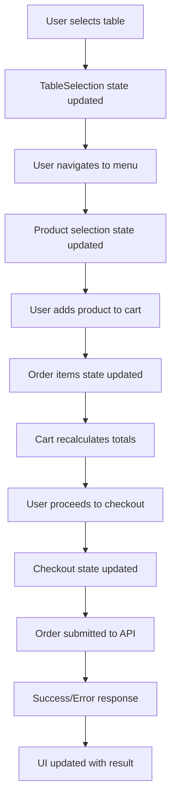

# Restaurant POS Order Creation Design Blueprint

## Executive Summary

This document provides a comprehensive design blueprint for transforming the current form-based restaurant order creation page at `http://127.0.0.1:8000/restaurant/orders/create` into a professional, touch-optimized POS interface that maintains all existing functionality while providing an enhanced user experience consistent with modern restaurant POS systems.

## 1. Overall Layout Structure

### 1.1 Primary Layout Architecture

```
┌─────────────────────────────────────────────────────────────────────────────────────────┐
│ Restaurant POS Header                                                              │
├─────────────────────────────────────────────────────────────────────────────────────────┤
│ Table Selection Area │ Menu & Product Selection Area │ Order Cart & Actions Area │
│ ┌─────────────────┐   │ ┌─────────────────────────────┐ │ ┌─────────────────────────────┐ │
│ │ Quick Table     │   │ │ Category Navigation          │ │ │ Current Order Summary       │ │
│ │ Selection       │   │ │ [Food] [Beverages] [Desserts]│ │ │ Table: T5                  │ │
│ │                 │   │ └─────────────────────────────┘ │ │ Items: 3                    │ │
│ │ [T1] [T2] [T3] │   │ │ Product Grid                 │ │ │ Total: $45.50               │ │
│ │ [T4] [T5] [T6] │   │ │ ┌─────────┐ ┌─────────┐   │ │ │                             │ │
│ │ [T7] [T8] [T9] │   │ │ │ Burger  │ │ Pizza   │   │ │ │ Order Items                 │ │
│ └─────────────────┘   │ │ │ $12.99  │ │ $15.99  │   │ │ │ • Burger x1 ........ $12.99 │ │
│                       │ │ └─────────┘ └─────────┘   │ │ │ • Fries x1 ........ $4.99  │ │
│                       │ │ ┌─────────┐ ┌─────────┐   │ │ │ • Coke x1 ........ $2.99   │ │
│                       │ │ │ Fries   │ │ Salad   │   │ │ └─────────────────────────────┘ │
│                       │ │ │ $4.99   │ │ $8.99   │   │ │                             │ │
│                       │ │ └─────────┘ └─────────┘   │ │ [Add Item] [Modify] [Checkout] │ │
│                       │ └─────────────────────────────┘ │ └─────────────────────────────┘ │
└─────────────────────────────────────────────────────────────────────────────────────────┘
```

### 1.2 Responsive Design Patterns

#### Desktop Layout (≥1200px)
- **Three-column layout**: Table selection (left), Menu (center), Cart (right)
- **Fixed sidebar widths**: Table selection (280px), Cart (380px)
- **Flexible center column**: Menu area with responsive grid
- **Persistent header**: Order information and quick actions

#### Tablet Layout (768px-1199px)
- **Two-column layout**: Collapsible table selection, Menu (main), Cart (overlay)
- **Swipe gestures**: Left-right navigation between sections
- **Touch-optimized**: Larger touch targets (44px minimum)
- **Adaptive grid**: 3-4 product columns based on orientation

#### Mobile Layout (<768px)
- **Single-column layout**: Full-screen sections with tab navigation
- **Bottom navigation**: Quick access to main sections
- **Vertical stacking**: Table → Menu → Cart → Checkout flow
- **Thumb-friendly design**: 48px minimum touch targets

## 2. Key Components Design

### 2.1 Table Selection Interface

```jsx
// TableSelectionArea.jsx
const TableSelectionArea = ({ tables, selectedTable, onTableSelect }) => {
  return (
    <Box className="table-selection-area">
      <Box className="table-selection-header">
        <Typography variant="h6">Select Table</Typography>
        <QuickTableFilter onFilter={handleTableFilter} />
      </Box>
      
      <Box className="table-grid">
        {tables.map(table => (
          <TableCard
            key={table.id}
            table={table}
            isSelected={selectedTable?.id === table.id}
            onClick={() => onTableSelect(table)}
            onLongPress={() => handleTableDetails(table)}
          />
        ))}
      </Box>
      
      <Box className="table-legend">
        <StatusChip label="Available" status="available" />
        <StatusChip label="Occupied" status="occupied" />
        <StatusChip label="Reserved" status="reserved" />
      </Box>
    </Box>
  );
};

// TableCard Component
const TableCard = ({ table, isSelected, onClick, onLongPress }) => {
  const getStatusColor = (status) => {
    const colors = {
      available: '#4caf50',
      occupied: '#ff9800',
      reserved: '#2196f3',
      cleaning: '#9e9e9e'
    };
    return colors[status] || '#f44336';
  };

  return (
    <TouchCard
      className={`table-card ${isSelected ? 'selected' : ''}`}
      style={{
        backgroundColor: getStatusColor(table.status),
        transform: isSelected ? 'scale(1.05)' : 'scale(1)',
      }}
      onClick={onClick}
      onLongPress={onLongPress}
      rippleColor="rgba(255,255,255,0.3)"
    >
      <Box className="table-number">
        <Typography variant="h4">{table.table_number}</Typography>
      </Box>
      
      {table.current_order && (
        <Box className="order-info">
          <Typography variant="caption">
            Order #{table.current_order.order_number}
          </Typography>
          <Typography variant="caption">
            {table.current_order.items_count} items
          </Typography>
        </Box>
      )}
      
      <Box className="table-capacity">
        <Typography variant="caption">
          {table.capacity} guests
        </Typography>
      </Box>
    </TouchCard>
  );
};
```

### 2.2 Product Selection Interface

```jsx
// ProductSelectionArea.jsx
const ProductSelectionArea = ({ categories, products, onProductSelect }) => {
  const [selectedCategory, setSelectedCategory] = useState(null);
  const [searchTerm, setSearchTerm] = useState('');

  return (
    <Box className="product-selection-area">
      <Box className="product-header">
        <CategoryNavigation
          categories={categories}
          selected={selectedCategory}
          onSelect={setSelectedCategory}
        />
        <ProductSearch
          value={searchTerm}
          onChange={setSearchTerm}
          onClear={() => setSearchTerm('')}
        />
      </Box>
      
      <Box className="product-grid">
        {filteredProducts.map(product => (
          <ProductCard
            key={product.id}
            product={product}
            onClick={() => onProductSelect(product)}
            onLongPress={() => showProductDetails(product)}
          />
        ))}
      </Box>
    </Box>
  );
};

// ProductCard Component
const ProductCard = ({ product, onClick, onLongPress }) => {
  return (
    <TouchCard
      className="product-card"
      onClick={onClick}
      onLongPress={onLongPress}
      disabled={!product.is_available}
    >
      {product.image_url && (
        <Box className="product-image">
          
        </Box>
      )}
      
      <Box className="product-info">
        <Typography variant="h6" className="product-name">
          {product.name}
        </Typography>
        
        <Typography variant="body2" className="product-description">
          {product.description}
        </Typography>
        
        <Box className="product-price">
          <Typography variant="h5" color="primary">
            ${product.price}
          </Typography>
          {product.original_price && product.original_price > product.price && (
            <Typography variant="caption" className="original-price">
              ${product.original_price}
            </Typography>
          )}
        </Box>
        
        {!product.is_available && (
          <Chip label="Unavailable" color="error" size="small" />
        )}
        
        {product.is_featured && (
          <Chip label="Featured" color="warning" size="small" />
        )}
      </Box>
    </TouchCard>
  );
};
```

### 2.3 Order Cart Interface

```jsx
// OrderCartArea.jsx
const OrderCartArea = ({ order, onItemUpdate, onCheckout }) => {
  return (
    <Box className="order-cart-area">
      <Box className="cart-header">
        <Typography variant="h6">Current Order</Typography>
        {order.table && (
          <Box className="table-info">
            <TableIcon />
            <Typography variant="body1">
              Table {order.table.table_number}
            </Typography>
          </Box>
        )}
      </Box>
      
      <Box className="cart-items">
        {order.items.length === 0 ? (
          <EmptyCartMessage />
        ) : (
          order.items.map(item => (
            <OrderItemCard
              key={item.id}
              item={item}
              onQuantityChange={(qty) => onItemUpdate(item.id, { quantity: qty })}
              onModifierChange={(modifiers) => onItemUpdate(item.id, { modifiers })}
              onRemove={() => onItemUpdate(item.id, { removed: true })}
            />
          ))
        )}
      </Box>
      
      <OrderSummary order={order} />
      
      <Box className="cart-actions">
        <Button
          variant="outlined"
          fullWidth
          onClick={() => handleClearCart()}
          disabled={order.items.length === 0}
        >
          Clear Cart
        </Button>
        
        <Button
          variant="contained"
          fullWidth
          onClick={onCheckout}
          disabled={order.items.length === 0}
          startIcon={<CheckoutIcon />}
        >
          Checkout Order
        </Button>
      </Box>
    </Box>
  );
};

// OrderItemCard Component
const OrderItemCard = ({ item, onQuantityChange, onModifierChange, onRemove }) => {
  return (
    <Card className="order-item-card">
      <CardContent>
        <Grid container spacing={2}>
          <Grid item xs={8}>
            <Typography variant="body1" className="item-name">
              {item.quantity}x {item.product.name}
            </Typography>
            
            {item.modifiers?.length > 0 && (
              <Typography variant="caption" className="item-modifiers">
                {item.modifiers.map(m => m.name).join(', ')}
              </Typography>
            )}
            
            {item.special_instructions && (
              <Typography variant="caption" color="primary" className="item-notes">
                Note: {item.special_instructions}
              </Typography>
            )}
          </Grid>
          
          <Grid item xs={2}>
            <Typography variant="body1" className="item-price">
              ${item.calculateSubtotal()}
            </Typography>
          </Grid>
          
          <Grid item xs={2}>
            <Box className="item-actions">
              <IconButton size="small" onClick={() => onModifierChange(item.modifiers)}>
                <EditIcon />
              </IconButton>
              <IconButton size="small" onClick={onRemove}>
                <DeleteIcon />
              </IconButton>
            </Box>
          </Grid>
        </Grid>
      </CardContent>
    </Card>
  );
};
```

## 3. Interactive Elements and Micro-interactions

### 3.1 Touch-Optimized Controls

```jsx
// TouchCard Component - Base for all touch interactions
const TouchCard = ({ children, onClick, onLongPress, disabled, rippleColor, ...props }) => {
  const [ripples, setRipples] = useState([]);
  const [isPressed, setIsPressed] = useState(false);
  
  const handleTouchStart = (e) => {
    if (disabled) return;
    
    setIsPressed(true);
    const ripple = createRipple(e);
    setRipples(prev => [...prev, ripple]);
    
    const longPressTimer = setTimeout(() => {
      onLongPress?.();
    }, 500);
    
    e.currentTarget.dataset.longPressTimer = longPressTimer;
  };
  
  const handleTouchEnd = (e) => {
    if (disabled) return;
    
    setIsPressed(false);
    clearTimeout(e.currentTarget.dataset.longPressTimer);
    
    if (onLongPress) return; // Don't trigger click if long press handled
    
    setTimeout(() => {
      onClick?.();
    }, 100);
  };
  
  return (
    <Box
      className={`touch-card ${isPressed ? 'pressed' : ''} ${disabled ? 'disabled' : ''}`}
      onTouchStart={handleTouchStart}
      onTouchEnd={handleTouchEnd}
      onMouseDown={handleTouchStart}
      onMouseUp={handleTouchEnd}
      {...props}
    >
      {children}
      {ripples.map(ripple => (
        <span
          key={ripple.id}
          className="ripple"
          style={{
            left: ripple.x,
            top: ripple.y,
            backgroundColor: rippleColor,
          }}
        />
      ))}
    </Box>
  );
};
```

### 3.2 Visual Feedback Patterns

```css
/* Touch feedback animations */
.touch-card {
  position: relative;
  overflow: hidden;
  transition: all 0.2s cubic-bezier(0.4, 0, 0.2, 1);
  transform: scale(1);
}

.touch-card.pressed {
  transform: scale(0.95);
  opacity: 0.8;
}

.touch-card.disabled {
  opacity: 0.5;
  pointer-events: none;
}

/* Ripple effect */
.ripple {
  position: absolute;
  border-radius: 50%;
  transform: scale(0);
  animation: ripple-animation 0.6s ease-out;
  pointer-events: none;
}

@keyframes ripple-animation {
  to {
    transform: scale(4);
    opacity: 0;
  }
}

/* Product card hover effects */
.product-card:hover {
  transform: translateY(-4px);
  box-shadow: 0 8px 25px rgba(0,0,0,0.15);
}

.product-card:active {
  transform: translateY(-2px);
  box-shadow: 0 4px 15px rgba(0,0,0,0.1);
}
```

### 3.3 Gesture Support

```jsx
// GestureHandler Component
const GestureHandler = ({ children, onSwipeLeft, onSwipeRight, onPinchZoom }) => {
  const [touchStart, setTouchStart] = useState(null);
  const [touchEnd, setTouchEnd] = useState(null);
  
  const handleTouchStart = (e) => {
    setTouchEnd(null);
    setTouchStart({
      x: e.targetTouches[0].clientX,
      y: e.targetTouches[0].clientY,
      time: Date.now()
    });
  };
  
  const handleTouchMove = (e) => {
    setTouchEnd({
      x: e.targetTouches[0].clientX,
      y: e.targetTouches[0].clientY
    });
  };
  
  const handleTouchEnd = () => {
    if (!touchStart || !touchEnd) return;
    
    const deltaX = touchStart.x - touchEnd.x;
    const deltaY = touchStart.y - touchEnd.y;
    const deltaTime = Date.now() - touchStart.time;
    
    // Swipe detection
    if (Math.abs(deltaX) > 50 && deltaTime < 300) {
      if (deltaX > 0) {
        onSwipeLeft?.();
      } else {
        onSwipeRight?.();
      }
    }
    
    setTouchStart(null);
    setTouchEnd(null);
  };
  
  return (
    <Box
      onTouchStart={handleTouchStart}
      onTouchMove={handleTouchMove}
      onTouchEnd={handleTouchEnd}
    >
      {children}
    </Box>
  );
};
```

## 4. Visual Design and Styling Patterns

### 4.1 Color Scheme and Typography

```css
/* Primary color palette */
:root {
  /* Navy theme colors */
  --navy-primary: #1e3a5f;
  --navy-primary-light: #3182ce;
  --navy-primary-dark: #172a45;
  
  --navy-secondary: #2c5282;
  --navy-secondary-light: #4299e1;
  
  --navy-background: #f8fafc;
  --navy-surface: #ffffff;
  --navy-surface-alt: #f1f5f9;
  
  --navy-text: #1a202c;
  --navy-text-secondary: #4a5568;
  --navy-text-muted: #718096;
  
  /* Status colors */
  --success: #48bb78;
  --warning: #ed8936;
  --error: #f56565;
  --info: #4299e1;
  
  /* Touch feedback colors */
  --ripple-color: rgba(66, 153, 225, 0.3);
  --pressed-overlay: rgba(0, 0, 0, 0.1);
}

/* Typography scale */
.text-h1 { font-size: 2.5rem; font-weight: 700; line-height: 1.2; }
.text-h2 { font-size: 2rem; font-weight: 600; line-height: 1.3; }
.text-h3 { font-size: 1.75rem; font-weight: 600; line-height: 1.3; }
.text-h4 { font-size: 1.5rem; font-weight: 600; line-height: 1.4; }
.text-h5 { font-size: 1.25rem; font-weight: 500; line-height: 1.4; }
.text-h6 { font-size: 1.125rem; font-weight: 500; line-height: 1.5; }

.text-body1 { font-size: 1rem; font-weight: 400; line-height: 1.5; }
.text-body2 { font-size: 0.875rem; font-weight: 400; line-height: 1.5; }
.text-caption { font-size: 0.75rem; font-weight: 400; line-height: 1.4; }
```

### 4.2 Component Styling Patterns

```css
/* Card component styles */
.pos-card {
  background: var(--navy-surface);
  border-radius: 12px;
  box-shadow: 0 2px 8px rgba(0, 0, 0, 0.1);
  border: 1px solid rgba(0, 0, 0, 0.05);
  transition: all 0.3s cubic-bezier(0.4, 0, 0.2, 1);
  overflow: hidden;
}

.pos-card:hover {
  box-shadow: 0 8px 25px rgba(0, 0, 0, 0.15);
  transform: translateY(-2px);
}

.pos-card:active {
  transform: translateY(0px);
  box-shadow: 0 4px 15px rgba(0, 0, 0, 0.1);
}

/* Button component styles */
.pos-button {
  min-height: 48px;
  min-width: 48px;
  border-radius: 8px;
  font-weight: 600;
  text-transform: none;
  transition: all 0.2s cubic-bezier(0.4, 0, 0.2, 1);
  position: relative;
  overflow: hidden;
}

.pos-button-primary {
  background: linear-gradient(135deg, var(--navy-primary) 0%, var(--navy-primary-light) 100%);
  color: white;
  border: none;
}

.pos-button-primary:hover {
  background: linear-gradient(135deg, var(--navy-primary-dark) 0%, var(--navy-primary) 100%);
  transform: translateY(-1px);
  box-shadow: 0 4px 12px rgba(30, 58, 95, 0.3);
}

.pos-button-primary:active {
  transform: translateY(0px);
  box-shadow: 0 2px 6px rgba(30, 58, 95, 0.2);
}

/* Input field styles */
.pos-input {
  background: var(--navy-surface);
  border: 2px solid transparent;
  border-radius: 8px;
  padding: 12px 16px;
  font-size: 1rem;
  transition: all 0.2s ease;
}

.pos-input:focus {
  border-color: var(--navy-primary-light);
  box-shadow: 0 0 0 3px rgba(66, 153, 225, 0.1);
}
```

## 5. Integration Points with Existing POS Components

### 5.1 Leveraging Existing RestaurantPOS Components

```jsx
// Integration with existing RestaurantPOS context
const OrderCreationPage = () => {
  const {
    tables,
    orders,
    selectedTable,
    currentOrder,
    selectTable,
    setCurrentOrder,
    getAvailableTables
  } = useRestaurantPOS();

  // Reuse existing table management
  const handleTableSelect = (table) => {
    selectTable(table);
    
    // Create new order for selected table
    if (table.status === 'available') {
      const newOrder = {
        table_id: table.id,
        table_name: table.name,
        order_type: 'dine-in',
        status: 'pending',
        items: [],
        created_at: new Date().toISOString()
      };
      
      setCurrentOrder(newOrder);
    }
  };

  // Reuse existing product search and filtering
  const handleProductSearch = (searchTerm) => {
    // Integrate with existing POS product search
    return searchProducts(searchTerm);
  };

  return (
    <RestaurantPOSLayout>
      <TableSelectionArea
        tables={getAvailableTables()}
        selectedTable={selectedTable}
        onTableSelect={handleTableSelect}
      />
      
      <ProductSelectionArea
        onProductSelect={handleProductAdd}
        onSearch={handleProductSearch}
      />
      
      <OrderCartArea
        order={currentOrder}
        onCheckout={handleOrderSubmit}
      />
    </RestaurantPOSLayout>
  );
};
```

### 5.2 Shared Component Library

```jsx
// Shared components to reuse from existing POS
import {
  // From existing RestaurantPOS
  TableFloorPlan,
  RestaurantOrder,
  KitchenDisplay,
  ReservationCalendar,
  
  // From existing POS
  ProductItem,
  CartSummary,
  SearchBox,
  
  // New components for order creation
  TableSelectionArea,
  ProductSelectionArea,
  OrderCartArea,
  ModifierSelectionModal,
  CheckoutDialog
} from '@/Components/RestaurantPOS';

// Component mapping for responsive layouts
const ComponentMap = {
  desktop: {
    tableSection: TableFloorPlan,
    menuSection: ProductSelectionArea,
    cartSection: OrderCartArea
  },
  tablet: {
    tableSection: CollapsibleTableSelection,
    menuSection: ProductSelectionArea,
    cartSection: OverlayOrderCart
  },
  mobile: {
    tableSection: MobileTableSelection,
    menuSection: MobileProductSelection,
    cartSection: MobileOrderCart
  }
};
```

## 6. Component Breakdown and File Organization

### 6.1 Component Structure

```
resources/js/Components/RestaurantPOS/OrderCreation/
├── OrderCreationPage.jsx              # Main order creation page
├── Layout/
│   ├── OrderCreationLayout.jsx        # Responsive layout wrapper
│   ├── DesktopLayout.jsx             # Desktop-specific layout
│   ├── TabletLayout.jsx              # Tablet-specific layout
│   └── MobileLayout.jsx              # Mobile-specific layout
├── TableSelection/
│   ├── TableSelectionArea.jsx        # Table selection container
│   ├── TableCard.jsx                # Individual table card
│   ├── TableFilter.jsx               # Table filtering options
│   └── TableDetailsModal.jsx         # Table details modal
├── ProductSelection/
│   ├── ProductSelectionArea.jsx      # Product selection container
│   ├── CategoryNavigation.jsx        # Category navigation
│   ├── ProductCard.jsx              # Individual product card
│   ├── ProductSearch.jsx             # Product search
│   └── ProductDetailsModal.jsx       # Product details modal
├── OrderCart/
│   ├── OrderCartArea.jsx            # Order cart container
│   ├── OrderItemCard.jsx            # Individual order item
│   ├── OrderSummary.jsx             # Order totals summary
│   └── EmptyCartMessage.jsx         # Empty cart state
├── Modifiers/
│   ├── ModifierSelectionModal.jsx     # Modifier selection modal
│   ├── ModifierGroup.jsx            # Modifier group component
│   └── ModifierOption.jsx           # Individual modifier option
├── Checkout/
│   ├── CheckoutDialog.jsx            # Checkout modal
│   ├── PaymentMethodSelection.jsx     # Payment method selection
│   ├── OrderConfirmation.jsx         # Order confirmation
│   └── ReceiptPreview.jsx            # Receipt preview
├── Shared/
│   ├── TouchCard.jsx                # Touch-optimized card base
│   ├── GestureHandler.jsx           # Gesture handling utilities
│   ├── ResponsiveGrid.jsx           # Responsive grid layout
│   └── StatusChip.jsx              # Status indicator chip
└── Hooks/
    ├── useOrderCreation.js           # Order creation state management
    ├── useProductSearch.js          # Product search functionality
    ├── useTableSelection.js         # Table selection logic
    └── useResponsiveLayout.js       # Responsive layout utilities
```

### 6.2 State Management Structure

```jsx
// useOrderCreation.js - Custom hook for order creation state
const useOrderCreation = () => {
  const [orderState, setOrderState] = useState({
    selectedTable: null,
    orderType: 'dine_in',
    items: [],
    customer: null,
    specialInstructions: '',
    estimatedTime: null,
    priority: 'normal'
  });

  const [uiState, setUiState] = useState({
    activeSection: 'table', // 'table', 'menu', 'cart'
    selectedCategory: null,
    searchTerm: '',
    modifiersOpen: false,
    checkoutOpen: false
  });

  const actions = {
    // Table actions
    selectTable: (table) => {
      setOrderState(prev => ({ ...prev, selectedTable: table }));
      setUiState(prev => ({ ...prev, activeSection: 'menu' }));
    },
    
    // Product actions
    addProduct: (product, modifiers = []) => {
      setOrderState(prev => ({
        ...prev,
        items: [...prev.items, {
          id: generateId(),
          product,
          quantity: 1,
          modifiers,
          specialInstructions: ''
        }]
      }));
    },
    
    updateItem: (itemId, updates) => {
      setOrderState(prev => ({
        ...prev,
        items: prev.items.map(item =>
          item.id === itemId ? { ...item, ...updates } : item
        )
      }));
    },
    
    removeItem: (itemId) => {
      setOrderState(prev => ({
        ...prev,
        items: prev.items.filter(item => item.id !== itemId)
      }));
    },
    
    // UI actions
    setActiveSection: (section) => {
      setUiState(prev => ({ ...prev, activeSection: section }));
    },
    
    setSelectedCategory: (category) => {
      setUiState(prev => ({ ...prev, selectedCategory: category }));
    }
  };

  return {
    state: { ...orderState, ...uiState },
    actions
  };
};
```

## 7. Step-by-Step Implementation Strategy

### 7.1 Phase 1: Foundation Components (Week 1-2)

1. **Create base layout structure**
   - Implement responsive layout wrapper
   - Create touch-optimized base components
   - Set up routing and navigation

2. **Develop table selection interface**
   - Build TableCard component with touch interactions
   - Implement table filtering and search
   - Add table details modal

3. **Set up state management**
   - Create useOrderCreation hook
   - Implement order state logic
   - Add error handling and validation

### 7.2 Phase 2: Product Selection (Week 3-4)

1. **Build product selection interface**
   - Implement CategoryNavigation component
   - Create ProductCard with touch interactions
   - Add product search functionality

2. **Implement modifier selection**
   - Build ModifierSelectionModal
   - Create modifier group and option components
   - Add modifier validation logic

3. **Integrate with existing product data**
   - Connect to existing product APIs
   - Implement product filtering and sorting
   - Add product availability checking

### 7.3 Phase 3: Order Cart and Checkout (Week 5-6)

1. **Develop order cart interface**
   - Build OrderCartArea component
   - Implement OrderItemCard with editing
   - Add order summary calculations

2. **Create checkout flow**
   - Build CheckoutDialog component
   - Implement payment method selection
   - Add order confirmation and receipt

3. **Add order submission logic**
   - Integrate with existing OrderController
   - Implement form data transformation
   - Add error handling and validation

### 7.4 Phase 4: Polish and Optimization (Week 7-8)

1. **Responsive design implementation**
   - Test and optimize for all screen sizes
   - Implement touch gesture support
   - Add accessibility features

2. **Performance optimization**
   - Implement lazy loading for products
   - Add image optimization
   - Optimize re-renders

3. **Integration testing**
   - Test with existing RestaurantPOS components
   - Verify data flow and state management
   - Add comprehensive error handling

## 8. Technical Implementation Details

### 8.1 Data Flow Architecture



### 8.2 API Integration Points

```jsx
// API integration structure
const OrderCreationAPI = {
  // Table operations
  getAvailableTables: () => axios.get('/api/restaurant/tables/available'),
  getTableDetails: (tableId) => axios.get(`/api/restaurant/tables/${tableId}`),
  
  // Product operations
  getProducts: (categoryId, searchTerm) => 
    axios.get('/api/products', { params: { category: categoryId, search: searchTerm } }),
  getProductModifiers: (productId) => 
    axios.get(`/api/products/${productId}/modifiers`),
  
  // Order operations
  createOrder: (orderData) => axios.post('/restaurant/orders', orderData),
  updateOrder: (orderId, updates) => axios.put(`/restaurant/orders/${orderId}`, updates),
  
  // Validation operations
  validateOrder: (orderData) => axios.post('/api/restaurant/orders/validate', orderData),
  checkTableAvailability: (tableId, dateTime) => 
    axios.get(`/api/restaurant/tables/${tableId}/availability`, { params: { dateTime } })
};
```

### 8.3 Error Handling Strategy

```jsx
// Error handling patterns
const useErrorHandling = () => {
  const [errors, setErrors] = useState({});
  const [notifications, setNotifications] = useState([]);

  const handleError = (error, context) => {
    console.error(`Error in ${context}:`, error);
    
    // Set form errors
    if (error.response?.data?.errors) {
      setErrors(error.response.data.errors);
    }
    
    // Show notification
    const notification = {
      id: Date.now(),
      type: 'error',
      message: error.response?.data?.message || 'An error occurred',
      context
    };
    
    setNotifications(prev => [...prev, notification]);
    
    // Auto-dismiss notification
    setTimeout(() => {
      setNotifications(prev => prev.filter(n => n.id !== notification.id));
    }, 5000);
  };

  const clearErrors = () => setErrors({});
  
  return { errors, notifications, handleError, clearErrors };
};
```

## 9. Testing Strategy

### 9.1 Unit Testing Approach

```jsx
// Example test structure
describe('OrderCreationPage', () => {
  test('should render table selection area', () => {
    render(<OrderCreationPage />);
    expect(screen.getByTestId('table-selection-area')).toBeInTheDocument();
  });

  test('should handle table selection', () => {
    const mockTable = { id: 1, table_number: 'T1', status: 'available' };
    render(<OrderCreationPage />);
    
    fireEvent.click(screen.getByTestId(`table-${mockTable.id}`));
    
    expect(mockSelectTable).toHaveBeenCalledWith(mockTable);
  });

  test('should add product to cart', () => {
    const mockProduct = { id: 1, name: 'Burger', price: 12.99 };
    render(<OrderCreationPage />);
    
    fireEvent.click(screen.getByTestId(`product-${mockProduct.id}`));
    
    expect(mockAddProduct).toHaveBeenCalledWith(mockProduct);
  });
});
```

### 9.2 Integration Testing

```jsx
// Integration test examples
describe('Order Creation Integration', () => {
  test('should complete full order creation flow', async () => {
    // Mock API responses
    mockAxios.get.mockResolvedValue({ data: mockTables });
    mockAxios.post.mockResolvedValue({ data: mockOrderResponse });
    
    render(<OrderCreationPage />);
    
    // Select table
    fireEvent.click(screen.getByTestId('table-1'));
    
    // Add product
    fireEvent.click(screen.getByTestId('product-1'));
    
    // Checkout
    fireEvent.click(screen.getByTestId('checkout-button'));
    
    // Submit order
    fireEvent.click(screen.getByTestId('submit-order'));
    
    await waitFor(() => {
      expect(mockAxios.post).toHaveBeenCalledWith('/restaurant/orders', expect.any(Object));
    });
  });
});
```

## 10. Performance Considerations

### 10.1 Optimization Strategies

1. **Lazy Loading Implementation**
   ```jsx
   // Lazy load product images
   const LazyProductImage = ({ src, alt }) => {
     const [isLoaded, setIsLoaded] = useState(false);
     const [isInView, setIsInView] = useState(false);
     
     const imgRef = useRef();
     
     useEffect(() => {
       const observer = new IntersectionObserver(
         ([entry]) => {
           if (entry.isIntersecting) {
             setIsInView(true);
             observer.disconnect();
           }
         }
       );
       
       if (imgRef.current) {
         observer.observe(imgRef.current);
       }
       
       return () => observer.disconnect();
     }, []);
     
     return (
       <Box ref={imgRef} className="product-image-container">
         {isInView && (
            setIsLoaded(true)}
             style={{ opacity: isLoaded ? 1 : 0 }}
           />
         )}
       </Box>
     );
   };
   ```

2. **Virtual Scrolling for Large Lists**
   ```jsx
   // Virtualized product grid
   const VirtualizedProductGrid = ({ products }) => {
     return (
       <FixedSizeGrid
         height={600}
         width={800}
         columnCount={3}
         rowCount={Math.ceil(products.length / 3)}
         rowHeight={200}
         columnWidth={250}
         itemData={products}
       >
         {({ columnIndex, rowIndex, style, data }) => {
           const product = data[rowIndex * 3 + columnIndex];
           if (!product) return null;
           
           return (
             <div style={style}>
               <ProductCard product={product} />
             </div>
           );
         }}
       </FixedSizeGrid>
     );
   };
   ```

3. **Memoization for Expensive Calculations**
   ```jsx
   // Memoized order calculations
   const useOrderCalculations = (items) => {
     return useMemo(() => {
       const subtotal = items.reduce((sum, item) => 
         sum + (item.quantity * item.product.price), 0
       );
       
       const tax = subtotal * 0.1; // 10% tax
       const total = subtotal + tax;
       
       return { subtotal, tax, total };
     }, [items]);
   };
   ```

## 11. Accessibility Features

### 11.1 Screen Reader Support

```jsx
// Accessible product card
const AccessibleProductCard = ({ product, onSelect }) => {
  return (
    <Box
      role="button"
      tabIndex={0}
      aria-label={`Product: ${product.name}, Price: $${product.price}`}
      aria-describedby={`product-${product.id}-description`}
      onClick={() => onSelect(product)}
      onKeyDown={(e) => {
        if (e.key === 'Enter' || e.key === ' ') {
          e.preventDefault();
          onSelect(product);
        }
      }}
    >
      <Typography variant="h6" id={`product-${product.id}-name`}>
        {product.name}
      </Typography>
      
      <Typography 
        variant="body2" 
        id={`product-${product.id}-description`}
        aria-live="polite"
      >
        {product.description}
      </Typography>
      
      <Typography variant="h6" aria-label={`Price: $${product.price}`}>
        ${product.price}
      </Typography>
    </Box>
  );
};
```

### 11.2 Keyboard Navigation

```jsx
// Keyboard navigation handler
const useKeyboardNavigation = (items, onSelect) => {
  const [selectedIndex, setSelectedIndex] = useState(-1);
  
  useEffect(() => {
    const handleKeyDown = (e) => {
      switch (e.key) {
        case 'ArrowUp':
          e.preventDefault();
          setSelectedIndex(prev => Math.max(0, prev - 1));
          break;
        case 'ArrowDown':
          e.preventDefault();
          setSelectedIndex(prev => Math.min(items.length - 1, prev + 1));
          break;
        case 'Enter':
        case ' ':
          e.preventDefault();
          if (selectedIndex >= 0) {
            onSelect(items[selectedIndex]);
          }
          break;
      }
    };
    
    document.addEventListener('keydown', handleKeyDown);
    return () => document.removeEventListener('keydown', handleKeyDown);
  }, [items, onSelect, selectedIndex]);
  
  return selectedIndex;
};
```

## 12. Deployment and Migration Strategy

### 12.1 Phased Rollout Plan

1. **Feature Flag Implementation**
   ```jsx
   // Feature flag for new POS interface
   const OrderCreationPage = () => {
     const { features } = useFeatureFlags();
     
     if (features.NEW_POS_INTERFACE) {
       return <NewPOSOrderCreation />;
     }
     
     return <LegacyOrderCreation />;
   };
   ```

2. **A/B Testing Setup**
   ```jsx
   // A/B testing wrapper
   const OrderCreationWrapper = () => {
     const [variant, setVariant] = useState('control');
     
     useEffect(() => {
       // Determine variant based on user ID or random assignment
       const userVariant = getUserVariant();
       setVariant(userVariant);
     }, []);
     
     if (variant === 'control') {
       return <LegacyOrderCreation />;
     }
     
     return <NewPOSOrderCreation />;
   };
   ```

3. **Gradual Migration Strategy**
   - Week 1-2: Internal testing with restaurant staff
   - Week 3-4: Beta testing with select locations
   - Week 5-6: Feature flag rollout to 25% of users
   - Week 7-8: Full rollout after performance validation

### 12.2 Data Migration Considerations

```jsx
// Data transformation utilities
const transformLegacyOrderData = (legacyData) => {
  return {
    table_id: legacyData.table_id,
    order_type: legacyData.order_type || 'dine_in',
    customer_count: legacyData.customer_count || 1,
    items: legacyData.items.map(item => ({
      product_id: item.product_id,
      quantity: item.quantity,
      unit_price: item.unit_price,
      unit_cost: item.unit_cost,
      modifiers: item.modifiers || [],
      special_instructions: item.special_instructions || ''
    })),
    special_instructions: legacyData.special_instructions || '',
    priority: legacyData.priority || 'normal',
    estimated_time: legacyData.estimated_time || null
  };
};
```

## Conclusion

This comprehensive design blueprint provides a complete roadmap for transforming the current form-based restaurant order creation page into a professional, touch-optimized POS interface. The design maintains all existing functionality while significantly enhancing the user experience through:

1. **Modern POS-style layout** with intuitive three-column design
2. **Touch-optimized interactions** with gesture support and visual feedback
3. **Responsive design** that works seamlessly across all device sizes
4. **Integration with existing components** to leverage current investments
5. **Performance optimizations** for smooth operation in busy restaurant environments
6. **Accessibility features** to ensure inclusive usage
7. **Comprehensive testing strategy** to ensure reliability

The implementation strategy provides a phased approach that allows for gradual rollout and validation, minimizing risk while delivering incremental value to restaurant staff and customers.

The resulting interface will provide a professional, efficient, and enjoyable order creation experience that matches modern restaurant POS standards while maintaining compatibility with the existing InfoShop ecosystem.