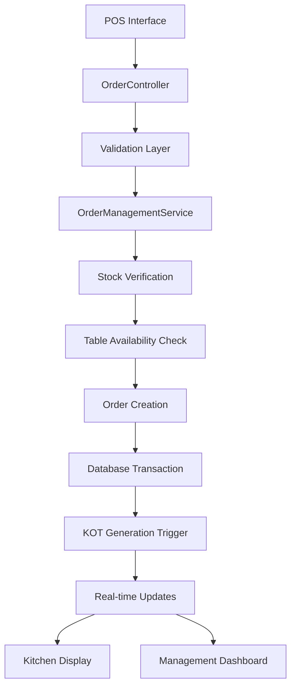
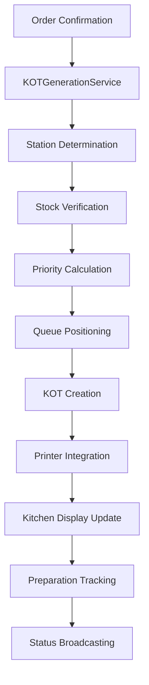
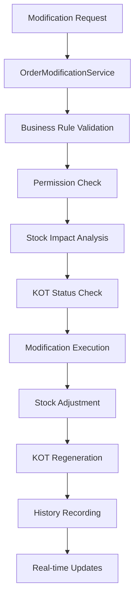
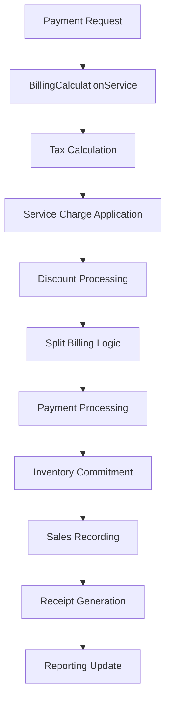
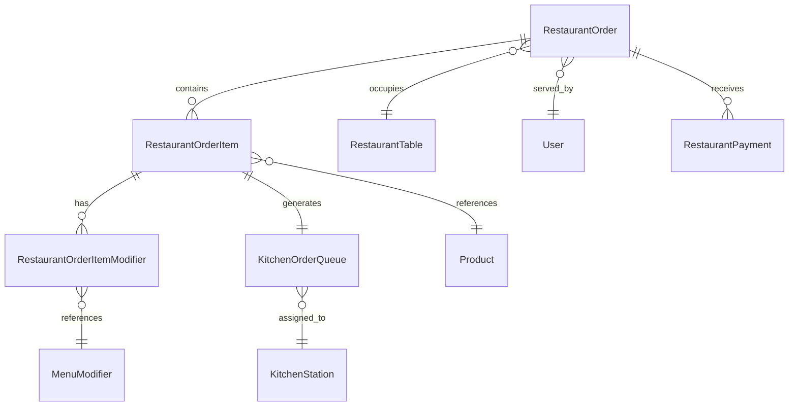
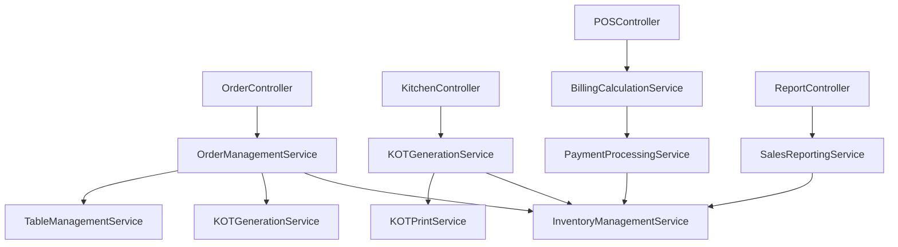
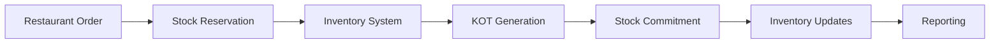
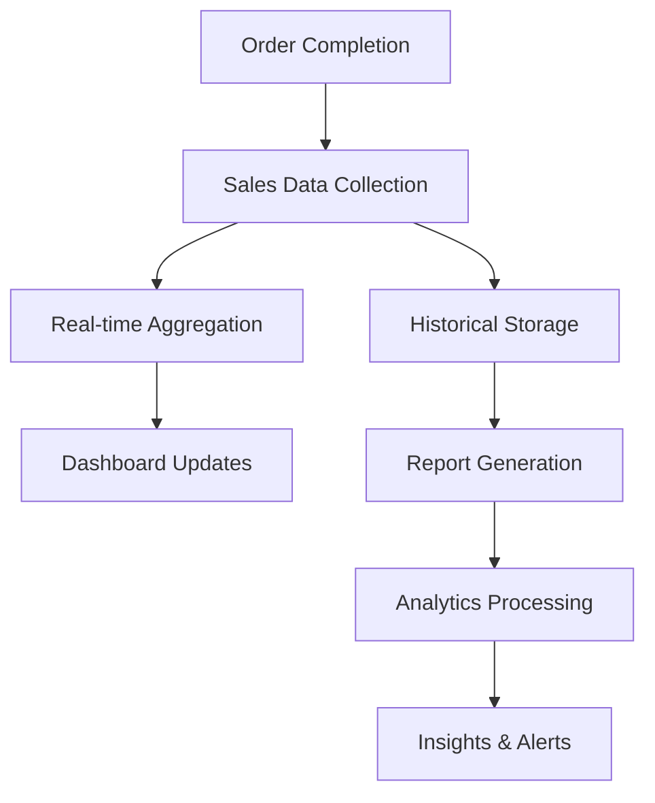

# Restaurant POS Order Lifecycle System - Complete Documentation

## Table of Contents

1. [Executive Summary](#executive-summary)
2. [System Architecture Documentation](#system-architecture-documentation)
3. [Order Lifecycle Stages Documentation](#order-lifecycle-stages-documentation)
4. [Integration Documentation](#integration-documentation)
5. [Implementation Guide](#implementation-guide)
6. [API Documentation](#api-documentation)
7. [Business Rules Documentation](#business-rules-documentation)
8. [Troubleshooting Guide](#troubleshooting-guide)
9. [Maintenance and Operations](#maintenance-and-operations)
10. [Future Enhancements](#future-enhancements)

---

## Executive Summary

### System Overview

The Restaurant POS Order Lifecycle System is a comprehensive, enterprise-grade restaurant management solution built on Laravel 11 with Inertia.js and React frontend. This system provides end-to-end order management from initial customer order through kitchen preparation to final payment and reporting.

The system supports multiple order types (dine-in, takeaway, delivery), complex table management, real-time kitchen display systems, inventory integration, and sophisticated billing calculations with support for split billing, taxes, and service charges.

### Key Benefits and Business Value

#### Operational Efficiency
- **Real-time Order Processing**: Orders flow seamlessly from POS to kitchen displays with automatic KOT generation
- **Table Management Optimization**: Intelligent table status tracking reduces wait times and maximizes seating capacity
- **Kitchen Workflow Automation**: Station-based preparation with priority queuing optimizes kitchen operations
- **Inventory Integration**: Automatic stock reservation and commitment prevents overselling and waste

#### Customer Experience Enhancement
- **Faster Service**: Streamlined order processing reduces preparation and delivery times
- **Order Accuracy**: Modifier system and special instructions ensure orders meet customer expectations
- **Flexible Payment Options**: Multiple payment methods with split billing capabilities
- **Real-time Updates**: Staff can provide accurate timing information to customers

#### Financial Management
- **Comprehensive Billing**: Complex tax calculations, service charges, and discount management
- **Revenue Tracking**: Detailed sales reporting with item-level analytics
- **Cost Control**: Inventory integration provides real-time cost of goods sold
- **Audit Trail**: Complete order modification history for compliance and dispute resolution

#### Scalability and Flexibility
- **Multi-store Support**: Centralized management with store-specific configurations
- **White-label Capabilities**: Customizable branding and themes for different restaurant concepts
- **Modular Architecture**: Extensible design allows for easy feature additions
- **API-driven Integration**: RESTful APIs enable third-party system connections

### Technical Architecture Highlights

#### Three-Tier Architecture
- **Presentation Layer**: React frontend with Inertia.js for seamless user experience
- **Application Layer**: Laravel 11 backend with comprehensive service layer
- **Data Layer**: MySQL database with optimized schema for restaurant operations

#### Key Technologies
- **Backend**: Laravel 11, PHP 8.2+, MySQL 8.0+
- **Frontend**: React 18, Inertia.js, Tailwind CSS
- **Real-time Communication**: WebSocket integration for kitchen displays
- **Queue Management**: Redis-based job processing for background tasks
- **Caching**: Redis for performance optimization

#### Design Patterns
- **Repository Pattern**: Data access abstraction
- **Service Layer**: Business logic encapsulation
- **Observer Pattern**: Automated workflow management
- **Factory Pattern**: Dynamic object creation
- **Strategy Pattern**: Flexible algorithm implementation

### Implementation Scope and Achievements

#### Completed Features
1. **Complete Order Management**
   - Order creation with validation and stock verification
   - Real-time status tracking and updates
   - Order modification with business rule enforcement
   - Cancellation workflows with proper cleanup

2. **Kitchen Operations**
   - Automatic KOT generation with station routing
   - Priority-based queue management
   - Preparation time estimation
   - Stock verification and alerts

3. **Table Management**
   - Dynamic table status tracking
   - Reservation system integration
   - Capacity management
   - Real-time availability updates

4. **Billing and Payments**
   - Complex tax calculations with jurisdiction support
   - Service charge management
   - Discount and promotional pricing
   - Split billing capabilities
   - Multiple payment method integration

5. **Inventory Integration**
   - Real-time stock reservation
   - Automatic commitment on order completion
   - Low stock alerts
   - Cost tracking and reporting

6. **Reporting and Analytics**
   - Sales reporting by period, item, and category
   - Kitchen performance metrics
   - Staff productivity analysis
   - Customer behavior insights

---

## System Architecture Documentation

### Complete Three-Tier Architecture Overview

#### Presentation Layer (Frontend)

The presentation layer provides the user interface for all restaurant operations:

**Components:**
- **POS Interface**: Order entry, table management, and payment processing
- **Kitchen Display System**: Real-time order queue and preparation tracking
- **Management Dashboard**: Reporting, analytics, and system configuration
- **Customer-facing Displays**: Order status and wait time information

**Technology Stack:**
- React 18 with functional components and hooks
- Inertia.js for seamless server-side rendering
- Tailwind CSS for responsive design
- Zustand for state management
- React Query for server state synchronization

**Key Features:**
- Real-time updates via WebSocket connections
- Offline capability for critical functions
- Responsive design for tablets and mobile devices
- Accessibility compliance (WCAG 2.1)

#### Application Layer (Backend)

The application layer contains all business logic and service orchestration:

**Core Components:**
- **Controllers**: HTTP request handling and response formatting
- **Services**: Business logic implementation and workflow orchestration
- **Observers**: Automated event handling and workflow triggers
- **Jobs**: Background task processing for non-blocking operations
- **Middleware**: Request filtering, authentication, and authorization

**Service Architecture:**
```
Service Layer Architecture:
├── Restaurant Services
│   ├── OrderManagementService
│   ├── KOTGenerationService
│   ├── BillingCalculationService
│   ├── OrderModificationService
│   └── TableManagementService
├── Inventory Services
│   ├── InventoryManagementService
│   ├── StockReservationService
│   └── InventoryAlertService
├── Payment Services
│   ├── PaymentProcessingService
│   └── RefundProcessingService
└── Reporting Services
    ├── SalesReportingService
    └── KitchenPerformanceService
```

**Data Flow Patterns:**
- Request validation and sanitization
- Business rule enforcement
- Transaction management for data consistency
- Event-driven architecture for loose coupling
- Comprehensive error handling and logging

#### Data Layer (Database)

The data layer provides persistent storage with optimized schemas:

**Database Design:**
- MySQL 8.0+ with InnoDB engine for ACID compliance
- Optimized indexes for performance-critical queries
- Foreign key constraints for data integrity
- Partitioning for large historical tables

**Key Tables:**
- `restaurant_orders`: Core order information
- `restaurant_order_items`: Order line items with modifiers
- `kitchen_order_queue`: Kitchen preparation queue
- `restaurant_tables`: Table management and status
- `kitchen_stations`: Preparation station configuration
- `restaurant_payments`: Payment processing and tracking

### Data Flow Diagrams for All Order Lifecycle Stages

#### Order Entry Data Flow



**Process Description:**
1. **Order Entry**: Staff enters order details through POS interface
2. **Validation**: System validates product availability, pricing, and table capacity
3. **Stock Verification**: Real-time inventory check with reservation
4. **Table Management**: Automatic table status updates for dine-in orders
5. **Order Creation**: Transactional order creation with proper error handling
6. **KOT Generation**: Automatic kitchen order ticket generation
7. **Real-time Updates**: WebSocket broadcasts to kitchen and management displays

#### KOT Generation Data Flow



**Process Description:**
1. **Station Determination**: Automatic routing based on product preparation requirements
2. **Stock Verification**: Final inventory check before kitchen commitment
3. **Priority Calculation**: Dynamic priority based on order type and wait time
4. **Queue Positioning**: Intelligent positioning in preparation queue
5. **KOT Creation**: Generation of kitchen order tickets with all details
6. **Printer Integration**: Automatic printing to designated station printers
7. **Real-time Updates**: Live kitchen display updates with status changes

#### Order Modification Data Flow



**Process Description:**
1. **Validation**: Comprehensive business rule and permission validation
2. **Stock Analysis**: Impact assessment on inventory levels
3. **KOT Status Check**: Verification of preparation status before modification
4. **Modification Execution**: Transactional modification with proper error handling
5. **Stock Adjustment**: Automatic reservation or release of inventory
6. **KOT Regeneration**: Update or regeneration of kitchen order tickets
7. **Audit Trail**: Complete modification history recording

#### Billing and Payment Data Flow



**Process Description:**
1. **Billing Calculation**: Comprehensive calculation of taxes, service charges, and discounts
2. **Split Billing**: Support for multiple payment methods and bill splitting
3. **Payment Processing**: Integration with various payment gateways
4. **Inventory Commitment**: Final stock commitment on successful payment
5. **Sales Recording**: Transaction recording for reporting and analytics
6. **Receipt Generation**: Automatic receipt generation with all details
7. **Reporting Update**: Real-time sales and inventory reporting updates

### Component Relationships and Dependencies

#### Core Model Relationships



#### Service Dependencies



### Technology Stack and Integration Points

#### Backend Technology Stack

**Core Framework:**
- Laravel 11 (PHP 8.2+)
- Composer for dependency management
- Artisan for command-line operations

**Database:**
- MySQL 8.0+ with JSON support
- Eloquent ORM for data access
- Database migrations for schema management

**Caching and Queues:**
- Redis for caching and session storage
- Redis queues for background job processing
- Horizon for queue monitoring

**Real-time Communication:**
- Laravel Echo for WebSocket integration
- Pusher for real-time broadcasting
- Server-sent events for kitchen displays

#### Frontend Technology Stack

**Core Framework:**
- React 18 with functional components
- Inertia.js for SPA-like experience
- Vite for asset bundling

**Styling and UI:**
- Tailwind CSS for utility-first styling
- Headless UI for accessible components
- Heroicons for consistent iconography

**State Management:**
- Zustand for client-side state
- React Query for server state
- Local storage for persistence

#### Third-Party Integrations

**Payment Gateways:**
- Stripe for credit card processing
- PayPal for digital payments
- Square for POS integration
- Local payment processors

**Printer Integration:**
- ESC/POS for thermal printer support
- Network printer discovery
- PDF generation for alternative printing

**Analytics and Reporting:**
- Google Analytics for web metrics
- Custom dashboard for restaurant metrics
- Export capabilities for external analysis

### Security and Performance Considerations

#### Security Implementation

**Authentication and Authorization:**
- Laravel Sanctum for API authentication
- Role-based access control (RBAC)
- Permission-based feature access
- Multi-factor authentication support

**Data Protection:**
- Input validation and sanitization
- SQL injection prevention
- XSS protection
- CSRF token validation
- Encrypted sensitive data storage

**API Security:**
- Rate limiting for API endpoints
- Request throttling for prevention of abuse
- API key management
- CORS configuration

#### Performance Optimization

**Database Optimization:**
- Strategic indexing for frequently queried columns
- Query optimization with eager loading
- Database connection pooling
- Read replicas for reporting queries

**Caching Strategy:**
- Multi-level caching (application, database, browser)
- Cache invalidation strategies
- Query result caching
- Session optimization

**Frontend Performance:**
- Code splitting and lazy loading
- Image optimization and CDN usage
- Minification and compression
- Progressive loading strategies

**Monitoring and Analytics:**
- Application performance monitoring (APM)
- Database query analysis
- Real-time performance metrics
- Error tracking and alerting

---

## Order Lifecycle Stages Documentation

### Order Entry: Detailed Workflow, API Endpoints, Validation Rules

#### Order Entry Workflow

The order entry stage is the critical first step in the restaurant POS order lifecycle. This stage involves capturing customer orders, validating availability, reserving inventory, and initiating kitchen preparation.

**Workflow Steps:**

1. **Order Initialization**
   - Select order type (dine-in, takeaway, delivery)
   - Assign table for dine-in orders
   - Capture customer information for delivery
   - Set order priority and special instructions

2. **Item Selection**
   - Browse menu categories and products
   - Configure product modifiers and customizations
   - Specify quantities and special preparation notes
   - Validate product availability and pricing

3. **Validation and Verification**
   - Check table availability for dine-in orders
   - Verify stock levels for all products and modifiers
   - Validate order against business rules
   - Calculate preliminary totals and taxes

4. **Order Creation**
   - Create order record with all details
   - Reserve inventory for ordered items
   - Update table status for dine-in orders
   - Generate order number and timestamps

5. **KOT Generation**
   - Automatically generate Kitchen Order Tickets
   - Route items to appropriate preparation stations
   - Queue items based on priority and preparation time
   - Broadcast to kitchen display systems

#### API Endpoints

**Create Restaurant Order**
```
POST /api/restaurant/orders
Content-Type: application/json
Authorization: Bearer {token}

Request Body:
{
  "table_id": 1,
  "order_type": "dine_in",
  "customer_count": 4,
  "waiter_id": 123,
  "priority": "normal",
  "special_instructions": "No onions please",
  "items": [
    {
      "product_id": 45,
      "quantity": 2,
      "unit_price": 12.99,
      "unit_cost": 5.50,
      "special_instructions": "Extra spicy",
      "modifiers": [
        {
          "modifier_id": 7,
          "quantity": 1,
          "price_adjustment": 1.50
        }
      ]
    }
  ]
}

Response:
{
  "success": true,
  "data": {
    "id": 1234,
    "order_number": "ORD202312140001",
    "status": "pending",
    "table": {
      "id": 1,
      "table_number": "T-15",
      "name": "Window Table"
    },
    "items": [...],
    "subtotal": 27.48,
    "tax_amount": 2.75,
    "total_amount": 30.23
  },
  "message": "Order created successfully"
}
```

**Get Available Tables**
```
GET /api/restaurant/tables/available?capacity=4
Authorization: Bearer {token}

Response:
{
  "success": true,
  "data": [
    {
      "id": 1,
      "table_number": "T-15",
      "name": "Window Table",
      "capacity": 6,
      "section": "Main Dining",
      "status": "available"
    }
  ]
}
```

**Validate Product Availability**
```
POST /api/restaurant/products/validate-availability
Content-Type: application/json
Authorization: Bearer {token}

Request Body:
{
  "items": [
    {
      "product_id": 45,
      "quantity": 2
    }
  ],
  "store_id": 1
}

Response:
{
  "success": true,
  "data": {
    "available": true,
    "stock_levels": {
      "45": {
        "available": 15,
        "requested": 2,
        "sufficient": true
      }
    }
  }
}
```

#### Validation Rules

**Order Level Validation:**
```php
// From StoreRestaurantOrderRequest.php
$rules = [
    'table_id' => 'nullable|exists:restaurant_tables,id',
    'order_type' => 'required|in:dine_in,takeaway,delivery',
    'customer_count' => 'required|integer|min:1|max:50',
    'waiter_id' => 'nullable|exists:users,id',
    'priority' => 'nullable|in:low,normal,high,urgent',
    'special_instructions' => 'nullable|string|max:1000',
    'items' => 'required|array|min:1',
];
```

**Item Level Validation:**
```php
$itemRules = [
    'items.*.product_id' => 'required|exists:products,id',
    'items.*.quantity' => 'required|numeric|min:0.01',
    'items.*.unit_price' => 'required|numeric|min:0',
    'items.*.unit_cost' => 'required|numeric|min:0',
    'items.*.discount' => 'nullable|numeric|min:0',
    'items.*.special_instructions' => 'nullable|string|max:500',
    'items.*.preparation_notes' => 'nullable|string|max:500',
    'items.*.course_number' => 'nullable|integer|min:1|max:10',
    'items.*.is_complimentary' => 'nullable|boolean',
];
```

**Modifier Validation:**
```php
$modifierRules = [
    'items.*.modifiers' => 'nullable|array',
    'items.*.modifiers.*.modifier_id' => 'required|exists:menu_modifiers,id',
    'items.*.modifiers.*.quantity' => 'required|numeric|min:0.01',
    'items.*.modifiers.*.price_adjustment' => 'required|numeric',
];
```

**Business Rule Validation:**
```php
// From RestaurantOrder model
public static function validateOrderData($data, $storeId)
{
    $errors = [];
    
    // Validate table availability for dine-in orders
    if ($data['order_type'] === 'dine_in' && isset($data['table_id'])) {
        $table = RestaurantTable::find($data['table_id']);
        if (!$table) {
            $errors['table'] = 'Selected table not found';
        } elseif (!$table->isAvailable()) {
            $errors['table'] = 'Selected table is not available';
        } elseif (!$table->canSeat($data['customer_count'])) {
            $errors['table'] = 'Selected table cannot accommodate ' . $data['customer_count'] . ' customers';
        }
    }
    
    return $errors;
}
```

### KOT Generation: Stock Verification, Kitchen Routing, Real-time Updates

#### KOT Generation Workflow

Kitchen Order Ticket (KOT) generation is a critical process that bridges order entry with kitchen preparation. This stage ensures accurate information reaches the kitchen with proper stock verification and station routing.

**Workflow Steps:**

1. **Order Confirmation Trigger**
   - Automatic KOT generation on order confirmation
   - Manual KOT generation for pending orders
   - Batch KOT generation for multiple orders

2. **Stock Verification**
   - Final inventory check before kitchen commitment
   - Alert generation for low stock items
   - Alternative suggestions for unavailable items

3. **Station Determination**
   - Automatic routing based on product preparation requirements
   - Load balancing across multiple stations
   - Special handling for complex preparations

4. **Priority Calculation**
   - Dynamic priority scoring based on multiple factors
   - Urgency flags for VIP customers or rush orders
   - Time-based priority adjustments

5. **Queue Positioning**
   - Intelligent positioning in preparation queue
   - Preparation time estimation
   - Dependency management for multi-course orders

6. **KOT Creation and Distribution**
   - Generation of detailed kitchen order tickets
   - Automatic printing to designated station printers
   - Real-time display on kitchen monitors

7. **Status Broadcasting**
   - WebSocket updates to all connected displays
   - Mobile notifications for kitchen staff
   - Management dashboard updates

#### Stock Verification Process

**Stock Verification Algorithm:**
```php
// From KOTGenerationService.php
public function verifyStockForKOT($orderItems, $storeId)
{
    $stockIssues = [];
    
    foreach ($orderItems as $item) {
        $product = $item->product;
        
        if ($product->is_stock_managed) {
            $availableStock = ProductStock::where('product_id', $product->id)
                ->where('store_id', $storeId)
                ->sum('quantity');
            
            $requiredQuantity = $item->quantity;
            
            // Check modifiers stock
            foreach ($item->modifiers as $modifier) {
                if ($modifier->modifier->is_stock_managed) {
                    $modifierStock = ProductStock::where('product_id', $modifier->modifier_id)
                        ->where('store_id', $storeId)
                        ->sum('quantity');
                    
                    $requiredModifierQuantity = $modifier->quantity * $item->quantity;
                    
                    if ($modifierStock < $requiredModifierQuantity) {
                        $stockIssues[] = [
                            'item' => $product->name,
                            'modifier' => $modifier->modifier->name,
                            'available' => $modifierStock,
                            'required' => $requiredModifierQuantity,
                            'shortage' => $requiredModifierQuantity - $modifierStock
                        ];
                    }
                }
            }
            
            if ($availableStock < $requiredQuantity) {
                $stockIssues[] = [
                    'item' => $product->name,
                    'available' => $availableStock,
                    'required' => $requiredQuantity,
                    'shortage' => $requiredQuantity - $availableStock
                ];
            }
        }
    }
    
    return [
        'verified' => empty($stockIssues),
        'issues' => $stockIssues,
        'can_proceed' => empty($stockIssues) || $this->hasOverridePermission()
    ];
}
```

**Low Stock Alerting:**
```php
public function checkLowStockAlerts($orderItems, $storeId)
{
    $alerts = [];
    $threshold = setting('restaurant.low_stock_threshold', 5, $storeId);
    
    foreach ($orderItems as $item) {
        $product = $item->product;
        
        if ($product->is_stock_managed) {
            $currentStock = ProductStock::where('product_id', $product->id)
                ->where('store_id', $storeId)
                ->sum('quantity');
            
            $remainingStock = $currentStock - $item->quantity;
            
            if ($remainingStock <= $threshold) {
                $alerts[] = [
                    'product_id' => $product->id,
                    'product_name' => $product->name,
                    'current_stock' => $currentStock,
                    'remaining_after_order' => $remainingStock,
                    'threshold' => $threshold,
                    'alert_level' => $remainingStock <= 0 ? 'critical' : 'warning'
                ];
            }
        }
    }
    
    return $alerts;
}
```

#### Kitchen Station Routing

**Station Determination Algorithm:**
```php
public function determineStation($orderItem)
{
    $product = $orderItem->product;
    
    // Check if product has specific station assignment
    $productStation = $product->kitchen_stations()->first();
    if ($productStation) {
        return $productStation->id;
    }
    
    // Determine station based on product category
    $categoryStation = $this->getStationByCategory($product->category_id);
    if ($categoryStation) {
        return $categoryStation->id;
    }
    
    // Default station based on preparation type
    return $this->getDefaultStationForPreparationType($product->preparation_type);
}

public function balanceStationLoad($stationId, $orderItem)
{
    $station = KitchenStation::find($stationId);
    $currentLoad = $station->getActiveQueueCount();
    $maxCapacity = $station->capacity;
    
    // If station is at capacity, find alternative
    if ($currentLoad >= $maxCapacity) {
        $alternativeStation = $this->findAlternativeStation($orderItem);
        if ($alternativeStation) {
            return $alternativeStation->id;
        }
    }
    
    return $stationId;
}
```

**Priority Calculation:**
```php
public function calculatePriority($order, $orderItem)
{
    $basePriority = $this->getBasePriorityScore($order->priority);
    
    // Add urgency based on wait time
    $waitTime = $order->created_at->diffInMinutes(now());
    $urgencyBonus = min($waitTime * 2, 200);
    
    // Add complexity bonus for items with modifiers
    $complexityBonus = count($orderItem->modifiers) * 10;
    
    // Add VIP customer bonus
    $vipBonus = $order->customer && $order->customer->is_vip ? 100 : 0;
    
    return $basePriority + $urgencyBonus + $complexityBonus + $vipBonus;
}
```

#### Real-time Update Mechanism

**WebSocket Event Broadcasting:**
```php
// From KitchenOrderQueue model
public function broadcastStatusUpdate()
{
    $statusData = $this->getRealTimeStatus();
    
    broadcast(new KOTStatusUpdated($statusData))->toOthers();
    
    Log::info('KOT status update broadcasted', [
        'kot_id' => $this->id,
        'status' => $this->status,
        'timestamp' => now()
    ]);

    return $statusData;
}

public function getRealTimeStatus()
{
    return [
        'kot_id' => $this->id,
        'kot_number' => $this->kot_number,
        'status' => $this->status,
        'priority' => $this->priority,
        'priority_score' => $this->getPriorityScore(),
        'estimated_time' => $this->estimated_time,
        'elapsed_time' => $this->created_at->diffInMinutes(now()),
        'is_overdue' => $this->isOverdue(),
        'station' => [
            'id' => $this->station->id,
            'name' => $this->station->name,
            'printer_name' => $this->station->printer_name
        ],
        'order_info' => [
            'order_number' => $this->orderItem->order->order_number,
            'table_number' => $this->orderItem->order->table->table_number,
            'order_type' => $this->orderItem->order->order_type,
        ],
        'item_info' => [
            'product_name' => $this->orderItem->product->name,
            'quantity' => $this->orderItem->quantity,
            'special_instructions' => $this->orderItem->special_instructions,
        ]
    ];
}
```

### Order Modification: Business Rules, Validation, Real-time Synchronization

#### Order Modification Workflow

Order modification is a critical feature that allows flexibility while maintaining kitchen efficiency and inventory accuracy. This stage enforces business rules to prevent disruptions while enabling necessary changes.

**Modification Types:**
1. **Add Items**: Add new items to existing orders
2. **Remove Items**: Remove items from orders
3. **Update Quantities**: Change item quantities
4. **Modify Items**: Update item modifiers or special instructions
5. **Cancel Order**: Cancel entire order with proper cleanup

**Business Rules and Restrictions:**

**Time-based Restrictions:**
- Orders can be modified within 10 minutes of confirmation
- No modifications allowed after 15 minutes for confirmed orders
- Priority orders have shorter modification windows

**Status-based Restrictions:**
- Pending orders: Full modification capabilities
- Confirmed orders: Limited modifications within time window
- Preparing orders: Only quantity reductions for unstarted items
- Ready orders: No modifications allowed
- Served orders: No modifications allowed

**Kitchen Status Restrictions:**
- Items with KOT status 'queued' can be fully modified
- Items with KOT status 'in_progress' can only be cancelled
- Items with KOT status 'ready' or 'completed' cannot be modified

#### Modification Validation

**Order Modification Validation:**
```php
// From OrderModificationService.php
private function canOrderBeModified(RestaurantOrder $order): bool
{
    // Order can only be modified in certain statuses
    if (!in_array($order->status, ['pending', 'confirmed'])) {
        return false;
    }

    // Check time-based restrictions
    if ($order->status === 'confirmed' && $order->updated_at->diffInMinutes(now()) > 10) {
        return false;
    }

    return true;
}

private function canItemBeModified(RestaurantOrderItem $orderItem): bool
{
    $kot = $orderItem->getKOT();
    
    if (!$kot) {
        return true; // No KOT generated yet, can be modified
    }

    // Can only modify if KOT is in queued status
    return $kot->status === 'queued';
}
```

**Stock Impact Analysis:**
```php
public function analyzeStockImpact($modificationType, $itemData, $storeId)
{
    $impact = [];
    
    switch ($modificationType) {
        case 'add_item':
            $impact = $this->analyzeAddItemImpact($itemData, $storeId);
            break;
            
        case 'remove_item':
            $impact = $this->analyzeRemoveItemImpact($itemData, $storeId);
            break;
            
        case 'update_quantity':
            $impact = $this->analyzeQuantityUpdateImpact($itemData, $storeId);
            break;
    }
    
    return [
        'has_impact' => !empty($impact),
        'impact_details' => $impact,
        'requires_manager_approval' => $this->requiresManagerApproval($impact)
    ];
}
```

#### Real-time Synchronization

**Modification Broadcasting:**
```php
public function broadcastModification($order, $modificationType, $details)
{
    $broadcastData = [
        'order_id' => $order->id,
        'order_number' => $order->order_number,
        'modification_type' => $modificationType,
        'details' => $details,
        'timestamp' => now()->toISOString(),
        'modified_by' => auth()->user()->name
    ];
    
    // Broadcast to POS systems
    broadcast(new OrderModified($broadcastData))->toOthers();
    
    // Broadcast to kitchen displays if items affected
    if ($this->affectsKitchenItems($modificationType)) {
        broadcast(new KitchenOrderModified($broadcastData))->toOthers();
    }
    
    // Update management dashboard
    broadcast(new ManagementDashboardUpdated($broadcastData))->toOthers();
}
```

**KOT Synchronization:**
```php
public function synchronizeKOTWithModification($orderItem, $modificationType, $data)
{
    $kot = $orderItem->getKOT();
    
    if (!$kot) {
        return; // No KOT to synchronize
    }
    
    switch ($modificationType) {
        case 'quantity_updated':
            $kot->handleModification('quantity_updated', [
                'old_quantity' => $data['old_quantity'],
                'new_quantity' => $data['new_quantity']
            ]);
            break;
            
        case 'modifiers_updated':
            $kot->handleModification('modifiers_updated', [
                'old_modifiers' => $data['old_modifiers'],
                'new_modifiers' => $data['new_modifiers']
            ]);
            break;
            
        case 'item_cancelled':
            $kot->handleModification('item_cancelled', [
                'reason' => $data['reason']
            ]);
            break;
    }
    
    // Broadcast KOT update to kitchen displays
    $kot->broadcastStatusUpdate();
}
```

### Billing & Tax: Calculation Algorithms, Discount Handling, Split Billing

#### Billing Calculation Workflow

The billing and tax calculation stage provides comprehensive financial processing with support for complex tax scenarios, discounts, service charges, and split billing arrangements.

**Calculation Components:**
1. **Base Amount Calculation**: Sum of all ordered items with modifiers
2. **Tax Calculation**: Jurisdiction-based tax calculations
3. **Service Charge Application**: Automatic service charges for dine-in orders
4. **Discount Processing**: Various discount types and validation
5. **Split Billing**: Multiple payment methods and bill splitting
6. **Rounding and Finalization**: Currency rounding and final total calculation

#### Tax Calculation Algorithm

**Tax Calculation Service:**
```php
// From BillingCalculationService.php
public function calculateTaxes($order, $taxConfiguration = null)
{
    $taxBreakdown = [];
    $totalTax = 0;
    
    // Get tax configuration for store location
    if (!$taxConfiguration) {
        $taxConfiguration = $this->getTaxConfiguration($order->store_id);
    }
    
    foreach ($order->items as $item) {
        $itemTax = $this->calculateItemTax($item, $taxConfiguration);
        $taxBreakdown = array_merge_recursive($taxBreakdown, $itemTax);
        $totalTax += array_sum($itemTax);
    }
    
    return [
        'total_tax' => $totalTax,
        'tax_breakdown' => $taxBreakdown,
        'tax_inclusive' => $taxConfiguration->tax_inclusive ?? false
    ];
}

public function calculateItemTax($item, $taxConfiguration)
{
    $itemTax = [];
    $itemSubtotal = $item->calculateSubtotal();
    
    foreach ($taxConfiguration->tax_rules as $rule) {
        if ($this->itemMatchesTaxRule($item, $rule)) {
            $taxAmount = $this->calculateTaxForRule($itemSubtotal, $rule);
            
            $itemTax[$rule->name] = ($itemTax[$rule->name] ?? 0) + $taxAmount;
        }
    }
    
    return $itemTax;
}

public function calculateTaxForRule($amount, $taxRule)
{
    switch ($taxRule->calculation_method) {
        case 'percentage':
            return $amount * ($taxRule->rate / 100);
            
        case 'fixed':
            return $taxRule->amount;
            
        case 'tiered':
            return $this->calculateTieredTax($amount, $taxRule->tiers);
            
        default:
            return 0;
    }
}
```

**Jurisdiction-based Tax Rules:**
```php
public function getTaxConfiguration($storeId)
{
    $store = Store::find($storeId);
    $locationCode = $store->tax_location_code;
    
    return TaxConfiguration::where('location_code', $locationCode)
        ->where('effective_date', '<=', now())
        ->orderBy('effective_date', 'desc')
        ->first();
}

public function itemMatchesTaxRule($item, $rule)
{
    // Check product category
    if ($rule->applicable_categories && !in_array($item->product->category_id, $rule->applicable_categories)) {
        return false;
    }
    
    // Check exemptions
    if ($rule->exempt_categories && in_array($item->product->category_id, $rule->exempt_categories)) {
        return false;
    }
    
    // Check time-based rules
    if ($rule->time_restrictions && !$this->isWithinTimeRestrictions($rule->time_restrictions)) {
        return false;
    }
    
    return true;
}
```

#### Discount Handling

**Discount Processing Algorithm:**
```php
public function calculateDiscounts($order, $discounts = [])
{
    $discountBreakdown = [];
    $totalDiscount = 0;
    $orderSubtotal = $order->subtotal;
    
    foreach ($discounts as $discount) {
        $discountAmount = $this->calculateDiscountAmount($discount, $orderSubtotal, $totalDiscount);
        
        if ($discountAmount > 0) {
            $discountBreakdown[] = [
                'type' => $discount['type'],
                'name' => $discount['name'] ?? 'Discount',
                'amount' => $discountAmount,
                'reason' => $discount['reason'] ?? ''
            ];
            
            $totalDiscount += $discountAmount;
        }
    }
    
    // Validate maximum discount percentage
    $maxDiscountPercentage = setting('restaurant.max_discount_percentage', 100, $order->store_id);
    $discountPercentage = ($totalDiscount / $orderSubtotal) * 100;
    
    if ($discountPercentage > $maxDiscountPercentage) {
        throw new \Exception("Discount percentage ({$discountPercentage}%) exceeds maximum allowed ({$maxDiscountPercentage}%)");
    }
    
    return [
        'total_discount' => $totalDiscount,
        'discount_breakdown' => $discountBreakdown,
        'discount_percentage' => $discountPercentage
    ];
}

public function calculateDiscountAmount($discount, $orderSubtotal, $currentTotalDiscount)
{
    switch ($discount['type']) {
        case 'percentage':
            $discountAmount = $orderSubtotal * ($discount['value'] / 100);
            break;
            
        case 'fixed':
            $discountAmount = min($discount['value'], $orderSubtotal - $currentTotalDiscount);
            break;
            
        case 'promotional':
            $discountAmount = $this->calculatePromotionalDiscount($discount, $orderSubtotal);
            break;
            
        default:
            $discountAmount = 0;
    }
    
    return max(0, $discountAmount);
}
```

#### Split Billing Implementation

**Split Billing Service:**
```php
public function calculateSplitBilling($order, $splitType, $splitData)
{
    switch ($splitType) {
        case 'equal':
            return $this->calculateEqualSplit($order, $splitData);
            
        case 'percentage':
            return $this->calculatePercentageSplit($order, $splitData);
            
        case 'item_based':
            return $this->calculateItemBasedSplit($order, $splitData);
            
        case 'custom':
            return $this->calculateCustomSplit($order, $splitData);
            
        default:
            throw new \Exception("Invalid split type: {$splitType}");
    }
}

public function calculateEqualSplit($order, $splitData)
{
    $numberOfSplits = $splitData['number_of_splits'];
    $amountPerSplit = $order->final_total / $numberOfSplits;
    
    $splits = [];
    for ($i = 1; $i <= $numberOfSplits; $i++) {
        $splits[] = [
            'split_number' => $i,
            'amount' => $amountPerSplit,
            'items' => $order->items->toArray(),
            'tax_allocation' => $order->tax_amount / $numberOfSplits,
            'service_charge_allocation' => $order->service_charge / $numberOfSplits
        ];
    }
    
    return $splits;
}

public function calculateItemBasedSplit($order, $splitData)
{
    $splits = [];
    $itemAllocations = $splitData['item_allocations'];
    
    foreach ($itemAllocations as $splitIndex => $itemIds) {
        $splitItems = $order->items->whereIn('id', $itemIds);
        $splitSubtotal = $splitItems->sum(function($item) {
            return $item->calculateSubtotal();
        });
        
        // Calculate proportional tax and service charge
        $taxRatio = $splitSubtotal / $order->subtotal;
        $splitTax = $order->tax_amount * $taxRatio;
        $splitServiceCharge = $order->service_charge * $taxRatio;
        
        $splits[] = [
            'split_number' => $splitIndex + 1,
            'amount' => $splitSubtotal + $splitTax + $splitServiceCharge,
            'items' => $splitItems->toArray(),
            'tax_allocation' => $splitTax,
            'service_charge_allocation' => $splitServiceCharge
        ];
    }
    
    return $splits;
}
```

### Payment Processing: Payment Methods, Security, Inventory Updates, Reporting

#### Payment Processing Workflow

The payment processing stage handles financial transactions with multiple payment methods, security validation, inventory commitment, and reporting integration.

**Payment Methods Supported:**
1. **Cash**: Traditional cash payments with change calculation
2. **Credit/Debit Cards**: Integration with payment gateways (Stripe, Square)
3. **Digital Wallets**: PayPal, Apple Pay, Google Pay
4. **Gift Cards**: Internal gift card system
5. **Store Credit**: Customer account credits
6. **Split Payments**: Multiple payment methods for single order

**Payment Processing Steps:**
1. **Payment Method Selection**: Choose payment method(s)
2. **Amount Validation**: Verify payment amounts match order total
3. **Security Validation**: Fraud checks and authentication
4. **Payment Authorization**: Process payment through gateway
5. **Inventory Commitment**: Finalize stock commitment
6. **Receipt Generation**: Create detailed receipts
7. **Reporting Update**: Update sales and inventory reports

#### Payment Security Implementation

**Payment Security Service:**
```php
public function processPayment($order, $paymentData)
{
    // Validate payment data
    $this->validatePaymentData($paymentData);
    
    // Check for fraud indicators
    $fraudCheck = $this->performFraudCheck($order, $paymentData);
    if (!$fraudCheck['passed']) {
        throw new \Exception('Payment flagged for potential fraud');
    }
    
    // Process payment based on method
    $result = $this->processPaymentByMethod($order, $paymentData);
    
    if ($result['success']) {
        // Commit inventory
        $this->commitInventoryForOrder($order);
        
        // Update order status
        $order->payment_status = 'paid';
        $order->status = 'completed';
        $order->completed_at = now();
        $order->save();
        
        // Generate receipt
        $this->generateReceipt($order, $result);
        
        // Update reports
        $this->updateSalesReports($order);
    }
    
    return $result;
}

public function performFraudCheck($order, $paymentData)
{
    $riskScore = 0;
    $riskFactors = [];
    
    // Check for unusual order amount
    if ($order->final_total > $this->getHighRiskThreshold($order->store_id)) {
        $riskScore += 20;
        $riskFactors[] = 'High order amount';
    }
    
    // Check payment frequency
    $recentPayments = $this->getRecentPayments($paymentData['customer_id'] ?? null);
    if ($recentPayments > $this->getFrequencyThreshold()) {
        $riskScore += 15;
        $riskFactors[] = 'High payment frequency';
    }
    
    // Check for suspicious payment patterns
    if ($this->hasSuspiciousPattern($paymentData)) {
        $riskScore += 30;
        $riskFactors[] = 'Suspicious payment pattern';
    }
    
    return [
        'passed' => $riskScore < 50,
        'risk_score' => $riskScore,
        'risk_factors' => $riskFactors
    ];
}
```

#### Inventory Commitment

**Inventory Commitment Service:**
```php
public function commitInventoryForOrder($order)
{
    foreach ($order->items as $item) {
        // Commit product stock
        if ($item->product->is_stock_managed) {
            $this->commitProductStock($item, $order->store_id);
        }
        
        // Commit modifier stock
        foreach ($item->modifiers as $modifier) {
            if ($modifier->modifier->is_stock_managed) {
                $this->commitModifierStock($modifier, $order->store_id);
            }
        }
    }
}

public function commitProductStock($orderItem, $storeId)
{
    $product = $orderItem->product;
    $quantity = $orderItem->quantity;
    
    DB::transaction(function() use ($product, $quantity, $storeId, $orderItem) {
        // Find and update stock record
        $stock = ProductStock::where('product_id', $product->id)
            ->where('store_id', $storeId)
            ->lockForUpdate()
            ->first();
        
        if (!$stock || $stock->quantity < $quantity) {
            throw new \Exception("Insufficient stock for product: {$product->name}");
        }
        
        $stock->quantity -= $quantity;
        $stock->save();
        
        // Create inventory transaction
        $transaction = InventoryTransaction::create([
            'store_id' => $storeId,
            'transaction_type' => 'sale',
            'reference_type' => 'restaurant_order_item',
            'reference_id' => $orderItem->id,
            'notes' => "Stock committed for order item - Order Item ID: {$orderItem->id}",
            'created_by' => auth()->id() ?? 1
        ]);
        
        InventoryTransactionItem::create([
            'inventory_transaction_id' => $transaction->id,
            'product_id' => $product->id,
            'quantity' => $quantity,
            'action' => 'commit',
            'unit_cost' => $product->cost ?? 0
        ]);
        
        // Update product stock level
        $product->stock_level -= $quantity;
        $product->save();
    });
}
```

#### Payment Reporting Integration

**Sales Reporting Service:**
```php
public function updateSalesReports($order)
{
    // Update daily sales
    $this->updateDailySales($order);
    
    // Update product sales
    $this->updateProductSales($order);
    
    // Update category sales
    $this->updateCategorySales($order);
    
    // Update payment method reports
    $this->updatePaymentMethodReports($order);
    
    // Update staff performance
    $this->updateStaffPerformance($order);
}

public function updateDailySales($order)
{
    $dailySales = DailySales::firstOrCreate([
        'store_id' => $order->store_id,
        'date' => $order->order_date
    ]);
    
    $dailySales->increment('total_orders');
    $dailySales->increment('total_revenue', $order->final_total);
    $dailySales->increment('subtotal', $order->subtotal);
    $dailySales->increment('tax_amount', $order->tax_amount);
    $dailySales->increment('service_charge', $order->service_charge);
    $dailySales->increment('discount_amount', $order->discount_amount);
    
    // Update order type counters
    switch ($order->order_type) {
        case 'dine_in':
            $dailySales->increment('dine_in_orders');
            $dailySales->increment('dine_in_revenue', $order->final_total);
            break;
        case 'takeaway':
            $dailySales->increment('takeaway_orders');
            $dailySales->increment('takeaway_revenue', $order->final_total);
            break;
        case 'delivery':
            $dailySales->increment('delivery_orders');
            $dailySales->increment('delivery_revenue', $order->final_total);
            break;
    }
    
    $dailySales->save();
}
```

---

## Integration Documentation

### Inventory Management System Integration Details

The restaurant POS system maintains a tight integration with the inventory management system to ensure accurate stock tracking, prevent overselling, and provide real-time cost calculations.

#### Integration Architecture

**Data Flow Between Systems:**


**Key Integration Points:**
1. **Order Entry**: Stock reservation during order creation
2. **Order Modification**: Dynamic stock adjustment during modifications
3. **KOT Generation**: Final stock verification before kitchen preparation
4. **Payment Processing**: Stock commitment on successful payment
5. **Order Cancellation**: Stock release on order cancellation
6. **Reporting**: Real-time cost calculation and inventory valuation

#### Stock Reservation System

**Stock Reservation Algorithm:**
```php
public function reserveStockForOrder($order, $storeId)
{
    $reservations = [];
    
    foreach ($order->items as $item) {
        if ($item->product->is_stock_managed) {
            $reservation = $this->reserveProductStock($item, $storeId);
            $reservations[] = $reservation;
        }
        
        // Reserve modifier stock
        foreach ($item->modifiers as $modifier) {
            if ($modifier->modifier->is_stock_managed) {
                $modifierReservation = $this->reserveModifierStock($modifier, $storeId);
                $reservations[] = $modifierReservation;
            }
        }
    }
    
    return $reservations;
}

public function reserveProductStock($orderItem, $storeId)
{
    $product = $orderItem->product;
    $quantity = $orderItem->quantity;
    
    return DB::transaction(function() use ($product, $quantity, $storeId, $orderItem) {
        // Find and lock stock record
        $stock = ProductStock::where('product_id', $product->id)
            ->where('store_id', $storeId)
            ->lockForUpdate()
            ->first();
        
        if (!$stock || $stock->quantity < $quantity) {
            throw new \Exception("Insufficient stock for product: {$product->name}");
        }
        
        $oldQuantity = $stock->quantity;
        $stock->quantity -= $quantity;
        $stock->reserved_quantity += $quantity;
        $stock->save();
        
        // Create reservation transaction
        $transaction = InventoryTransaction::create([
            'store_id' => $storeId,
            'transaction_type' => 'reservation',
            'reference_type' => 'restaurant_order_item',
            'reference_id' => $orderItem->id,
            'notes' => "Stock reserved for order item - Order Item ID: {$orderItem->id}",
            'created_by' => auth()->id() ?? 1
        ]);
        
        InventoryTransactionItem::create([
            'inventory_transaction_id' => $transaction->id,
            'product_id' => $product->id,
            'quantity' => $quantity,
            'action' => 'reserve',
            'unit_cost' => $product->cost ?? 0
        ]);
        
        return [
            'product_id' => $product->id,
            'product_name' => $product->name,
            'quantity_reserved' => $quantity,
            'previous_quantity' => $oldQuantity,
            'new_quantity' => $stock->quantity,
            'reservation_id' => $transaction->id
        ];
    });
}
```

#### Real-time Stock Updates

**Stock Update Broadcasting:**
```php
public function broadcastStockUpdate($productId, $storeId, $newQuantity, $changeType)
{
    $updateData = [
        'product_id' => $productId,
        'store_id' => $storeId,
        'new_quantity' => $newQuantity,
        'change_type' => $changeType,
        'timestamp' => now()->toISOString()
    ];
    
    // Broadcast to POS systems
    broadcast(new StockUpdated($updateData))->toOthers();
    
    // Update inventory dashboard
    broadcast(new InventoryDashboardUpdated($updateData))->toOthers();
    
    // Send low stock alerts if necessary
    if ($newQuantity <= $this->getLowStockThreshold($storeId)) {
        $this->sendLowStockAlert($productId, $storeId, $newQuantity);
    }
}
```

#### Cost Calculation Integration

**Real-time Cost Calculation:**
```php
public function calculateOrderCost($order)
{
    $totalCost = 0;
    $itemCosts = [];
    
    foreach ($order->items as $item) {
        $itemCost = $this->calculateItemCost($item);
        $itemCosts[] = $itemCost;
        $totalCost += $itemCost['total_cost'];
    }
    
    return [
        'total_cost' => $totalCost,
        'item_costs' => $itemCosts,
        'cost_percentage' => ($totalCost / $order->subtotal) * 100,
        'profit_margin' => (($order->subtotal - $totalCost) / $order->subtotal) * 100
    ];
}

public function calculateItemCost($orderItem)
{
    $productCost = $orderItem->product->cost * $orderItem->quantity;
    $modifierCosts = 0;
    
    foreach ($orderItem->modifiers as $modifier) {
        $modifierCosts += $modifier->modifier->cost * $modifier->quantity * $orderItem->quantity;
    }
    
    $totalItemCost = $productCost + $modifierCosts;
    
    return [
        'product_id' => $orderItem->product_id,
        'product_name' => $orderItem->product->name,
        'quantity' => $orderItem->quantity,
        'product_cost' => $productCost,
        'modifier_costs' => $modifierCosts,
        'total_cost' => $totalItemCost,
        'unit_cost' => $totalItemCost / $orderItem->quantity
    ];
}
```

### Sales Reporting and Analytics Integration

The restaurant POS system integrates with a comprehensive reporting and analytics system to provide insights into sales performance, customer behavior, and operational efficiency.

#### Reporting Architecture

**Reporting Data Flow:**


#### Real-time Sales Reporting

**Sales Data Collection Service:**
```php
public function collectSalesData($order)
{
    $salesData = [
        'order_id' => $order->id,
        'order_number' => $order->order_number,
        'store_id' => $order->store_id,
        'order_date' => $order->order_date,
        'order_time' => $order->order_time,
        'order_type' => $order->order_type,
        'subtotal' => $order->subtotal,
        'tax_amount' => $order->tax_amount,
        'service_charge' => $order->service_charge,
        'discount_amount' => $order->discount_amount,
        'final_total' => $order->final_total,
        'customer_count' => $order->customer_count,
        'waiter_id' => $order->waiter_id,
        'table_id' => $order->table_id,
        'items' => $this->collectItemData($order),
        'payments' => $this->collectPaymentData($order),
        'timestamp' => now()
    ];
    
    // Store in real-time aggregation tables
    $this->updateRealTimeAggregates($salesData);
    
    // Store in historical data warehouse
    $this->storeHistoricalData($salesData);
    
    // Trigger real-time dashboard updates
    $this->updateDashboards($salesData);
    
    return $salesData;
}

public function collectItemData($order)
{
    $itemData = [];
    
    foreach ($order->items as $item) {
        $itemData[] = [
            'product_id' => $item->product_id,
            'product_name' => $item->product->name,
            'category_id' => $item->product->category_id,
            'category_name' => $item->product->category->name,
            'quantity' => $item->quantity,
            'unit_price' => $item->unit_price,
            'unit_cost' => $item->unit_cost,
            'subtotal' => $item->calculateSubtotal(),
            'modifiers' => $this->collectModifierData($item),
            'preparation_time' => $item->getPreparationTime(),
            'course_number' => $item->course_number
        ];
    }
    
    return $itemData;
}
```

#### Analytics Integration

**Sales Analytics Service:**
```php
public function generateSalesAnalytics($storeId, $startDate, $endDate)
{
    return [
        'revenue_analytics' => $this->generateRevenueAnalytics($storeId, $startDate, $endDate),
        'item_analytics' => $this->generateItemAnalytics($storeId, $startDate, $endDate),
        'customer_analytics' => $this->generateCustomerAnalytics($storeId, $startDate, $endDate),
        'staff_performance' => $this->generateStaffPerformanceAnalytics($storeId, $startDate, $endDate),
        'time_based_analytics' => $this->generateTimeBasedAnalytics($storeId, $startDate, $endDate)
    ];
}

public function generateRevenueAnalytics($storeId, $startDate, $endDate)
{
    $orders = RestaurantOrder::where('store_id', $storeId)
        ->whereBetween('order_date', [$startDate, $endDate])
        ->where('payment_status', 'paid')
        ->get();
    
    return [
        'total_revenue' => $orders->sum('final_total'),
        'total_orders' => $orders->count(),
        'average_order_value' => $orders->avg('final_total'),
        'revenue_by_order_type' => $orders->groupBy('order_type')->map(function($typeOrders) {
            return [
                'count' => $typeOrders->count(),
                'revenue' => $typeOrders->sum('final_total'),
                'average_value' => $typeOrders->avg('final_total')
            ];
        }),
        'revenue_by_hour' => $orders->groupBy(function($order) {
            return $order->order_time->format('H:00');
        })->map(function($hourOrders) {
            return [
                'count' => $hourOrders->count(),
                'revenue' => $hourOrders->sum('final_total')
            ];
        }),
        'revenue_growth' => $this->calculateRevenueGrowth($storeId, $startDate, $endDate)
    ];
}
```

### Real-time Update Mechanisms

The restaurant POS system implements comprehensive real-time update mechanisms to ensure all stakeholders have access to current information across all interfaces.

#### WebSocket Integration

**Real-time Broadcasting System:**
```php
class RealtimeUpdateService
{
    public function broadcastOrderUpdate($order, $updateType)
    {
        $updateData = $this->prepareOrderUpdateData($order, $updateType);
        
        // Broadcast to different channels based on update type
        switch ($updateType) {
            case 'created':
                $this->broadcastToChannel('orders.new', $updateData);
                $this->broadcastToKitchen($order);
                break;
                
            case 'modified':
                $this->broadcastToChannel('orders.updated', $updateData);
                $this->broadcastToKitchen($order);
                break;
                
            case 'status_changed':
                $this->broadcastToChannel('orders.status', $updateData);
                $this->broadcastToKitchen($order);
                break;
                
            case 'paid':
                $this->broadcastToChannel('orders.paid', $updateData);
                $this->broadcastToManagement($updateData);
                break;
        }
    }
    
    public function broadcastToKitchen($order)
    {
        $kitchenData = [
            'order_id' => $order->id,
            'order_number' => $order->order_number,
            'table_number' => $order->table ? $order->table->table_number : null,
            'order_type' => $order->order_type,
            'status' => $order->status,
            'items' => $order->items->map(function($item) {
                return [
                    'product_name' => $item->product->name,
                    'quantity' => $item->quantity,
                    'modifiers' => $item->modifiers->map(function($modifier) {
                        return [
                            'name' => $modifier->modifier->name,
                            'quantity' => $modifier->quantity
                        ];
                    }),
                    'special_instructions' => $item->special_instructions,
                    'kot_status' => $item->getKOTStatus()
                ];
            }),
            'priority' => $order->priority,
            'created_at' => $order->created_at->toISOString()
        ];
        
        broadcast(new KitchenOrderUpdated($kitchenData))->toOthers();
    }
}
```

#### Event-Driven Architecture

**Event System Implementation:**
```php
// Order Events
class OrderCreated
{
    public function __construct(public RestaurantOrder $order) {}
}

class OrderModified
{
    public function __construct(
        public RestaurantOrder $order,
        public string $modificationType,
        public array $modificationData
    ) {}
}

class OrderStatusChanged
{
    public function __construct(
        public RestaurantOrder $order,
        public string $oldStatus,
        public string $newStatus
    ) {}
}

// Event Listeners
class OrderCreatedListener
{
    public function handle(OrderCreated $event)
    {
        $order = $event->order;
        
        // Generate KOTs
        $order->generateKOTs();
        
        // Update table status
        if ($order->table) {
            $order->table->markAsOccupied($order->id);
        }
        
        // Broadcast real-time updates
        $this->realtimeService->broadcastOrderUpdate($order, 'created');
        
        // Update analytics
        $this->analyticsService->trackOrderCreation($order);
    }
}
```

### Third-party System Connections

The restaurant POS system provides comprehensive integration capabilities for connecting with third-party systems to extend functionality and streamline operations.

#### Payment Gateway Integration

**Payment Gateway Abstraction:**
```php
interface PaymentGatewayInterface
{
    public function processPayment($paymentData);
    public function refundPayment($paymentId, $amount);
    public function getPaymentStatus($paymentId);
    public function handleWebhook($webhookData);
}

class StripeGateway implements PaymentGatewayInterface
{
    public function processPayment($paymentData)
    {
        try {
            $intent = \Stripe\PaymentIntent::create([
                'amount' => $paymentData['amount'] * 100, // Convert to cents
                'currency' => $paymentData['currency'],
                'payment_method' => $paymentData['payment_method_id'],
                'confirmation_method' => 'manual',
                'confirm' => true,
                'metadata' => [
                    'order_id' => $paymentData['order_id'],
                    'order_number' => $paymentData['order_number']
                ]
            ]);
            
            return [
                'success' => true,
                'payment_id' => $intent->id,
                'status' => $intent->status,
                'client_secret' => $intent->client_secret
            ];
        } catch (\Exception $e) {
            return [
                'success' => false,
                'error' => $e->getMessage()
            ];
        }
    }
}
```

#### Accounting System Integration

**Accounting Integration Service:**
```php
public function exportOrderToAccounting($order)
{
    $accountingData = [
        'transaction_date' => $order->order_date,
        'transaction_number' => $order->order_number,
        'customer_id' => $order->customer_id,
        'revenue_accounts' => $this->mapItemsToRevenueAccounts($order),
        'tax_accounts' => $this->mapTaxesToAccounts($order),
        'payment_accounts' => $this->mapPaymentsToAccounts($order),
        'cost_accounts' => $this->mapCostsToAccounts($order)
    ];
    
    // Send to accounting system
    $response = $this->accountingClient->createTransaction($accountingData);
    
    if ($response['success']) {
        // Store accounting reference
        $order->accounting_transaction_id = $response['transaction_id'];
        $order->save();
    }
    
    return $response;
}
```

### Data Synchronization Patterns

The restaurant POS system implements robust data synchronization patterns to ensure consistency across multiple stores, devices, and systems.

#### Multi-store Synchronization

**Store Synchronization Service:**
```php
public function synchronizeStoreData($storeId)
{
    $syncData = [
        'products' => $this->getProductUpdates($storeId),
        'menus' => $this->getMenuUpdates($storeId),
        'prices' => $this->getPriceUpdates($storeId),
        'inventory' => $this->getInventoryUpdates($storeId),
        'settings' => $this->getSettingUpdates($storeId)
    ];
    
    // Push updates to all connected POS terminals
    $this->broadcastToStoreTerminals($storeId, $syncData);
    
    // Update central database
    $this->updateCentralDatabase($storeId, $syncData);
    
    return $syncData;
}

public function handleOfflineSync($storeId, $offlineData)
{
    // Process offline orders
    foreach ($offlineData['orders'] as $orderData) {
        $this->processOfflineOrder($orderData, $storeId);
    }
    
    // Process inventory updates
    foreach ($offlineData['inventory_updates'] as $inventoryUpdate) {
        $this->processInventoryUpdate($inventoryUpdate, $storeId);
    }
    
    // Resolve conflicts
    $this->resolveDataConflicts($storeId, $offlineData);
}
```

#### Conflict Resolution

**Conflict Resolution Strategy:**
```php
public function resolveDataConflicts($storeId, $offlineData)
{
    $conflicts = $this->detectConflicts($storeId, $offlineData);
    
    foreach ($conflicts as $conflict) {
        switch ($conflict['type']) {
            case 'inventory_conflict':
                $this->resolveInventoryConflict($conflict);
                break;
                
            case 'order_conflict':
                $this->resolveOrderConflict($conflict);
                break;
                
            case 'pricing_conflict':
                $this->resolvePricingConflict($conflict);
                break;
        }
    }
}

public function resolveInventoryConflict($conflict)
{
    $localQuantity = $conflict['local_quantity'];
    $serverQuantity = $conflict['server_quantity'];
    $transactionQuantity = $conflict['transaction_quantity'];
    
    // Use last-write-wins strategy for inventory
    $finalQuantity = max($localQuantity, $serverQuantity) - $transactionQuantity;
    
    // Update inventory with resolved quantity
    ProductStock::where('product_id', $conflict['product_id'])
        ->where('store_id', $conflict['store_id'])
        ->update(['quantity' => $finalQuantity]);
    
    // Log conflict resolution
    Log::info('Inventory conflict resolved', [
        'conflict_id' => $conflict['id'],
        'resolution' => 'last-write-wins',
        'final_quantity' => $finalQuantity
    ]);
}
```

---

## Implementation Guide

### Step-by-step Setup Instructions

This implementation guide provides comprehensive instructions for setting up the Restaurant POS Order Lifecycle System in a production environment.

#### Prerequisites

**System Requirements:**
- **Server**: Linux (Ubuntu 20.04+ recommended) or Windows Server 2019+
- **Web Server**: Apache 2.4+ or Nginx 1.18+
- **PHP**: 8.2+ with required extensions
- **Database**: MySQL 8.0+ or MariaDB 10.6+
- **Redis**: 6.0+ for caching and queues
- **Node.js**: 18+ for frontend build tools
- **Composer**: 2.0+ for PHP dependency management

**Required PHP Extensions:**
```bash
# Required extensions
php-fpm
php-mysql
php-redis
php-json
php-mbstring
php-xml
php-curl
php-zip
php-bcmath
php-gd
php-intl
php-tokenizer
```

#### Installation Steps

**1. Server Setup**

```bash
# Update system packages
sudo apt update && sudo apt upgrade -y

# Install required software
sudo apt install nginx mysql-server redis-server nodejs npm -y

# Install PHP and extensions
sudo apt install php8.2-fpm php8.2-mysql php8.2-redis php8.2-json php8.2-mbstring php8.2-xml php8.2-curl php8.2-zip php8.2-bcmath php8.2-gd php8.2-intl php8.2-tokenizer -y

# Install Composer
curl -sS https://getcomposer.org/installer | php
sudo mv composer.phar /usr/local/bin/composer
sudo chmod +x /usr/local/bin/composer
```

**2. Database Setup**

```sql
-- Create database
CREATE DATABASE restaurant_pos CHARACTER SET utf8mb4 COLLATE utf8mb4_unicode_ci;

-- Create database user
CREATE USER 'restaurant_user'@'localhost' IDENTIFIED BY 'secure_password';
GRANT ALL PRIVILEGES ON restaurant_pos.* TO 'restaurant_user'@'localhost';
FLUSH PRIVILEGES;
```

**3. Application Setup**

```bash
# Clone repository
git clone https://github.com/your-org/restaurant-pos.git /var/www/restaurant-pos
cd /var/www/restaurant-pos

# Install PHP dependencies
composer install --optimize-autoloader --no-dev

# Install Node.js dependencies
npm install
npm run build

# Environment configuration
cp .env.example .env
php artisan key:generate

# Configure environment variables
nano .env
```

**4. Environment Configuration**

```env
# Database Configuration
DB_CONNECTION=mysql
DB_HOST=127.0.0.1
DB_PORT=3306
DB_DATABASE=restaurant_pos
DB_USERNAME=restaurant_user
DB_PASSWORD=secure_password

# Redis Configuration
REDIS_HOST=127.0.0.1
REDIS_PASSWORD=null
REDIS_PORT=6379

# Application Configuration
APP_NAME="Restaurant POS"
APP_ENV=production
APP_KEY=base64:your-generated-key
APP_DEBUG=false
APP_URL=https://your-domain.com

# Queue Configuration
QUEUE_CONNECTION=redis

# Cache Configuration
CACHE_DRIVER=redis
SESSION_DRIVER=redis

# Mail Configuration
MAIL_MAILER=smtp
MAIL_HOST=your-mail-server
MAIL_PORT=587
MAIL_USERNAME=your-email
MAIL_PASSWORD=your-password
MAIL_ENCRYPTION=tls
MAIL_FROM_ADDRESS=noreply@your-domain.com
MAIL_FROM_NAME="${APP_NAME}"

# Payment Gateway Configuration
STRIPE_KEY=your-stripe-key
STRIPE_SECRET=your-stripe-secret
STRIPE_WEBHOOK_SECRET=your-webhook-secret

# Printer Configuration
KITCHEN_PRINTER_IP=192.168.1.100
KITCHEN_PRINTER_PORT=9100
```

**5. Database Migration**

```bash
# Run migrations
php artisan migrate --force

# Seed initial data
php artisan db:seed --force

# Create initial restaurant data
php artisan restaurant:setup-initial-data
```

**6. Web Server Configuration**

**Nginx Configuration:**
```nginx
server {
    listen 80;
    server_name your-domain.com;
    return 301 https://$server_name$request_uri;
}

server {
    listen 443 ssl http2;
    server_name your-domain.com;
    root /var/www/restaurant-pos/public;
    index index.php;

    ssl_certificate /path/to/ssl/cert.pem;
    ssl_certificate_key /path/to/ssl/private.key;

    location / {
        try_files $uri $uri/ /index.php?$query_string;
    }

    location ~ \.php$ {
        fastcgi_pass unix:/var/run/php/php8.2-fpm.sock;
        fastcgi_index index.php;
        fastcgi_param SCRIPT_FILENAME $realpath_root$fastcgi_script_name;
        include fastcgi_params;
    }

    location ~ /\.ht {
        deny all;
    }

    # Gzip compression
    gzip on;
    gzip_vary on;
    gzip_proxied any;
    gzip_comp_level 6;
    gzip_types text/plain text/css text/xml text/javascript application/json application/javascript application/xml+rss application/rss+xml application/atom+xml image/svg+xml;
}
```

**7. SSL Certificate Setup**

```bash
# Install Let's Encrypt
sudo apt install certbot python3-certbot-nginx -y

# Obtain SSL certificate
sudo certbot --nginx -d your-domain.com

# Set up auto-renewal
sudo crontab -e
# Add: 0 12 * * * /usr/bin/certbot renew --quiet
```

**8. Queue Worker Setup**

```bash
# Create systemd service for queue workers
sudo nano /etc/systemd/system/restaurant-pos-queue.service
```

```ini
[Unit]
Description=Restaurant POS Queue Worker
After=network.target

[Service]
Type=simple
User=www-data
Group=www-data
Restart=always
RestartSec=10
WorkingDirectory=/var/www/restaurant-pos
ExecStart=/usr/bin/php artisan queue:work --sleep=3 --tries=3 --max-time=3600

[Install]
WantedBy=multi-user.target
```

```bash
# Enable and start the service
sudo systemctl enable restaurant-pos-queue
sudo systemctl start restaurant-pos-queue

# Create service for queue monitoring
sudo nano /etc/systemd/system/restaurant-pos-queue-monitor.service
```

```ini
[Unit]
Description=Restaurant POS Queue Monitor
After=network.target

[Service]
Type=simple
User=www-data
Group=www-data
Restart=always
RestartSec=10
WorkingDirectory=/var/www/restaurant-pos
ExecStart=/usr/bin/php artisan horizon

[Install]
WantedBy=multi-user.target
```

**9. Scheduler Setup**

```bash
# Add cron job for Laravel scheduler
sudo crontab -e
# Add: * * * * * cd /var/www/restaurant-pos && php artisan schedule:run >> /dev/null 2>&1
```

**10. File Permissions**

```bash
# Set proper file permissions
sudo chown -R www-data:www-data /var/www/restaurant-pos
sudo find /var/www/restaurant-pos -type f -exec chmod 644 {} \;
sudo find /var/www/restaurant-pos -type d -exec chmod 755 {} \;
sudo chmod -R 775 /var/www/restaurant-pos/storage
sudo chmod -R 775 /var/www/restaurant-pos/bootstrap/cache
```

### Configuration Requirements

#### Restaurant Configuration

**Basic Settings:**
```php
// config/restaurant.php
return [
    'name' => env('RESTAURANT_NAME', 'My Restaurant'),
    'address' => env('RESTAURANT_ADDRESS', '123 Main St'),
    'phone' => env('RESTAURANT_PHONE', '+1234567890'),
    'email' => env('RESTAURANT_EMAIL', 'info@restaurant.com'),
    
    'order_types' => [
        'dine_in' => 'Dine In',
        'takeaway' => 'Takeaway',
        'delivery' => 'Delivery'
    ],
    
    'order_statuses' => [
        'pending' => 'Pending',
        'confirmed' => 'Confirmed',
        'preparing' => 'Preparing',
        'ready' => 'Ready',
        'served' => 'Served',
        'completed' => 'Completed',
        'cancelled' => 'Cancelled'
    ],
    
    'priorities' => [
        'low' => 'Low',
        'normal' => 'Normal',
        'high' => 'High',
        'urgent' => 'Urgent'
    ],
    
    'modification' => [
        'allow_modification_minutes' => 10,
        'allow_cancellation_minutes' => 15,
        'require_manager_for_discount' => true,
        'max_discount_percentage' => 25
    ],
    
    'kot' => [
        'auto_generate' => true,
        'print_on_generation' => true,
        'verify_stock' => true,
        'priority_scoring' => true
    ],
    
    'billing' => [
        'tax_inclusive' => false,
        'service_charge_percentage' => 10,
        'rounding_rule' => 'nearest_0.05',
        'default_currency' => 'USD'
    ]
];
```

#### Kitchen Configuration

**Station Setup:**
```php
// Kitchen station configuration example
$kitchenStations = [
    [
        'id' => 1,
        'name' => 'Main Kitchen',
        'description' => 'Main preparation area',
        'printer_name' => 'kitchen_main',
        'capacity' => 5,
        'preparation_types' => ['grill', 'fry', 'sauté'],
        'products' => [1, 2, 3, 4, 5] // Product IDs
    ],
    [
        'id' => 2,
        'name' => 'Cold Station',
        'description' => 'Salads and cold appetizers',
        'printer_name' => 'kitchen_cold',
        'capacity' => 3,
        'preparation_types' => ['cold', 'salad'],
        'products' => [6, 7, 8, 9]
    ],
    [
        'id' => 3,
        'name' => 'Bar',
        'description' => 'Beverages and cocktails',
        'printer_name' => 'bar_printer',
        'capacity' => 10,
        'preparation_types' => ['beverage', 'cocktail'],
        'products' => [10, 11, 12, 13, 14]
    ]
];
```

#### Printer Configuration

**Thermal Printer Setup:**
```php
// config/printers.php
return [
    'kitchen' => [
        'driver' => 'network',
        'ip' => env('KITCHEN_PRINTER_IP', '192.168.1.100'),
        'port' => env('KITCHEN_PRINTER_PORT', 9100),
        'timeout' => 30,
        'paper_width' => 80, // mm
        'character_set' => 'PC437_USA',
        'code_page' => '0'
    ],
    'receipt' => [
        'driver' => 'usb',
        'device' => '/dev/usb/lp0',
        'paper_width' => 58, // mm
        'character_set' => 'PC437_USA',
        'code_page' => '0'
    ]
];
```

### Database Migration Procedures

#### Migration Strategy

**Phase 1: Schema Migration**
```bash
# Run core migrations
php artisan migrate --step --force

# Verify migration status
php artisan migrate:status
```

**Phase 2: Data Migration**
```bash
# Run data migration scripts
php artisan migrate:data --class=RestaurantDataMigration
php artisan migrate:data --class=InventoryDataMigration
php artisan migrate:data --class=UserDataMigration
```

**Phase 3: Index Optimization**
```sql
-- Create performance indexes
CREATE INDEX idx_restaurant_orders_store_date ON restaurant_orders(store_id, order_date);
CREATE INDEX idx_restaurant_orders_status ON restaurant_orders(status);
CREATE INDEX idx_kitchen_queue_station_status ON kitchen_order_queue(station_id, status);
CREATE INDEX idx_restaurant_order_items_order ON restaurant_order_items(order_id);
CREATE INDEX idx_product_stock_store_product ON product_stocks(store_id, product_id);
```

#### Rollback Procedures

**Migration Rollback:**
```bash
# Rollback last batch
php artisan migrate:rollback --step --force

# Rollback to specific batch
php artisan migrate:rollback --batch=5 --force

# Reset all migrations (development only)
php artisan migrate:reset --force
```

**Data Backup Before Migration:**
```bash
# Create database backup
mysqldump -u restaurant_user -p restaurant_pos > backup_before_migration_$(date +%Y%m%d_%H%M%S).sql

# Compress backup
gzip backup_before_migration_*.sql
```

### Service Registration and Dependencies

#### Service Provider Registration

**Core Service Providers:**
```php
// config/app.php
'providers' => [
    // ... other providers
    
    // Restaurant POS Service Providers
    App\Providers\RestaurantServiceProvider::class,
    App\Providers\KitchenServiceProvider::class,
    App\Providers\PaymentServiceProvider::class,
    App\Providers\InventoryServiceProvider::class,
    App\Providers\ReportingServiceProvider::class,
    
    // Third-party Service Providers
    App\Providers\StripeServiceProvider::class,
    App\Providers\PrinterServiceProvider::class,
    App\Providers\WebSocketServiceProvider::class,
],
```

**Custom Service Provider Example:**
```php
// app/Providers/RestaurantServiceProvider.php
namespace App\Providers;

use App\Services\Restaurant\OrderManagementService;
use App\Services\Restaurant\KOTGenerationService;
use App\Services\Restaurant\BillingCalculationService;
use Illuminate\Support\ServiceProvider;

class RestaurantServiceProvider extends ServiceProvider
{
    public function register()
    {
        $this->app->singleton(OrderManagementService::class, function ($app) {
            return new OrderManagementService();
        });
        
        $this->app->singleton(KOTGenerationService::class, function ($app) {
            return new KOTGenerationService(
                $app->make(InventoryManagementService::class),
                $app->make(PrinterService::class)
            );
        });
        
        $this->app->singleton(BillingCalculationService::class, function ($app) {
            return new BillingCalculationService(
                $app->make(TaxService::class),
                $app->make(DiscountService::class)
            );
        });
    }
    
    public function boot()
    {
        // Load restaurant configurations
        $this->loadRoutesFrom(__DIR__.'/../Routes/restaurant.php');
        $this->loadViewsFrom(__DIR__.'/../Views/restaurant', 'restaurant');
        $this->loadMigrationsFrom(__DIR__.'/../Database/Migrations/restaurant');
    }
}
```

#### Dependency Injection Configuration

**Service Container Bindings:**
```php
// app/Providers/AppServiceProvider.php
public function register()
{
    // Interface to implementation bindings
    $this->app->bind(
        App\Contracts\PaymentGatewayInterface::class,
        App\Services\Payment\StripeGateway::class
    );
    
    $this->app->bind(
        App\Contracts\PrinterInterface::class,
        App\Services\Printing\ThermalPrinter::class
    );
    
    $this->app->bind(
        App\Contracts\InventoryInterface::class,
        App\Services\Inventory\InventoryManagementService::class
    );
    
    // Contextual bindings
    $this->app->when(App\Http\Controllers\POSController::class)
        ->needs(App\Contracts\PaymentGatewayInterface::class)
        ->give(function () {
            return new App\Services\Payment\StripeGateway(
                config('services.stripe.secret')
            );
        });
}
```

### Testing and Validation Procedures

#### Unit Testing

**Test Suite Setup:**
```bash
# Run unit tests
php artisan test --testsuite=Unit

# Run specific test
php artisan test tests/Unit/RestaurantOrderTest.php

# Run tests with coverage
php artisan test --coverage --min=80
```

**Example Unit Test:**
```php
// tests/Unit/RestaurantOrderTest.php
namespace Tests\Unit;

use App\Models\Restaurant\RestaurantOrder;
use App\Models\Restaurant\RestaurantOrderItem;
use Tests\TestCase;

class RestaurantOrderTest extends TestCase
{
    public function test_order_can_be_created()
    {
        $order = RestaurantOrder::factory()->create([
            'order_type' => 'dine_in',
            'customer_count' => 4,
            'status' => 'pending'
        ]);
        
        $this->assertInstanceOf(RestaurantOrder::class, $order);
        $this->assertEquals('dine_in', $order->order_type);
        $this->assertEquals(4, $order->customer_count);
        $this->assertEquals('pending', $order->status);
    }
    
    public function test_order_calculation_is_accurate()
    {
        $order = RestaurantOrder::factory()->create();
        
        // Add items
        $item1 = RestaurantOrderItem::factory()->create([
            'order_id' => $order->id,
            'quantity' => 2,
            'unit_price' => 10.00
        ]);
        
        $item2 = RestaurantOrderItem::factory()->create([
            'order_id' => $order->id,
            'quantity' => 1,
            'unit_price' => 15.00
        ]);
        
        $order->calculateTotals();
        
        $this->assertEquals(35.00, $order->subtotal);
        $this->assertEquals(3.50, $order->tax_amount); // 10% tax
        $this->assertEquals(38.50, $order->total_amount);
    }
}
```

#### Integration Testing

**API Endpoint Testing:**
```php
// tests/Feature/OrderAPITest.php
namespace Tests\Feature;

use App\Models\User;
use App\Models\Restaurant\RestaurantOrder;
use Tests\TestCase;

class OrderAPITest extends TestCase
{
    public function test_can_create_order_via_api()
    {
        $user = User::factory()->create();
        
        $orderData = [
            'table_id' => 1,
            'order_type' => 'dine_in',
            'customer_count' => 4,
            'items' => [
                [
                    'product_id' => 1,
                    'quantity' => 2,
                    'unit_price' => 12.99,
                    'unit_cost' => 5.50
                ]
            ]
        ];
        
        $response = $this->actingAs($user)
            ->postJson('/api/restaurant/orders', $orderData);
        
        $response->assertStatus(201)
            ->assertJsonStructure([
                'success',
                'data' => [
                    'id',
                    'order_number',
                    'status',
                    'items'
                ]
            ]);
    }
}
```

#### Performance Testing

**Load Testing Script:**
```bash
# Install Apache Bench
sudo apt install apache2-utils -y

# Test order creation endpoint
ab -n 1000 -c 10 -H "Authorization: Bearer your-token" \
   -H "Content-Type: application/json" \
   -p order_data.json \
   https://your-domain.com/api/restaurant/orders
```

**Database Query Optimization:**
```php
// Test database query performance
$startTime = microtime(true);

$orders = RestaurantOrder::with(['items.product', 'table', 'waiter'])
    ->where('store_id', $storeId)
    ->whereBetween('order_date', [$startDate, $endDate])
    ->orderBy('created_at', 'desc')
    ->limit(100)
    ->get();

$endTime = microtime(true);
$executionTime = ($endTime - $startTime) * 1000; // Convert to milliseconds

$this->assertLessThan(500, $executionTime, 'Query should execute in less than 500ms');
```

#### Validation Testing

**Business Rule Validation:**
```php
public function test_order_modification_restrictions()
{
    $order = RestaurantOrder::factory()->create([
        'status' => 'preparing'
    ]);
    
    // Should not be able to modify order in preparing status
    $this->assertFalse($order->canBeModified());
    
    // Should not be able to cancel order after time limit
    $order->status = 'confirmed';
    $order->updated_at = now()->subMinutes(20);
    $this->assertFalse($order->canBeCancelled());
}
```

---

## API Documentation

### Complete Endpoint Reference with Examples

The Restaurant POS system provides a comprehensive RESTful API for all order lifecycle operations. This section documents all available endpoints with request/response examples.

#### Authentication

All API endpoints require authentication using Laravel Sanctum tokens.

**Authentication Endpoint:**
```http
POST /api/auth/login
Content-Type: application/json

{
    "email": "user@example.com",
    "password": "password",
    "device_name": "POS Terminal 1"
}

Response:
{
    "success": true,
    "data": {
        "token": "1|abc123def456...",
        "user": {
            "id": 123,
            "name": "John Doe",
            "email": "user@example.com",
            "roles": ["waiter", "cashier"]
        }
    }
}
```

**Using the Token:**
```http
GET /api/restaurant/orders
Authorization: Bearer 1|abc123def456...
Content-Type: application/json
```

### Order Management Endpoints

#### Create Restaurant Order

```http
POST /api/restaurant/orders
Authorization: Bearer {token}
Content-Type: application/json

Request Body:
{
    "table_id": 15,
    "order_type": "dine_in",
    "customer_count": 4,
    "waiter_id": 123,
    "priority": "normal",
    "special_instructions": "No onions please",
    "items": [
        {
            "product_id": 45,
            "quantity": 2,
            "unit_price": 12.99,
            "unit_cost": 5.50,
            "special_instructions": "Extra spicy",
            "preparation_notes": "Serve hot",
            "course_number": 1,
            "modifiers": [
                {
                    "modifier_id": 7,
                    "quantity": 1,
                    "price_adjustment": 1.50
                },
                {
                    "modifier_id": 12,
                    "quantity": 2,
                    "price_adjustment": 0.75
                }
            ]
        },
        {
            "product_id": 67,
            "quantity": 1,
            "unit_price": 8.99,
            "unit_cost": 3.25,
            "course_number": 2
        }
    ]
}

Response (201 Created):
{
    "success": true,
    "data": {
        "id": 1234,
        "order_number": "ORD202312140001",
        "status": "pending",
        "table": {
            "id": 15,
            "table_number": "T-15",
            "name": "Window Table",
            "section": "Main Dining"
        },
        "order_type": "dine_in",
        "customer_count": 4,
        "waiter": {
            "id": 123,
            "name": "John Smith"
        },
        "priority": "normal",
        "special_instructions": "No onions please",
        "subtotal": 34.97,
        "tax_amount": 3.50,
        "service_charge": 3.50,
        "total_amount": 41.97,
        "items": [
            {
                "id": 5678,
                "product": {
                    "id": 45,
                    "name": "Spicy Chicken Burger",
                    "description": "Juicy chicken burger with special sauce"
                },
                "quantity": 2,
                "unit_price": 12.99,
                "subtotal": 25.98,
                "modifiers": [
                    {
                        "id": 89,
                        "modifier": {
                            "id": 7,
                            "name": "Extra Cheese"
                        },
                        "quantity": 1,
                        "price_adjustment": 1.50
                    }
                ]
            }
        ],
        "created_at": "2023-12-14T10:30:00Z",
        "updated_at": "2023-12-14T10:30:00Z"
    },
    "message": "Order created successfully"
}
```

#### Get Order Details

```http
GET /api/restaurant/orders/{id}
Authorization: Bearer {token}

Response (200 OK):
{
    "success": true,
    "data": {
        "id": 1234,
        "order_number": "ORD202312140001",
        "status": "confirmed",
        "table": {
            "id": 15,
            "table_number": "T-15",
            "name": "Window Table",
            "section": "Main Dining"
        },
        "order_type": "dine_in",
        "customer_count": 4,
        "waiter": {
            "id": 123,
            "name": "John Smith"
        },
        "priority": "normal",
        "special_instructions": "No onions please",
        "subtotal": 34.97,
        "tax_amount": 3.50,
        "service_charge": 3.50,
        "total_amount": 41.97,
        "items": [...],
        "kots": [
            {
                "id": 901,
                "kot_number": "KOT202312140001",
                "status": "queued",
                "station": {
                    "id": 1,
                    "name": "Main Kitchen"
                },
                "priority": "normal",
                "estimated_time": 15,
                "created_at": "2023-12-14T10:31:00Z"
            }
        ],
        "payments": [],
        "created_at": "2023-12-14T10:30:00Z",
        "updated_at": "2023-12-14T10:31:00Z"
    }
}
```

#### Update Order Status

```http
PUT /api/restaurant/orders/{id}/status
Authorization: Bearer {token}
Content-Type: application/json

Request Body:
{
    "status": "confirmed",
    "notes": "Customer confirmed order"
}

Response (200 OK):
{
    "success": true,
    "data": {
        "id": 1234,
        "status": "confirmed",
        "updated_at": "2023-12-14T10:35:00Z"
    },
    "message": "Order status updated successfully"
}
```

#### List Orders

```http
GET /api/restaurant/orders?status=confirmed&store_id=1&date=2023-12-14
Authorization: Bearer {token}

Response (200 OK):
{
    "success": true,
    "data": {
        "orders": [
            {
                "id": 1234,
                "order_number": "ORD202312140001",
                "status": "confirmed",
                "table": {
                    "id": 15,
                    "table_number": "T-15"
                },
                "customer_count": 4,
                "total_amount": 41.97,
                "created_at": "2023-12-14T10:30:00Z"
            }
        ],
        "pagination": {
            "current_page": 1,
            "per_page": 20,
            "total": 45,
            "last_page": 3
        }
    }
}
```

### Order Modification Endpoints

#### Add Item to Order

```http
POST /api/restaurant/orders/{id}/items
Authorization: Bearer {token}
Content-Type: application/json

Request Body:
{
    "product_id": 78,
    "quantity": 1,
    "unit_price": 6.99,
    "unit_cost": 2.75,
    "special_instructions": "No ice",
    "modifiers": [
        {
            "modifier_id": 15,
            "quantity": 1,
            "price_adjustment": 0.50
        }
    ]
}

Response (201 Created):
{
    "success": true,
    "data": {
        "order_item": {
            "id": 5679,
            "product": {
                "id": 78,
                "name": "Lemonade"
            },
            "quantity": 1,
            "unit_price": 6.99,
            "subtotal": 7.49
        },
        "order": {
            "id": 1234,
            "subtotal": 42.46,
            "total_amount": 51.01
        }
    },
    "message": "Item added successfully"
}
```

#### Update Item Quantity

```http
PUT /api/restaurant/orders/{order_id}/items/{item_id}/quantity
Authorization: Bearer {token}
Content-Type: application/json

Request Body:
{
    "quantity": 3
}

Response (200 OK):
{
    "success": true,
    "data": {
        "order_item": {
            "id": 5678,
            "quantity": 3,
            "subtotal": 38.97
        },
        "order": {
            "id": 1234,
            "subtotal": 46.45,
            "total_amount": 55.74
        }
    },
    "message": "Item quantity updated successfully"
}
```

#### Remove Item from Order

```http
DELETE /api/restaurant/orders/{order_id}/items/{item_id}
Authorization: Bearer {token}
Content-Type: application/json

Request Body:
{
    "reason": "Customer changed mind"
}

Response (200 OK):
{
    "success": true,
    "data": {
        "order": {
            "id": 1234,
            "subtotal": 21.99,
            "total_amount": 26.39
        }
    },
    "message": "Item removed successfully"
}
```

#### Cancel Order

```http
DELETE /api/restaurant/orders/{id}
Authorization: Bearer {token}
Content-Type: application/json

Request Body:
{
    "reason": "Customer left restaurant"
}

Response (200 OK):
{
    "success": true,
    "data": {
        "order": {
            "id": 1234,
            "status": "cancelled",
            "cancelled_at": "2023-12-14T10:45:00Z"
        }
    },
    "message": "Order cancelled successfully"
}
```

### Kitchen Management Endpoints

#### Get Kitchen Queue

```http
GET /api/kitchen/queue?station_id=1&status=queued
Authorization: Bearer {token}

Response (200 OK):
{
    "success": true,
    "data": {
        "queue": [
            {
                "id": 901,
                "kot_number": "KOT202312140001",
                "status": "queued",
                "priority": "normal",
                "priority_score": 520,
                "estimated_time": 15,
                "elapsed_time": 5,
                "is_overdue": false,
                "station": {
                    "id": 1,
                    "name": "Main Kitchen"
                },
                "order_info": {
                    "order_number": "ORD202312140001",
                    "table_number": "T-15",
                    "order_type": "dine_in",
                    "customer_count": 4
                },
                "item_info": {
                    "product_name": "Spicy Chicken Burger",
                    "quantity": 2,
                    "special_instructions": "Extra spicy",
                    "modifiers": [
                        {
                            "name": "Extra Cheese",
                            "quantity": 1
                        }
                    ]
                },
                "created_at": "2023-12-14T10:31:00Z"
            }
        ]
    }
}
```

#### Update KOT Status

```http
PUT /api/kitchen/kots/{id}/status
Authorization: Bearer {token}
Content-Type: application/json

Request Body:
{
    "status": "in_progress",
    "notes": "Started preparation"
}

Response (200 OK):
{
    "success": true,
    "data": {
        "kot": {
            "id": 901,
            "status": "in_progress",
            "started_at": "2023-12-14T10:36:00Z",
            "updated_at": "2023-12-14T10:36:00Z"
        }
    },
    "message": "KOT status updated successfully"
}
```

#### Complete KOT

```http
PUT /api/kitchen/kots/{id}/complete
Authorization: Bearer {token}
Content-Type: application/json

Request Body:
{
    "notes": "Preparation completed successfully"
}

Response (200 OK):
{
    "success": true,
    "data": {
        "kot": {
            "id": 901,
            "status": "completed",
            "completed_at": "2023-12-14T10:45:00Z",
            "completed_by": {
                "id": 456,
                "name": "Chef John"
            },
            "preparation_time": 9
        }
    },
    "message": "KOT completed successfully"
}
```

### Billing and Payment Endpoints

#### Calculate Billing

```http
POST /api/restaurant/orders/{id}/billing/calculate
Authorization: Bearer {token}
Content-Type: application/json

Request Body:
{
    "discounts": [
        {
            "type": "percentage",
            "value": 10,
            "reason": "Loyalty discount"
        }
    ],
    "service_charges": [
        {
            "type": "percentage",
            "value": 10,
            "name": "Service Charge"
        }
    ],
    "tax_inclusive": false,
    "rounding_rule": "nearest_0.05"
}

Response (200 OK):
{
    "success": true,
    "data": {
        "billing": {
            "subtotal": 46.45,
            "discounts": [
                {
                    "type": "percentage",
                    "value": 10,
                    "amount": 4.65,
                    "reason": "Loyalty discount"
                }
            ],
            "total_discount": 4.65,
            "tax_breakdown": {
                "VAT": {
                    "rate": 10,
                    "amount": 4.18
                }
            },
            "total_tax": 4.18,
            "service_charges": [
                {
                    "type": "percentage",
                    "value": 10,
                    "amount": 4.18,
                    "name": "Service Charge"
                }
            ],
            "total_service_charge": 4.18,
            "rounding_adjustment": 0.02,
            "final_total": 50.18,
            "breakdown": {
                "items_total": 46.45,
                "discount_total": -4.65,
                "tax_total": 4.18,
                "service_charge_total": 4.18,
                "rounding": 0.02
            }
        }
    }
}
```

#### Process Payment

```http
POST /api/restaurant/orders/{id}/payment
Authorization: Bearer {token}
Content-Type: application/json

Request Body:
{
    "payment_method": "card",
    "amount": 50.18,
    "tip_amount": 5.00,
    "card_details": {
        "payment_method_id": "pm_1234567890",
        "card_last4": "4242"
    },
    "split_billing": [
        {
            "method": "card",
            "amount": 30.18
        },
        {
            "method": "cash",
            "amount": 20.00
        }
    ]
}

Response (201 Created):
{
    "success": true,
    "data": {
        "payment": {
            "id": 789,
            "payment_number": "PAY202312140001",
            "payment_method": "card",
            "amount": 50.18,
            "tip_amount": 5.00,
            "total_amount": 55.18,
            "status": "completed",
            "processed_at": "2023-12-14T10:50:00Z",
            "card_last4": "4242"
        },
        "order": {
            "id": 1234,
            "payment_status": "paid",
            "status": "completed",
            "completed_at": "2023-12-14T10:50:00Z"
        }
    },
    "message": "Payment processed successfully"
}
```

### Table Management Endpoints

#### Get Available Tables

```http
GET /api/restaurant/tables/available?capacity=4&section=Main%20Dining
Authorization: Bearer {token}

Response (200 OK):
{
    "success": true,
    "data": {
        "tables": [
            {
                "id": 15,
                "table_number": "T-15",
                "name": "Window Table",
                "section": "Main Dining",
                "capacity": 6,
                "status": "available",
                "position": {
                    "x": 150,
                    "y": 200
                }
            },
            {
                "id": 16,
                "table_number": "T-16",
                "name": "Corner Table",
                "section": "Main Dining",
                "capacity": 4,
                "status": "available",
                "position": {
                    "x": 250,
                    "y": 300
                }
            }
        ]
    }
}
```

#### Update Table Status

```http
PUT /api/restaurant/tables/{id}/status
Authorization: Bearer {token}
Content-Type: application/json

Request Body:
{
    "status": "occupied",
    "order_id": 1234,
    "customer_count": 4
}

Response (200 OK):
{
    "success": true,
    "data": {
        "table": {
            "id": 15,
            "status": "occupied",
            "current_order_id": 1234,
            "customer_count": 4,
            "updated_at": "2023-12-14T10:30:00Z"
        }
    },
    "message": "Table status updated successfully"
}
```

### Request/Response Formats

#### Standard Response Format

All API responses follow a consistent format:

**Success Response:**
```json
{
    "success": true,
    "data": {
        // Response data
    },
    "message": "Operation completed successfully",
    "timestamp": "2023-12-14T10:30:00Z"
}
```

**Error Response:**
```json
{
    "success": false,
    "error": {
        "code": "VALIDATION_ERROR",
        "message": "The given data was invalid.",
        "details": {
            "table_id": ["The selected table is not available."],
            "items.0.quantity": ["Quantity must be at least 0.01."]
        }
    },
    "timestamp": "2023-12-14T10:30:00Z"
}
```

#### Pagination Format

List endpoints support pagination with the following format:

```json
{
    "success": true,
    "data": {
        "items": [...],
        "pagination": {
            "current_page": 1,
            "per_page": 20,
            "total": 45,
            "last_page": 3,
            "from": 1,
            "to": 20
        }
    }
}
```

#### Filtering and Sorting

Most list endpoints support filtering and sorting:

**Query Parameters:**
- `page`: Page number (default: 1)
- `per_page`: Items per page (default: 20, max: 100)
- `sort`: Field to sort by (default: created_at)
- `order`: Sort direction (asc|desc, default: desc)
- `search`: Search term
- `status`: Filter by status
- `store_id`: Filter by store ID
- `date`: Filter by date (Y-m-d format)
- `date_from`: Filter by date range start
- `date_to`: Filter by date range end

**Example:**
```http
GET /api/restaurant/orders?page=2&per_page=10&sort=total_amount&order=desc&status=completed&date_from=2023-12-01&date_to=2023-12-31
```

### Authentication and Authorization

#### Token-based Authentication

The API uses Laravel Sanctum for token-based authentication:

**Generate Token:**
```http
POST /api/auth/login
Content-Type: application/json

{
    "email": "user@example.com",
    "password": "password",
    "device_name": "POS Terminal 1"
}
```

**Use Token:**
```http
GET /api/restaurant/orders
Authorization: Bearer 1|abc123def456...
```

**Revoke Token:**
```http
DELETE /api/auth/tokens/{token_id}
Authorization: Bearer {token}
```

#### Role-based Authorization

The API implements role-based access control:

**Roles:**
- `admin`: Full system access
- `manager`: Store management access
- `waiter`: Order and table management
- `kitchen_staff`: Kitchen operations
- `cashier`: Payment processing

**Permissions:**
- `restaurant.orders.create`: Create orders
- `restaurant.orders.update`: Update orders
- `restaurant.orders.delete`: Delete orders
- `restaurant.kot.manage`: Manage KOTs
- `restaurant.billing.calculate`: Calculate billing
- `restaurant.payments.process`: Process payments

**Example Authorization Check:**
```php
// In controller method
$this->authorize('restaurant.orders.create');
```

### Error Handling and Status Codes

#### HTTP Status Codes

- `200 OK`: Request successful
- `201 Created`: Resource created successfully
- `400 Bad Request`: Invalid request data
- `401 Unauthorized`: Authentication required
- `403 Forbidden`: Insufficient permissions
- `404 Not Found`: Resource not found
- `422 Unprocessable Entity`: Validation errors
- `429 Too Many Requests`: Rate limit exceeded
- `500 Internal Server Error`: Server error

#### Error Response Format

```json
{
    "success": false,
    "error": {
        "code": "VALIDATION_ERROR",
        "message": "The given data was invalid.",
        "details": {
            "field_name": ["Error message"]
        }
    },
    "timestamp": "2023-12-14T10:30:00Z"
}
```

#### Common Error Codes

- `VALIDATION_ERROR`: Request validation failed
- `AUTHENTICATION_REQUIRED`: No authentication token provided
- `INSUFFICIENT_PERMISSIONS`: User lacks required permissions
- `RESOURCE_NOT_FOUND`: Requested resource does not exist
- `ORDER_NOT_MODIFIABLE`: Order cannot be modified in current state
- `INSUFFICIENT_STOCK`: Not enough inventory available
- `PAYMENT_FAILED`: Payment processing failed
- `RATE_LIMIT_EXCEEDED`: Too many requests

### Real-time WebSocket Events

#### Connection Setup

**JavaScript Client:**
```javascript
import Echo from 'laravel-echo';

window.Echo = new Echo({
    broadcaster: 'pusher',
    key: 'your-pusher-key',
    cluster: 'your-pusher-cluster',
    forceTLS: true
});
```

#### Order Events

**Order Created:**
```javascript
window.Echo.channel('orders')
    .listen('OrderCreated', (e) => {
        console.log('New order:', e.order);
        // Update UI with new order
    });
```

**Order Updated:**
```javascript
window.Echo.channel('orders')
    .listen('OrderUpdated', (e) => {
        console.log('Order updated:', e.order);
        // Update order in UI
    });
```

#### Kitchen Events

**KOT Status Updated:**
```javascript
window.Echo.channel('kitchen')
    .listen('KOTStatusUpdated', (e) => {
        console.log('KOT updated:', e.kot);
        // Update kitchen display
    });
```

**New Kitchen Order:**
```javascript
window.Echo.channel('kitchen')
    .listen('NewKitchenOrder', (e) => {
        console.log('New KOT:', e.kot);
        // Add to kitchen queue
    });
```

#### Stock Events

**Stock Updated:**
```javascript
window.Echo.channel('inventory')
    .listen('StockUpdated', (e) => {
        console.log('Stock updated:', e.update);
        // Update inventory display
    });
```

---

## Business Rules Documentation

### Order Modification Rules and Restrictions

The restaurant POS system enforces comprehensive business rules for order modifications to ensure operational efficiency while maintaining customer satisfaction.

#### Modification Eligibility Rules

**Order Status Restrictions:**
- **Pending Orders**: Full modification capabilities (add, remove, update items)
- **Confirmed Orders**: Limited modifications within 10-minute window
- **Preparing Orders**: Only quantity reductions for unstarted items
- **Ready Orders**: No modifications allowed
- **Served Orders**: No modifications allowed
- **Completed Orders**: No modifications allowed
- **Cancelled Orders**: No modifications allowed

**Time-based Restrictions:**
```php
// From RestaurantOrder model
public function canBeModified()
{
    // Order can only be modified in certain statuses
    if (!in_array($this->status, ['pending', 'confirmed'])) {
        return false;
    }

    // Check time-based restrictions
    if ($this->status === 'confirmed' && $this->updated_at->diffInMinutes(now()) > 10) {
        return false;
    }

    // Check if any items are already being prepared
    $itemsBeingPrepared = $this->items()->whereHas('kitchenQueue', function($query) {
        $query->whereIn('status', ['in_progress', 'ready']);
    })->count();

    if ($itemsBeingPrepared > 0) {
        return false;
    }

    return true;
}
```

**Kitchen Status Restrictions:**
- **Queued KOTs**: Full modification capabilities
- **In Progress KOTs**: Only cancellation allowed
- **Ready KOTs**: No modifications allowed
- **Completed KOTs**: No modifications allowed
- **Cancelled KOTs**: No modifications allowed

#### Modification Type Rules

**Add Item Rules:**
1. **Stock Availability**: Must have sufficient inventory
2. **Product Availability**: Product must be active and available
3. **Order Type Compatibility**: Product must be available for order type
4. **Time Restrictions**: Must be within modification window
5. **Kitchen Capacity**: Kitchen must have capacity for additional items

**Remove Item Rules:**
1. **Minimum Order Size**: Cannot remove last item (cancel order instead)
2. **KOT Status**: Item must not be in preparation
3. **Permission Requirements**: May require manager approval for high-value items
4. **Reason Recording**: Must provide removal reason

**Quantity Update Rules:**
1. **Stock Verification**: Must have sufficient inventory for increases
2. **Minimum Quantity**: Cannot reduce below 0.01
3. **Proportional Modifiers**: Modifier quantities adjust proportionally
4. **Price Recalculation**: Order totals automatically recalculated

**Modifier Update Rules:**
1. **Availability**: Modifiers must be available
2. **Stock Impact**: Must have sufficient modifier stock
3. **Price Adjustment**: Total price adjusted accordingly
4. **Kitchen Notification**: Kitchen notified of changes

#### Permission Requirements

**Staff Permission Levels:**
```php
// Permission-based modification restrictions
public function getModificationPermissions($user, $order)
{
    $permissions = [
        'can_add_items' => $user->can('restaurant.orders.modify'),
        'can_remove_items' => $user->can('restaurant.orders.modify'),
        'can_update_quantities' => $user->can('restaurant.orders.modify'),
        'can_apply_discounts' => $user->can('restaurant.billing.discount'),
        'can_cancel_order' => $user->can('restaurant.orders.cancel'),
        'can_override_restrictions' => $user->can('restaurant.orders.override')
    ];
    
    // Additional restrictions based on order value
    if ($order->total_amount > 100) {
        $permissions['can_remove_items'] &= $user->can('restaurant.orders.high_value');
    }
    
    return $permissions;
}
```

**Manager Approval Requirements:**
- High-value item removal (> $50)
- Discount applications > 10%
- Order cancellations after 5 minutes
- Modifications to VIP customer orders

#### Modification Workflow

**Modification Validation Process:**
```php
public function validateModification($order, $modificationType, $data, $user)
{
    $errors = [];
    
    // Check basic modification permission
    if (!$this->canOrderBeModified($order)) {
        $errors['permission'] = 'Order cannot be modified: ' . implode(', ', $order->getModificationRestrictions());
    }
    
    // Check user permissions
    $permissions = $this->getModificationPermissions($user, $order);
    if (!$permissions[$this->getPermissionForModification($modificationType)]) {
        $errors['authorization'] = 'Insufficient permissions for this modification';
    }
    
    // Check manager approval requirements
    if ($this->requiresManagerApproval($modificationType, $data)) {
        if (!$user->can('restaurant.orders.manager_approval')) {
            $errors['approval'] = 'Manager approval required for this modification';
        }
    }
    
    // Validate specific modification type
    switch ($modificationType) {
        case 'add_item':
            $itemErrors = $this->validateItemAddition($data, $order->store_id);
            $errors = array_merge($errors, $itemErrors);
            break;
            
        case 'remove_item':
            if ($order->items->count() <= 1) {
                $errors['items'] = 'Cannot remove the last item from an order. Consider cancelling the order instead.';
            }
            break;
            
        case 'update_quantity':
            $quantityErrors = $this->validateQuantityUpdate($data, $order);
            $errors = array_merge($errors, $quantityErrors);
            break;
    }
    
    return $errors;
}
```

#### Real-time Synchronization Rules

**Kitchen Notification Rules:**
1. **Immediate Notification**: All modifications trigger immediate kitchen updates
2. **KOT Regeneration**: Modified items require new KOT generation
3. **Queue Repositioning**: Priority recalculation for modified items
4. **Stock Adjustment**: Real-time inventory updates for all changes

**POS Display Updates:**
1. **Order Summary**: Real-time order total updates
2. **Item Details**: Modified item information displayed
3. **Modification History**: Timestamp log of all changes
4. **Staff Notifications**: Alerts for significant modifications

### Tax Calculation Rules and Compliance

The restaurant POS system implements comprehensive tax calculation rules to ensure compliance with various jurisdiction requirements while maintaining flexibility for different tax scenarios.

#### Tax Configuration Architecture

**Tax Jurisdiction Setup:**
```php
// Tax configuration structure
$taxConfiguration = [
    'location_code' => 'US-NY-NYC',
    'jurisdiction_name' => 'New York City, New York',
    'effective_date' => '2023-01-01',
    'tax_inclusive' => false,
    'tax_rules' => [
        [
            'name' => 'NY State Sales Tax',
            'rate' => 4.0,
            'calculation_method' => 'percentage',
            'applicable_categories' => [1, 2, 3, 4, 5],
            'exempt_categories' => [6, 7], // Food items
            'time_restrictions' => null,
            'minimum_amount' => null,
            'maximum_amount' => null
        ],
        [
            'name' => 'NYC Local Sales Tax',
            'rate' => 4.5,
            'calculation_method' => 'percentage',
            'applicable_categories' => [1, 2, 3, 4, 5],
            'exempt_categories' => [6, 7], // Food items
            'time_restrictions' => null,
            'minimum_amount' => null,
            'maximum_amount' => null
        ],
        [
            'name' => 'Restaurant Service Charge Tax',
            'rate' => 8.875,
            'calculation_method' => 'percentage',
            'applicable_categories' => [8, 9], // Service charges
            'exempt_categories' => null,
            'time_restrictions' => null,
            'minimum_amount' => null,
            'maximum_amount' => null
        ]
    ]
];
```

#### Tax Calculation Algorithms

**Percentage-based Tax Calculation:**
```php
public function calculatePercentageTax($amount, $rate)
{
    return $amount * ($rate / 100);
}
```

**Fixed Amount Tax Calculation:**
```php
public function calculateFixedTax($amount, $fixedAmount)
{
    return min($fixedAmount, $amount);
}
```

**Tiered Tax Calculation:**
```php
public function calculateTieredTax($amount, $tiers)
{
    $tax = 0;
    $remainingAmount = $amount;
    
    foreach ($tiers as $tier) {
        if ($remainingAmount <= 0) {
            break;
        }
        
        $tierAmount = min($remainingAmount, $tier['up_to'] - ($tier['from'] ?? 0));
        $tax += $tierAmount * ($tier['rate'] / 100);
        $remainingAmount -= $tierAmount;
    }
    
    return $tax;
}
```

**Compound Tax Calculation:**
```php
public function calculateCompoundTax($amount, $primaryTax, $secondaryTax)
{
    $primaryTaxAmount = $amount * ($primaryTax / 100);
    $secondaryTaxAmount = ($amount + $primaryTaxAmount) * ($secondaryTax / 100);
    
    return $primaryTaxAmount + $secondaryTaxAmount;
}
```

#### Tax Exemption Rules

**Product Category Exemptions:**
```php
public function isTaxExempt($product, $taxRule)
{
    // Check category exemptions
    if ($taxRule['exempt_categories'] && in_array($product->category_id, $taxRule['exempt_categories'])) {
        return true;
    }
    
    // Check product-specific exemptions
    if ($product->tax_exempt) {
        return true;
    }
    
    // Check customer exemptions
    if ($this->customer && $this->customer->tax_exempt) {
        return true;
    }
    
    // Check time-based exemptions
    if ($taxRule['time_restrictions'] && !$this->isWithinTimeRestrictions($taxRule['time_restrictions'])) {
        return true;
    }
    
    return false;
}
```

**Customer Tax Exemptions:**
```php
public function applyCustomerTaxExemptions($taxes, $customer)
{
    if (!$customer) {
        return $taxes;
    }
    
    $exemptTaxes = [];
    
    // Apply tax-exempt status
    if ($customer->tax_exempt) {
        $exemptTaxes = array_keys($taxes);
    }
    
    // Apply specific tax exemptions
    if ($customer->tax_exemptions) {
        $exemptTaxes = array_merge($exemptTaxes, $customer->tax_exemptions);
    }
    
    // Remove exempt taxes
    foreach ($exemptTaxes as $exemptTax) {
        unset($taxes[$exemptTax]);
    }
    
    return $taxes;
}
```

#### Compliance Requirements

**Tax Reporting Requirements:**
```php
public function generateTaxReport($startDate, $endDate, $storeId)
{
    $orders = RestaurantOrder::where('store_id', $storeId)
        ->whereBetween('order_date', [$startDate, $endDate])
        ->where('payment_status', 'paid')
        ->get();
    
    $taxReport = [
        'period' => [
            'start_date' => $startDate,
            'end_date' => $endDate,
            'store_id' => $storeId
        ],
        'summary' => [
            'total_revenue' => $orders->sum('final_total'),
            'total_tax_collected' => $orders->sum('tax_amount'),
            'taxable_revenue' => 0,
            'exempt_revenue' => 0
        ],
        'tax_breakdown' => [],
        'exemptions' => []
    ];
    
    foreach ($orders as $order) {
        $taxBreakdown = json_decode($order->tax_breakdown, true);
        
        foreach ($taxBreakdown as $taxName => $taxAmount) {
            if (!isset($taxReport['tax_breakdown'][$taxName])) {
                $taxReport['tax_breakdown'][$taxName] = 0;
            }
            $taxReport['tax_breakdown'][$taxName] += $taxAmount;
        }
    }
    
    return $taxReport;
}
```

**Audit Trail Requirements:**
```php
public function recordTaxCalculation($order, $taxCalculation)
{
    $taxRecord = [
        'order_id' => $order->id,
        'order_number' => $order->order_number,
        'calculation_date' => now(),
        'subtotal' => $order->subtotal,
        'tax_rules_applied' => $taxCalculation['rules_applied'],
        'tax_amounts' => $taxCalculation['tax_amounts'],
        'total_tax' => $taxCalculation['total_tax'],
        'tax_configuration_version' => $taxCalculation['config_version'],
        'calculated_by' => auth()->id() ?? 'system'
    ];
    
    TaxCalculationLog::create($taxRecord);
}
```

#### Special Tax Scenarios

**Service Charge Taxation:**
```php
public function calculateServiceChargeTax($serviceChargeAmount, $taxRules)
{
    $serviceChargeTax = 0;
    
    foreach ($taxRules as $rule) {
        if (in_array('service_charge', $rule['applicable_categories'])) {
            $serviceChargeTax += $this->calculateTaxForRule($serviceChargeAmount, $rule);
        }
    }
    
    return $serviceChargeTax;
}
```

**Delivery Fee Taxation:**
```php
public function calculateDeliveryFeeTax($deliveryFee, $taxRules, $deliveryLocation)
{
    $deliveryTax = 0;
    
    // Check if delivery location has specific tax rules
    $locationSpecificRules = $this->getLocationSpecificTaxRules($deliveryLocation);
    
    foreach ($locationSpecificRules as $rule) {
        if (in_array('delivery_fee', $rule['applicable_categories'])) {
            $deliveryTax += $this->calculateTaxForRule($deliveryFee, $rule);
        }
    }
    
    return $deliveryTax;
}
```

**Alcohol Tax Calculation:**
```php
public function calculateAlcoholTax($alcoholItems, $taxRules)
{
    $alcoholTax = 0;
    
    foreach ($alcoholItems as $item) {
        $itemTax = 0;
        
        // Apply specific alcohol tax rates
        foreach ($taxRules as $rule) {
            if (in_array('alcohol', $rule['applicable_categories'])) {
                $itemTax += $this->calculateTaxForRule($item->calculateSubtotal(), $rule);
            }
        }
        
        // Apply volume-based alcohol tax if applicable
        if ($item->product->alcohol_volume) {
            $volumeTax = $this->calculateVolumeBasedAlcoholTax($item);
            $itemTax += $volumeTax;
        }
        
        $alcoholTax += $itemTax;
    }
    
    return $alcoholTax;
}
```

### Payment Processing Rules

The restaurant POS system implements comprehensive payment processing rules to ensure secure transactions, proper fund allocation, and compliance with payment industry standards.

#### Payment Method Rules

**Accepted Payment Methods:**
```php
$paymentMethods = [
    'cash' => [
        'name' => 'Cash',
        'enabled' => true,
        'order_types' => ['dine_in', 'takeaway'],
        'fees' => 0,
        'requires_approval' => false,
        'daily_limit' => null
    ],
    'card' => [
        'name' => 'Credit/Debit Card',
        'enabled' => true,
        'order_types' => ['dine_in', 'takeaway', 'delivery'],
        'fees' => 2.9, // Percentage
        'requires_approval' => false,
        'daily_limit' => 10000
    ],
    'mobile' => [
        'name' => 'Mobile Payment',
        'enabled' => true,
        'order_types' => ['dine_in', 'takeaway', 'delivery'],
        'fees' => 2.5,
        'requires_approval' => false,
        'daily_limit' => 5000
    ],
    'gift_card' => [
        'name' => 'Gift Card',
        'enabled' => true,
        'order_types' => ['dine_in', 'takeaway'],
        'fees' => 0,
        'requires_approval' => false,
        'daily_limit' => null
    ],
    'store_credit' => [
        'name' => 'Store Credit',
        'enabled' => true,
        'order_types' => ['dine_in', 'takeaway'],
        'fees' => 0,
        'requires_approval' => true,
        'daily_limit' => 1000
    ]
];
```

**Payment Method Validation:**
```php
public function validatePaymentMethod($paymentMethod, $order, $amount)
{
    $methodConfig = $this->paymentMethods[$paymentMethod] ?? null;
    
    if (!$methodConfig || !$methodConfig['enabled']) {
        return [
            'valid' => false,
            'error' => 'Payment method not available'
        ];
    }
    
    // Check order type compatibility
    if (!in_array($order->order_type, $methodConfig['order_types'])) {
        return [
            'valid' => false,
            'error' => 'Payment method not compatible with order type'
        ];
    }
    
    // Check daily limits
    if ($methodConfig['daily_limit']) {
        $todayTotal = $this->getTodayTotalForMethod($paymentMethod, $order->store_id);
        if ($todayTotal + $amount > $methodConfig['daily_limit']) {
            return [
                'valid' => false,
                'error' => 'Daily payment limit exceeded'
            ];
        }
    }
    
    // Check approval requirements
    if ($methodConfig['requires_approval'] && !auth()->user()->can('payments.approve_high_value')) {
        return [
            'valid' => false,
            'error' => 'Manager approval required for this payment method'
        ];
    }
    
    return ['valid' => true];
}
```

#### Split Billing Rules

**Split Billing Types:**
```php
public function validateSplitBilling($order, $splitType, $splitData)
{
    $errors = [];
    
    switch ($splitType) {
        case 'equal':
            if ($splitData['number_of_splits'] < 2 || $splitData['number_of_splits'] > 20) {
                $errors['number_of_splits'] = 'Number of splits must be between 2 and 20';
            }
            break;
            
        case 'percentage':
            $totalPercentage = array_sum(array_column($splitData['splits'], 'percentage'));
            if (abs($totalPercentage - 100) > 0.01) {
                $errors['percentages'] = 'Split percentages must total 100%';
            }
            break;
            
        case 'item_based':
            $allItemsAllocated = $this->validateItemAllocation($order, $splitData['item_allocations']);
            if (!$allItemsAllocated) {
                $errors['item_allocation'] = 'All items must be allocated to splits';
            }
            break;
            
        case 'custom':
            $totalAmount = array_sum(array_column($splitData['splits'], 'amount'));
            if (abs($totalAmount - $order->final_total) > 0.01) {
                $errors['amounts'] = 'Split amounts must total the order final total';
            }
            break;
    }
    
    return empty($errors) ? ['valid' => true] : ['valid' => false, 'errors' => $errors];
}
```

#### Payment Security Rules

**Fraud Detection Rules:**
```php
public function detectPaymentFraud($order, $paymentData)
{
    $riskScore = 0;
    $riskFactors = [];
    
    // High-value transaction check
    if ($order->final_total > $this->getHighRiskThreshold($order->store_id)) {
        $riskScore += 25;
        $riskFactors[] = 'High-value transaction';
    }
    
    // Unusual payment method for order type
    if ($this->isUnusualPaymentMethod($order->order_type, $paymentData['payment_method'])) {
        $riskScore += 15;
        $riskFactors[] = 'Unusual payment method for order type';
    }
    
    // Multiple payment attempts
    $recentAttempts = $this->getRecentPaymentAttempts($paymentData['customer_identifier']);
    if ($recentAttempts > 3) {
        $riskScore += 20;
        $riskFactors[] = 'Multiple recent payment attempts';
    }
    
    // Velocity check
    $velocityCheck = $this->checkPaymentVelocity($paymentData['customer_identifier']);
    if ($velocityCheck['exceeds_limit']) {
        $riskScore += 30;
        $riskFactors[] = 'Payment velocity limit exceeded';
    }
    
    // Geolocation check (for online payments)
    if (isset($paymentData['ip_address']) && isset($paymentData['billing_address'])) {
        $geoCheck = $this->verifyGeolocation($paymentData['ip_address'], $paymentData['billing_address']);
        if (!$geoCheck['matches']) {
            $riskScore += 20;
            $riskFactors[] = 'Geolocation mismatch';
        }
    }
    
    return [
        'risk_score' => $riskScore,
        'risk_factors' => $riskFactors,
        'requires_review' => $riskScore >= 50,
        'blocked' => $riskScore >= 80
    ];
}
```

**Payment Processing Rules:**
```php
public function processPaymentWithRules($order, $paymentData)
{
    // Validate payment method
    $methodValidation = $this->validatePaymentMethod($paymentData['payment_method'], $order, $paymentData['amount']);
    if (!$methodValidation['valid']) {
        throw new \Exception($methodValidation['error']);
    }
    
    // Fraud detection
    $fraudCheck = $this->detectPaymentFraud($order, $paymentData);
    if ($fraudCheck['blocked']) {
        throw new \Exception('Payment blocked due to fraud detection');
    }
    
    if ($fraudCheck['requires_review']) {
        // Flag for manual review
        $this->flagForReview($order, $paymentData, $fraudCheck);
    }
    
    // Process payment through gateway
    $gateway = $this->getPaymentGateway($paymentData['payment_method']);
    $result = $gateway->processPayment($paymentData);
    
    if ($result['success']) {
        // Update order payment status
        $this->updateOrderPaymentStatus($order, $result);
        
        // Commit inventory
        $this->commitInventoryForOrder($order);
        
        // Generate receipt
        $this->generateReceipt($order, $result);
        
        // Update analytics
        $this->updatePaymentAnalytics($order, $paymentData, $result);
    }
    
    return $result;
}
```

#### Refund Processing Rules

**Refund Eligibility Rules:**
```php
public function validateRefundEligibility($order, $refundAmount)
{
    $errors = [];
    
    // Check time limits
    $refundTimeLimit = setting('restaurant.refund_time_limit', 30, $order->store_id); // days
    if ($order->completed_at->diffInDays(now()) > $refundTimeLimit) {
        $errors['time_limit'] = 'Refund period has expired';
    }
    
    // Check refund amount
    if ($refundAmount > $order->final_total) {
        $errors['amount'] = 'Refund amount cannot exceed order total';
    }
    
    // Check previous refunds
    $totalRefunded = $order->payments()->sum('refunded_amount');
    if ($totalRefunded + $refundAmount > $order->final_total) {
        $errors['amount'] = 'Total refunds cannot exceed order total';
    }
    
    // Check order status
    if (!in_array($order->status, ['completed', 'served'])) {
        $errors['status'] = 'Order must be completed to process refund';
    }
    
    // Check permission requirements
    $requiresManagerApproval = $refundAmount > setting('restaurant.refund_manager_threshold', 50, $order->store_id);
    if ($requiresManagerApproval && !auth()->user()->can('payments.refund_high_value')) {
        $errors['permission'] = 'Manager approval required for this refund amount';
    }
    
    return empty($errors) ? ['valid' => true] : ['valid' => false, 'errors' => $errors];
}
```

**Refund Processing Workflow:**
```php
public function processRefund($order, $refundData)
{
    // Validate refund eligibility
    $validation = $this->validateRefundEligibility($order, $refundData['amount']);
    if (!$validation['valid']) {
        throw new \Exception(implode(', ', $validation['errors']));
    }
    
    // Process refund through payment gateway
    $gateway = $this->getPaymentGateway($refundData['payment_method']);
    $result = $gateway->refundPayment($refundData['payment_id'], $refundData['amount']);
    
    if ($result['success']) {
        // Update payment record
        $payment = $order->payments()->find($refundData['payment_id']);
        $payment->refunded_amount += $refundData['amount'];
        $payment->refund_reason = $refundData['reason'];
        $payment->refunded_by = auth()->id();
        $payment->refunded_at = now();
        $payment->save();
        
        // Release inventory if applicable
        if ($refundData['release_inventory']) {
            $this->releaseInventoryForRefund($order, $refundData);
        }
        
        // Update order status if fully refunded
        if ($payment->refunded_amount >= $order->final_total) {
            $order->payment_status = 'refunded';
            $order->save();
        }
        
        // Generate refund receipt
        $this->generateRefundReceipt($order, $refundData, $result);
        
        // Update analytics
        $this->updateRefundAnalytics($order, $refundData, $result);
    }
    
    return $result;
}
```

### Inventory Management Policies

The restaurant POS system implements comprehensive inventory management policies to ensure accurate stock tracking, prevent stockouts, and maintain food safety standards.

#### Stock Reservation Policies

**Reservation Timing Rules:**
```php
public function reserveStockForOrder($order, $storeId)
{
    $reservationPolicies = [
        'dine_in' => [
            'reserve_immediately' => true,
            'release_after_minutes' => 60, // Release if not paid within 60 minutes
            'auto_commit_on_payment' => true
        ],
        'takeaway' => [
            'reserve_immediately' => true,
            'release_after_minutes' => 30, // Release if not picked up within 30 minutes
            'auto_commit_on_payment' => true
        ],
        'delivery' => [
            'reserve_immediately' => true,
            'release_after_minutes' => 120, // Release if not delivered within 2 hours
            'auto_commit_on_payment' => false // Commit on delivery confirmation
        ]
    ];
    
    $policy = $reservationPolicies[$order->order_type];
    
    foreach ($order->items as $item) {
        if ($policy['reserve_immediately']) {
            $this->reserveItemStock($item, $storeId);
        }
    }
    
    // Schedule stock release if applicable
    if ($policy['release_after_minutes']) {
        $this->scheduleStockRelease($order, $policy['release_after_minutes']);
    }
}
```

**Low Stock Handling:**
```php
public function handleLowStockSituation($productId, $storeId, $requestedQuantity)
{
    $currentStock = $this->getCurrentStock($productId, $storeId);
    $lowStockThreshold = $this->getLowStockThreshold($productId, $storeId);
    
    if ($currentStock < $requestedQuantity) {
        $shortage = $requestedQuantity - $currentStock;
        
        // Check for alternative products
        $alternatives = $this->findAlternativeProducts($productId, $storeId);
        
        // Check other store locations
        $otherStores = $this->checkOtherStoreStock($productId, $storeId);
        
        // Generate stock alert
        $this->generateStockAlert([
            'product_id' => $productId,
            'store_id' => $storeId,
            'current_stock' => $currentStock,
            'requested_quantity' => $requestedQuantity,
            'shortage' => $shortage,
            'alternatives' => $alternatives,
            'other_stores' => $otherStores,
            'urgency' => $currentStock <= $lowStockThreshold ? 'critical' : 'warning'
        ]);
        
        return [
            'can_fulfill' => false,
            'shortage' => $shortage,
            'alternatives' => $alternatives,
            'other_stores' => $otherStores
        ];
    }
    
    return ['can_fulfill' => true];
}
```

#### Stock Commitment Policies

**Commitment Timing Rules:**
```php
public function commitStockForOrder($order, $storeId)
{
    $commitmentPolicies = [
        'dine_in' => [
            'commit_on' => 'payment',
            'partial_commitment_allowed' => false
        ],
        'takeaway' => [
            'commit_on' => 'pickup_confirmation',
            'partial_commitment_allowed' => true
        ],
        'delivery' => [
            'commit_on' => 'delivery_confirmation',
            'partial_commitment_allowed' => true
        ]
    ];
    
    $policy = $commitmentPolicies[$order->order_type];
    
    foreach ($order->items as $item) {
        if ($policy['partial_commitment_allowed'] || $this->shouldCommitItem($item)) {
            $this->commitItemStock($item, $storeId);
        }
    }
}
```

**Waste Management Policies:**
```php
public function handleWasteRecording($productId, $storeId, $quantity, $wasteReason)
{
    $wasteCategories = [
        'spoilage' => 'Spoilage',
        'preparation_error' => 'Preparation Error',
        'customer_return' => 'Customer Return',
        'quality_issue' => 'Quality Issue',
        'expiration' => 'Expiration',
        'theft' => 'Theft',
        'other' => 'Other'
    ];
    
    // Record waste transaction
    $transaction = InventoryTransaction::create([
        'store_id' => $storeId,
        'transaction_type' => 'waste',
        'reference_type' => 'manual',
        'reference_id' => null,
        'notes' => "Waste recorded - Reason: {$wasteCategories[$wasteReason]}",
        'created_by' => auth()->id() ?? 1
    ]);
    
    InventoryTransactionItem::create([
        'inventory_transaction_id' => $transaction->id,
        'product_id' => $productId,
        'quantity' => $quantity,
        'action' => 'waste',
        'unit_cost' => $this->getProductCost($productId),
        'waste_reason' => $wasteReason
    ]);
    
    // Update stock levels
    $this->decreaseStock($productId, $storeId, $quantity);
    
    // Update waste analytics
    $this->updateWasteAnalytics($productId, $storeId, $quantity, $wasteReason);
    
    // Check for waste threshold alerts
    $this->checkWasteThresholds($productId, $storeId);
}
```

#### Inventory Reconciliation Policies

**Daily Reconciliation Rules:**
```php
public function performDailyReconciliation($storeId, $reconciliationDate)
{
    $reconciliationData = [
        'store_id' => $storeId,
        'reconciliation_date' => $reconciliationDate,
        'expected_stock' => [],
        'actual_stock' => [],
        'discrepancies' => [],
        'adjustments_needed' => []
    ];
    
    // Get expected stock based on transactions
    $expectedStock = $this->calculateExpectedStock($storeId, $reconciliationDate);
    
    // Get actual stock counts (would be from physical count)
    $actualStock = $this->getActualStockCounts($storeId, $reconciliationDate);
    
    // Identify discrepancies
    foreach ($expectedStock as $productId => $expectedQuantity) {
        $actualQuantity = $actualStock[$productId] ?? 0;
        $discrepancy = $actualQuantity - $expectedQuantity;
        
        if (abs($discrepancy) > $this->getToleranceThreshold($productId)) {
            $reconciliationData['discrepancies'][] = [
                'product_id' => $productId,
                'product_name' => $this->getProductName($productId),
                'expected_quantity' => $expectedQuantity,
                'actual_quantity' => $actualQuantity,
                'discrepancy' => $discrepancy,
                'discrepancy_value' => $discrepancy * $this->getProductCost($productId),
                'requires_investigation' => abs($discrepancy) > $this->getInvestigationThreshold($productId)
            ];
        }
    }
    
    // Generate adjustment recommendations
    foreach ($reconciliationData['discrepancies'] as $discrepancy) {
        if (!$discrepancy['requires_investigation']) {
            $reconciliationData['adjustments_needed'][] = [
                'product_id' => $discrepancy['product_id'],
                'adjustment_type' => $discrepancy['discrepancy'] > 0 ? 'increase' : 'decrease',
                'adjustment_quantity' => abs($discrepancy['discrepancy']),
                'reason' => 'Daily reconciliation adjustment'
            ];
        }
    }
    
    return $reconciliationData;
}
```

#### Batch and Expiry Management

**Batch Tracking Rules:**
```php
public function trackProductBatch($productId, $storeId, $batchData)
{
    $batch = ProductBatch::create([
        'product_id' => $productId,
        'store_id' => $storeId,
        'batch_number' => $batchData['batch_number'],
        'expiry_date' => $batchData['expiry_date'],
        'quantity' => $batchData['quantity'],
        'unit_cost' => $batchData['unit_cost'],
        'supplier_id' => $batchData['supplier_id'] ?? null,
        'received_date' => now(),
        'status' => 'active'
    ]);
    
    // Update stock levels
    $this->increaseStock($productId, $storeId, $batchData['quantity'], $batch->id);
    
    // Schedule expiry alerts
    $this->scheduleExpiryAlert($batch);
    
    return $batch;
}

public function selectBatchForOrder($productId, $storeId, $quantity)
{
    // Get available batches ordered by expiry date (FEFO - First Expired, First Out)
    $availableBatches = ProductBatch::where('product_id', $productId)
        ->where('store_id', $storeId)
        ->where('status', 'active')
        ->where('quantity', '>', 0)
        ->where('expiry_date', '>', now())
        ->orderBy('expiry_date', 'asc')
        ->orderBy('created_at', 'asc')
        ->get();
    
    $selectedBatches = [];
    $remainingQuantity = $quantity;
    
    foreach ($availableBatches as $batch) {
        if ($remainingQuantity <= 0) {
            break;
        }
        
        $batchQuantity = min($remainingQuantity, $batch->quantity);
        $selectedBatches[] = [
            'batch_id' => $batch->id,
            'batch_number' => $batch->batch_number,
            'quantity' => $batchQuantity,
            'expiry_date' => $batch->expiry_date
        ];
        
        $remainingQuantity -= $batchQuantity;
    }
    
    if ($remainingQuantity > 0) {
        throw new \Exception("Insufficient stock across all batches for product: {$productId}");
    }
    
    return $selectedBatches;
}
```

---

## Troubleshooting Guide

### Common Issues and Solutions

This troubleshooting guide provides solutions for common issues that may arise during the operation of the Restaurant POS Order Lifecycle System.

#### Order Entry Issues

**Issue: Order Creation Fails with Validation Error**
```
Error: "The selected table is not available"
```

**Causes and Solutions:**
1. **Table Already Occupied**: Check table status in table management
   ```bash
   # Check table status via API
   GET /api/restaurant/tables/{id}
   ```

2. **Table Capacity Mismatch**: Verify customer count doesn't exceed table capacity
   ```php
   // Check table capacity
   $table = RestaurantTable::find($tableId);
   if (!$table->canSeat($customerCount)) {
       // Select different table or adjust customer count
   }
   ```

3. **Table Reserved**: Check if table is reserved for the time slot
   ```php
   // Check reservation conflicts
   $conflict = Reservation::where('table_id', $tableId)
       ->where('start_time', '<=', $orderTime)
       ->where('end_time', '>=', $orderTime)
       ->first();
   ```

**Issue: Stock Verification Fails**
```
Error: "Insufficient stock for product: Burger Patty"
```

**Solutions:**
1. **Check Current Stock Levels**:
   ```bash
   GET /api/inventory/stock/{product_id}
   ```

2. **Find Alternative Products**:
   ```bash
   GET /api/products/alternatives/{product_id}
   ```

3. **Check Other Store Locations**:
   ```bash
   GET /api/inventory/stock/{product_id}/other-stores
   ```

#### KOT Generation Issues

**Issue: KOT Not Generated Automatically**

**Troubleshooting Steps:**
1. **Check Order Status**: Ensure order is confirmed
   ```php
   $order = RestaurantOrder::find($orderId);
   if ($order->status !== 'confirmed') {
       $order->markAsConfirmed(); // This will trigger KOT generation
   }
   ```

2. **Verify Observer Registration**: Check if RestaurantOrderObserver is registered
   ```php
   // In App\Providers\RestaurantObserverServiceProvider
   protected $observers = [
       RestaurantOrder::class => RestaurantOrderObserver::class,
   ];
   ```

3. **Check Queue Worker Status**: Ensure queue workers are running
   ```bash
   php artisan queue:status
   # Or check systemd service
   sudo systemctl status restaurant-pos-queue
   ```

**Issue: KOT Not Printing**

**Solutions:**
1. **Check Printer Configuration**:
   ```php
   // Verify printer settings in config/printers.php
   'ip' => '192.168.1.100',
   'port' => 9100,
   ```

2. **Test Network Connectivity**:
   ```bash
   telnet 192.168.1.100 9100
   ```

3. **Check Printer Status**:
   ```bash
   # Test printer connection
   php artisan printer:test --kitchen
   ```

#### Payment Processing Issues

**Issue: Payment Gateway Connection Failed**

**Troubleshooting Steps:**
1. **Verify API Credentials**:
   ```php
   // Check .env file
   STRIPE_KEY=pk_test_...
   STRIPE_SECRET=sk_test_...
   ```

2. **Test Gateway Connection**:
   ```bash
   php artisan payment:test --gateway=stripe
   ```

3. **Check Webhook Configuration**:
   ```bash
   # Verify webhook endpoint is accessible
   curl -X POST https://your-domain.com/api/webhooks/stripe
   ```

**Issue: Split Billing Calculation Error**

**Debugging Steps:**
1. **Validate Split Data Structure**:
   ```php
   $validator = validator($splitData, [
       'splits.*.amount' => 'required|numeric|min:0',
       'splits.*.method' => 'required|string'
   ]);
   ```

2. **Check Total Calculation**:
   ```php
   $totalAmount = array_sum(array_column($splitData['splits'], 'amount'));
   if (abs($totalAmount - $order->final_total) > 0.01) {
       // Split amounts don't match order total
   }
   ```

#### Real-time Update Issues

**Issue: WebSocket Connection Failed**

**Solutions:**
1. **Check Pusher Configuration**:
   ```javascript
   // Verify client configuration
   window.Echo = new Echo({
       broadcaster: 'pusher',
       key: 'your-pusher-key',
       cluster: 'your-cluster',
       forceTLS: true
   });
   ```

2. **Check Server Broadcasting**:
   ```php
   // Test broadcast
   broadcast(new TestEvent(['message' => 'Test']));
   ```

3. **Verify CORS Configuration**:
   ```php
   // In config/cors.php
   'paths' => ['api/*', 'ws/*'],
   'allowed_methods' => ['*'],
   'allowed_origins' => ['*'],
   ```

#### Performance Issues

**Issue: Slow Order Loading**

**Optimization Steps:**
1. **Add Database Indexes**:
   ```sql
   -- Add missing indexes
   CREATE INDEX idx_orders_status_date ON restaurant_orders(status, order_date);
   CREATE INDEX idx_items_order_product ON restaurant_order_items(order_id, product_id);
   ```

2. **Optimize Queries**:
   ```php
   // Use eager loading to prevent N+1 queries
   $orders = RestaurantOrder::with(['items.product', 'table', 'waiter'])
       ->where('status', 'confirmed')
       ->get();
   ```

3. **Enable Query Caching**:
   ```php
   // Cache frequently accessed data
   $products = Cache::remember('products.active', 3600, function () {
       return Product::where('is_active', true)->get();
   });
   ```

#### Inventory Sync Issues

**Issue: Stock Levels Not Updating**

**Troubleshooting Steps:**
1. **Check Transaction Integrity**:
   ```php
   // Ensure database transactions are properly used
   DB::transaction(function () use ($order) {
       // Stock modification code
   });
   ```

2. **Verify Observer Triggers**:
   ```php
   // Check if inventory observers are firing
   Log::info('Stock modification triggered', [
       'order_id' => $order->id,
       'items' => $order->items->count()
   ]);
   ```

3. **Check Queue Processing**:
   ```bash
   # Monitor queue jobs
   php artisan queue:monitor
   ```

### Performance Optimization Tips

#### Database Optimization

**Query Optimization:**
```php
// Use appropriate indexes
$orders = RestaurantOrder::where('store_id', $storeId)
    ->whereBetween('order_date', [$startDate, $endDate])
    ->orderBy('created_at', 'desc')
    ->get();

// Use eager loading
$orders = RestaurantOrder::with(['items.product', 'table'])
    ->where('status', 'confirmed')
    ->get();

// Use pagination for large datasets
$orders = RestaurantOrder::paginate(50);
```

**Index Optimization:**
```sql
-- Create composite indexes for common query patterns
CREATE INDEX idx_orders_store_status_date ON restaurant_orders(store_id, status, order_date);
CREATE INDEX idx_items_order_status ON restaurant_order_items(order_id, status);
CREATE INDEX idx_kots_station_status ON kitchen_order_queue(station_id, status, priority);
```

#### Caching Strategies

**Application Caching:**
```php
// Cache menu data
$menu = Cache::remember('menu.' . $storeId, 3600, function () use ($storeId) {
    return Product::with(['category', 'modifiers'])
        ->where('store_id', $storeId)
        ->where('is_active', true)
        ->get();
});

// Cache table availability
$tables = Cache::remember('tables.available.' . $storeId, 300, function () use ($storeId) {
    return RestaurantTable::where('store_id', $storeId)
        ->where('status', 'available')
        ->get();
});
```

**Query Result Caching:**
```php
// Cache expensive calculations
$analytics = Cache::remember('analytics.daily.' . $storeId . '.' . $date, 1800, function () use ($storeId, $date) {
    return $this->calculateDailyAnalytics($storeId, $date);
});
```

#### Frontend Optimization

**Component Optimization:**
```javascript
// Use React.memo for expensive components
const OrderList = React.memo(({ orders }) => {
    return (
        <div>
            {orders.map(order => (
                <OrderItem key={order.id} order={order} />
            ))}
        </div>
    );
});

// Use useMemo for expensive calculations
const orderTotals = useMemo(() => {
    return calculateOrderTotals(order);
}, [order.items, order.discounts]);
```

**State Management Optimization:**
```javascript
// Use React Query for server state
const { data: orders, isLoading } = useQuery(
    ['orders', storeId, status],
    () => fetchOrders(storeId, status),
    {
        staleTime: 30000, // 30 seconds
        cacheTime: 300000, // 5 minutes
    }
);
```

### Debugging Procedures

#### Logging Configuration

**Enable Debug Logging:**
```php
// config/logging.php
'channels' => [
    'restaurant' => [
        'driver' => 'daily',
        'path' => storage_path('logs/restaurant.log'),
        'level' => env('LOG_LEVEL', 'debug'),
        'days' => 14,
    ],
],
```

**Custom Logging:**
```php
// Log order events
Log::channel('restaurant')->info('Order created', [
    'order_id' => $order->id,
    'order_number' => $order->order_number,
    'user_id' => auth()->id(),
    'timestamp' => now()
]);

// Log errors with context
Log::channel('restaurant')->error('Payment processing failed', [
    'order_id' => $order->id,
    'payment_method' => $paymentData['payment_method'],
    'error' => $exception->getMessage(),
    'trace' => $exception->getTraceAsString()
]);
```

#### Debug Mode

**Enable Application Debug:**
```env
# .env
APP_DEBUG=true
APP_LOG_LEVEL=debug
```

**Database Query Debugging:**
```php
// Enable query logging
DB::enableQueryLog();

// Execute queries
$orders = RestaurantOrder::where('status', 'confirmed')->get();

// Log queries
Log::info('Database queries', [
    'queries' => DB::getQueryLog(),
    'total_time' => collect(DB::getQueryLog())->sum('time')
]);
```

#### API Debugging

**Request/Response Logging:**
```php
// In middleware
class ApiDebugMiddleware
{
    public function handle($request, Closure $next)
    {
        $startTime = microtime(true);
        
        $response = $next($request);
        
        $endTime = microtime(true);
        $executionTime = ($endTime - $startTime) * 1000;
        
        Log::info('API Request', [
            'method' => $request->method(),
            'url' => $request->fullUrl(),
            'headers' => $request->headers->all(),
            'body' => $request->all(),
            'response_status' => $response->getStatusCode(),
            'execution_time' => $executionTime,
            'user_id' => auth()->id()
        ]);
        
        return $response;
    }
}
```

### Log Analysis and Monitoring

#### Log Analysis Tools

**Custom Log Analyzer:**
```php
class RestaurantLogAnalyzer
{
    public function analyzeErrors($date)
    {
        $logFile = storage_path("logs/restaurant-{$date}.log");
        $errors = [];
        
        if (file_exists($logFile)) {
            $content = file_get_contents($logFile);
            $lines = explode("\n", $content);
            
            foreach ($lines as $line) {
                if (strpos($line, 'ERROR') !== false) {
                    $errors[] = $this->parseErrorLine($line);
                }
            }
        }
        
        return $errors;
    }
    
    public function generateReport($date)
    {
        $errors = $this->analyzeErrors($date);
        
        return [
            'date' => $date,
            'total_errors' => count($errors),
            'error_types' => $this->categorizeErrors($errors),
            'peak_hours' => $this->getErrorPeakHours($errors),
            'recommendations' => $this->generateRecommendations($errors)
        ];
    }
}
```

#### Performance Monitoring

**Application Performance Monitoring:**
```php
class PerformanceMonitor
{
    public function trackOrderCreation($order, $creationTime)
    {
        $metrics = [
            'order_id' => $order->id,
            'creation_time' => $creationTime,
            'item_count' => $order->items->count(),
            'complexity_score' => $this->calculateOrderComplexity($order),
            'database_queries' => DB::getQueryLog(),
            'memory_usage' => memory_get_peak_usage(true),
            'timestamp' => now()
        ];
        
        // Store metrics for analysis
        PerformanceMetric::create($metrics);
        
        // Alert if performance is below threshold
        if ($creationTime > 5000) { // 5 seconds
            $this->alertSlowOrderCreation($metrics);
        }
    }
}
```

#### Health Checks

**System Health Monitoring:**
```php
class HealthCheck
{
    public function checkSystemHealth()
    {
        $checks = [
            'database' => $this->checkDatabase(),
            'cache' => $this->checkCache(),
            'queue' => $this->checkQueue(),
            'storage' => $this->checkStorage(),
            'external_services' => $this->checkExternalServices()
        ];
        
        $overallStatus = collect($checks)->every(function ($check) {
            return $check['status'] === 'healthy';
        }) ? 'healthy' : 'unhealthy';
        
        return [
            'overall_status' => $overallStatus,
            'checks' => $checks,
            'timestamp' => now()
        ];
    }
    
    private function checkDatabase()
    {
        try {
            DB::connection()->getPdo();
            return ['status' => 'healthy', 'message' => 'Database connection successful'];
        } catch (\Exception $e) {
            return ['status' => 'unhealthy', 'message' => $e->getMessage()];
        }
    }
    
    private function checkQueue()
    {
        try {
            $failedJobs = DB::table('failed_jobs')->count();
            $pendingJobs = DB::table('jobs')->count();
            
            if ($failedJobs > 100) {
                return ['status' => 'unhealthy', 'message' => 'Too many failed jobs'];
            }
            
            return ['status' => 'healthy', 'message' => 'Queue system operational'];
        } catch (\Exception $e) {
            return ['status' => 'unhealthy', 'message' => $e->getMessage()];
        }
    }
}
```

### Backup and Recovery Procedures

#### Database Backup Procedures

**Automated Backup Script:**
```bash
#!/bin/bash
# backup_database.sh

DATE=$(date +%Y%m%d_%H%M%S)
BACKUP_DIR="/var/backups/restaurant-pos"
DB_NAME="restaurant_pos"
DB_USER="restaurant_user"

# Create backup directory
mkdir -p $BACKUP_DIR

# Create database backup
mysqldump -u $DB_USER -p$DB_PASSWORD $DB_NAME | gzip > $BACKUP_DIR/backup_$DATE.sql.gz

# Remove backups older than 7 days
find $BACKUP_DIR -name "backup_*.sql.gz" -mtime +7 -delete

# Log backup
echo "Database backup completed: backup_$DATE.sql.gz" >> /var/log/backup.log
```

**Backup Verification:**
```php
class BackupManager
{
    public function verifyBackup($backupFile)
    {
        try {
            // Extract backup to temporary location
            $tempFile = tempnam(sys_get_temp_dir(), 'backup_verify');
            exec("gunzip -c $backupFile > $tempFile");
            
            // Verify backup integrity
            $process = new Process("mysql --execute='SELECT COUNT(*) FROM restaurant_orders' < $tempFile");
            $process->run();
            
            if (!$process->isSuccessful()) {
                throw new \Exception('Backup verification failed');
            }
            
            // Clean up
            unlink($tempFile);
            
            return true;
        } catch (\Exception $e) {
            Log::error('Backup verification failed', [
                'backup_file' => $backupFile,
                'error' => $e->getMessage()
            ]);
            
            return false;
        }
    }
}
```

#### Recovery Procedures

**Database Recovery:**
```bash
#!/bin/bash
# restore_database.sh

BACKUP_FILE=$1
DB_NAME="restaurant_pos"
DB_USER="restaurant_user"

if [ -z "$BACKUP_FILE" ]; then
    echo "Usage: $0 <backup_file>"
    exit 1
fi

echo "Restoring database from: $BACKUP_FILE"

# Create new database
mysql -u $DB_USER -p -e "CREATE DATABASE ${DB_NAME}_restore"

# Restore backup
gunzip -c $BACKUP_FILE | mysql -u $DB_USER -p ${DB_NAME}_restore

echo "Database restored to: ${DB_NAME}_restore"
```

**Application Recovery:**
```php
class RecoveryManager
{
    public function performDisasterRecovery()
    {
        try {
            // 1. Stop application services
            $this->stopServices();
            
            // 2. Restore database from latest backup
            $this->restoreDatabase();
            
            // 3. Verify data integrity
            $this->verifyDataIntegrity();
            
            // 4. Restart application services
            $this->startServices();
            
            // 5. Perform health checks
            $this->performHealthChecks();
            
            Log::info('Disaster recovery completed successfully');
            
        } catch (\Exception $e) {
            Log::error('Disaster recovery failed', [
                'error' => $e->getMessage(),
                'trace' => $e->getTraceAsString()
            ]);
            
            // Alert administrators
            $this->alertAdministrators('Disaster recovery failed', $e->getMessage());
            
            throw $e;
        }
    }
}
```

---

## Maintenance and Operations

### Daily Operational Procedures

This section outlines the daily operational procedures required to maintain the Restaurant POS Order Lifecycle System.

#### Opening Procedures

**System Startup Checklist:**
1. **Server Health Check**
   ```bash
   # Check server status
   sudo systemctl status nginx
   sudo systemctl status php8.2-fpm
   sudo systemctl status mysql
   sudo systemctl status redis
   sudo systemctl status restaurant-pos-queue
   ```

2. **Application Health Check**
   ```bash
   # Run application health check
   php artisan health:check
   
   # Check queue status
   php artisan queue:status
   ```

3. **Database Verification**
   ```bash
   # Check database connectivity
   php artisan db:show
   
   # Run any pending migrations
   php artisan migrate --force
   ```

4. **Cache Warm-up**
   ```bash
   # Warm up application cache
   php artisan cache:clear
   php artisan config:cache
   php artisan route:cache
   php artisan view:cache
   ```

5. **Printer Verification**
   ```bash
   # Test kitchen printers
   php artisan printer:test --all
   ```

#### Daily Data Validation

**Inventory Validation:**
```php
// Daily inventory reconciliation script
class DailyInventoryCheck
{
    public function performInventoryReconciliation()
    {
        $storeId = config('restaurant.default_store');
        $yesterday = now()->subDay()->toDateString();
        
        // Get expected stock from transactions
        $expectedStock = $this->calculateExpectedStock($storeId, $yesterday);
        
        // Get actual stock counts
        $actualStock = $this->getActualStockCounts($storeId);
        
        // Identify discrepancies
        $discrepancies = $this->identifyDiscrepancies($expectedStock, $actualStock);
        
        if (!empty($discrepancies)) {
            $this->generateDiscrepancyReport($discrepancies);
            $this->alertManagement($discrepancies);
        }
    }
}
```

**Sales Data Verification:**
```php
class DailySalesVerification
{
    public function verifySalesData()
    {
        $yesterday = now()->subDay()->toDateString();
        
        // Verify order totals
        $orderTotals = $this->verifyOrderTotals($yesterday);
        
        // Verify payment totals
        $paymentTotals = $this->verifyPaymentTotals($yesterday);
        
        // Verify tax calculations
        $taxCalculations = $this->verifyTaxCalculations($yesterday);
        
        // Generate daily report
        $this->generateDailyVerificationReport([
            'order_totals' => $orderTotals,
            'payment_totals' => $paymentTotals,
            'tax_calculations' => $taxCalculations
        ]);
    }
}
```

#### Closing Procedures

**End-of-Day Processing:**
```php
class EndOfDayProcessor
{
    public function processEndOfDay()
    {
        $storeId = config('restaurant.default_store');
        $today = now()->toDateString();
        
        try {
            // 1. Process pending orders
            $this->processPendingOrders($storeId);
            
            // 2. Generate daily sales report
            $this->generateDailySalesReport($storeId, $today);
            
            // 3. Update inventory levels
            $this->updateInventoryLevels($storeId);
            
            // 4. Archive completed orders
            $this->archiveCompletedOrders($storeId, $today);
            
            // 5. Perform data backup
            $this->performDailyBackup($storeId);
            
            // 6. Generate management summary
            $this->generateManagementSummary($storeId, $today);
            
            Log::info('End of day processing completed', [
                'store_id' => $storeId,
                'date' => $today
            ]);
            
        } catch (\Exception $e) {
            Log::error('End of day processing failed', [
                'store_id' => $storeId,
                'date' => $today,
                'error' => $e->getMessage()
            ]);
            
            $this->alertAdministrators('End of day processing failed', $e->getMessage());
        }
    }
}
```

### Performance Monitoring

#### Real-time Performance Metrics

**Performance Dashboard:**
```php
class PerformanceDashboard
{
    public function getRealTimeMetrics()
    {
        return [
            'order_metrics' => $this->getOrderMetrics(),
            'kitchen_metrics' => $this->getKitchenMetrics(),
            'payment_metrics' => $this->getPaymentMetrics(),
            'system_metrics' => $this->getSystemMetrics(),
            'inventory_metrics' => $this->getInventoryMetrics()
        ];
    }
    
    private function getOrderMetrics()
    {
        $now = now();
        $today = $now->toDateString();
        
        return [
            'orders_today' => RestaurantOrder::whereDate('created_at', $today)->count(),
            'orders_pending' => RestaurantOrder::where('status', 'pending')->count(),
            'orders_confirmed' => RestaurantOrder::where('status', 'confirmed')->count(),
            'orders_preparing' => RestaurantOrder::where('status', 'preparing')->count(),
            'average_preparation_time' => $this->calculateAveragePreparationTime($today),
            'order_completion_rate' => $this->calculateCompletionRate($today)
        ];
    }
    
    private function getKitchenMetrics()
    {
        return [
            'active_kots' => KitchenOrderQueue::whereIn('status', ['queued', 'in_progress'])->count(),
            'overdue_kots' => KitchenOrderQueue::where('status', 'queued')
                ->where('created_at', '<', now()->subMinutes(30))->count(),
            'kitchen_utilization' => $this->calculateKitchenUtilization(),
            'average_kot_time' => $this->calculateAverageKOTTime()
        ];
    }
}
```

#### Alert System

**Performance Alerts:**
```php
class PerformanceAlertSystem
{
    public function checkPerformanceAlerts()
    {
        $alerts = [];
        
        // Check order processing time
        if ($this->getAverageOrderProcessingTime() > 300) { // 5 minutes
            $alerts[] = [
                'type' => 'performance',
                'severity' => 'warning',
                'message' => 'Order processing time is above threshold',
                'metric' => 'order_processing_time',
                'value' => $this->getAverageOrderProcessingTime()
            ];
        }
        
        // Check queue backlog
        if ($this->getQueueBacklog() > 50) {
            $alerts[] = [
                'type' => 'performance',
                'severity' => 'critical',
                'message' => 'Queue backlog is too high',
                'metric' => 'queue_backlog',
                'value' => $this->getQueueBacklog()
            ];
        }
        
        // Check database performance
        if ($this->getDatabaseQueryTime() > 1000) { // 1 second
            $alerts[] = [
                'type' => 'performance',
                'severity' => 'warning',
                'message' => 'Database query time is above threshold',
                'metric' => 'database_query_time',
                'value' => $this->getDatabaseQueryTime()
            ];
        }
        
        if (!empty($alerts)) {
            $this->sendAlerts($alerts);
        }
    }
}
```

### Backup and Maintenance Schedules

#### Automated Backup Schedule

**Daily Backup Script:**
```bash
#!/bin/bash
# daily_backup.sh

DATE=$(date +%Y%m%d)
BACKUP_DIR="/var/backups/restaurant-pos/daily"
RETENTION_DAYS=30

# Create backup directory
mkdir -p $BACKUP_DIR

# Database backup
mysqldump --single-transaction --routines --triggers restaurant_pos | gzip > $BACKUP_DIR/database_$DATE.sql.gz

# Application files backup
tar -czf $BACKUP_DIR/files_$DATE.tar.gz /var/www/restaurant-pos/storage/app

# Configuration backup
tar -czf $BACKUP_DIR/config_$DATE.tar.gz /var/www/restaurant-pos/.env /var/www/restaurant-pos/config

# Remove old backups
find $BACKUP_DIR -name "*.gz" -mtime +$RETENTION_DAYS -delete

# Upload to cloud storage (optional)
# aws s3 cp $BACKUP_DIR/database_$DATE.sql.gz s3://restaurant-backups/daily/

echo "Daily backup completed: $DATE"
```

**Weekly Backup Script:**
```bash
#!/bin/bash
# weekly_backup.sh

DATE=$(date +%Y%m%d)
BACKUP_DIR="/var/backups/restaurant-pos/weekly"

# Full system backup
tar -czf $BACKUP_DIR/full_system_$DATE.tar.gz /var/www/restaurant-pos

# Database with full structure
mysqldump --all-databases --routines --triggers --events | gzip > $BACKUP_DIR/full_database_$DATE.sql.gz

# Verify backup integrity
php artisan backup:verify $BACKUP_DIR/full_system_$DATE.tar.gz

echo "Weekly backup completed: $DATE"
```

#### Maintenance Windows

**Scheduled Maintenance:**
```php
class MaintenanceScheduler
{
    public function scheduleMaintenanceTasks()
    {
        $schedule = app(Schedule::class);
        
        // Daily tasks (2:00 AM)
        $schedule->command('restaurant:daily-cleanup')->dailyAt('02:00');
        $schedule->command('restaurant:inventory-reconcile')->dailyAt('02:15');
        $schedule->command('restaurant:generate-reports')->dailyAt('02:30');
        
        // Weekly tasks (Sunday 3:00 AM)
        $schedule->command('restaurant:weekly-maintenance')->weeklyOn(0, '03:00');
        $schedule->command('restaurant:database-optimization')->weeklyOn(0, '03:30');
        
        // Monthly tasks (1st of month 4:00 AM)
        $schedule->command('restaurant:monthly-archiving')->monthlyOn(1, '04:00');
        $schedule->command('restaurant:performance-analysis')->monthlyOn(1, '04:30');
    }
}
```

### Security Considerations

#### Security Monitoring

**Security Audit Script:**
```php
class SecurityAuditor
{
    public function performSecurityAudit()
    {
        $auditResults = [
            'user_access' => $this->auditUserAccess(),
            'api_security' => $this->auditAPISecurity(),
            'data_integrity' => $this->auditDataIntegrity(),
            'system_vulnerabilities' => $this->auditSystemVulnerabilities()
        ];
        
        // Generate security report
        $this->generateSecurityReport($auditResults);
        
        // Alert on critical issues
        $this->alertOnSecurityIssues($auditResults);
        
        return $auditResults;
    }
    
    private function auditUserAccess()
    {
        return [
            'failed_login_attempts' => $this->getFailedLoginAttempts(24),
            'suspicious_activities' => $this->getSuspiciousActivities(24),
            'privilege_escalations' => $this->getPrivilegeEscalations(24),
            'inactive_accounts' => $this->getInactiveAccounts(90)
        ];
    }
    
    private function auditAPISecurity()
    {
        return [
            'unauthorized_requests' => $this->getUnauthorizedRequests(24),
            'rate_limit_violations' => $this->getRateLimitViolations(24),
            'injection_attempts' => $this->getInjectionAttempts(24),
            'unusual_patterns' => $this->getUnusualAPIPatterns(24)
        ];
    }
}
```

#### Access Control

**Role-based Access Control:**
```php
class AccessControlManager
{
    public function enforceAccessControl($user, $resource, $action)
    {
        // Check user permissions
        if (!$this->hasPermission($user, $resource, $action)) {
            throw new AuthorizationException('Unauthorized access attempt');
        }
        
        // Log access attempt
        $this->logAccessAttempt($user, $resource, $action, true);
        
        return true;
    }
    
    public function reviewUserPermissions($userId)
    {
        $user = User::find($userId);
        $permissions = $user->getAllPermissions();
        
        return [
            'user_id' => $userId,
            'roles' => $user->roles->pluck('name'),
            'permissions' => $permissions,
            'last_review' => $user->permission_review_at,
            'requires_review' => $this->requiresPermissionReview($user)
        ];
    }
}
```

#### Data Protection

**Data Encryption:**
```php
class DataProtectionManager
{
    public function encryptSensitiveData($data)
    {
        $encrypted = [
            'data' => encrypt($data),
            'algorithm' => 'AES-256-GCM',
            'key_id' => $this->getCurrentKeyId(),
            'encrypted_at' => now(),
            'encrypted_by' => auth()->id() ?? 'system'
        ];
        
        return $encrypted;
    }
    
    public function decryptSensitiveData($encryptedData)
    {
        try {
            return decrypt($encryptedData['data']);
        } catch (\Exception $e) {
            Log::error('Data decryption failed', [
                'error' => $e->getMessage(),
                'key_id' => $encryptedData['key_id'] ?? 'unknown'
            ]);
            
            throw new \Exception('Unable to decrypt sensitive data');
        }
    }
}
```

### Scaling and Upgrade Procedures

#### Horizontal Scaling

**Load Balancer Configuration:**
```nginx
# nginx load balancer configuration
upstream restaurant_pos_backend {
    server 192.168.1.10:8000 weight=1 max_fails=3 fail_timeout=30s;
    server 192.168.1.11:8000 weight=1 max_fails=3 fail_timeout=30s;
    server 192.168.1.12:8000 weight=1 max_fails=3 fail_timeout=30s;
}

server {
    listen 80;
    server_name restaurant-pos.example.com;
    
    location / {
        proxy_pass http://restaurant_pos_backend;
        proxy_set_header Host $host;
        proxy_set_header X-Real-IP $remote_addr;
        proxy_set_header X-Forwarded-For $proxy_add_x_forwarded_for;
        proxy_set_header X-Forwarded-Proto $scheme;
    }
}
```

**Database Scaling:**
```php
// Read replica configuration
class DatabaseScalingManager
{
    public function configureReadReplicas()
    {
        config(['database.connections.read_replica' => [
            'driver' => 'mysql',
            'host' => env('DB_READ_REPLICA_HOST', 'localhost'),
            'port' => env('DB_READ_REPLICA_PORT', '3306'),
            'database' => env('DB_DATABASE'),
            'username' => env('DB_USERNAME'),
            'password' => env('DB_PASSWORD'),
            'read_timeout' => 60,
            'write_timeout' => 60,
        ]]);
    }
    
    public function routeReadQueriesToReplica()
    {
        // Use read replica for reporting queries
        $reports = DB::connection('read_replica')
            ->table('restaurant_orders')
            ->selectRaw('DATE(order_date) as date, COUNT(*) as orders, SUM(final_total) as revenue')
            ->groupBy('date')
            ->orderBy('date', 'desc')
            ->limit(30)
            ->get();
        
        return $reports;
    }
}
```

#### Upgrade Procedures

**Zero-downtime Deployment:**
```bash
#!/bin/bash
# deploy.sh

NEW_VERSION=$1
CURRENT_DIR="/var/www/restaurant-pos"
RELEASE_DIR="/var/www/releases/restaurant-pos-$NEW_VERSION"

# Create release directory
mkdir -p $RELEASE_DIR

# Deploy new version
git clone https://github.com/your-org/restaurant-pos.git $RELEASE_DIR
cd $RELEASE_DIR
git checkout $NEW_VERSION

# Install dependencies
composer install --optimize-autoloader --no-dev
npm install
npm run build

# Copy environment file
cp $CURRENT_DIR/.env $RELEASE_DIR/.env

# Run migrations
php artisan migrate --force

# Update symbolic link
ln -sfn $RELEASE_DIR $CURRENT_DIR/current

# Restart services
sudo systemctl reload php8.2-fpm
sudo systemctl reload nginx

# Health check
php artisan health:check

echo "Deployment completed: $NEW_VERSION"
```

**Rollback Procedure:**
```bash
#!/bin/bash
# rollback.sh

PREVIOUS_VERSION=$1
RELEASE_DIR="/var/www/releases/restaurant-pos-$PREVIOUS_VERSION"

# Update symbolic link
ln -sfn $RELEASE_DIR /var/www/restaurant-pos/current

# Restart services
sudo systemctl reload php8.2-fpm
sudo systemctl reload nginx

# Run rollback migrations if needed
php artisan migrate:rollback --step

# Health check
php artisan health:check

echo "Rollback completed to: $PREVIOUS_VERSION"
```

---

## Future Enhancements

### Planned Improvements and Features

The Restaurant POS Order Lifecycle System is continuously evolving to meet the changing needs of the restaurant industry. This section outlines planned enhancements and future development directions.

#### Short-term Enhancements (3-6 months)

**1. Enhanced Mobile Experience**
- **Native Mobile Apps**: iOS and Android applications for staff
- **Offline Capability**: Full offline mode with automatic sync
- **Push Notifications**: Real-time alerts for order status changes
- **Mobile Payment Integration**: NFC and QR code payment support

**2. Advanced Analytics Dashboard**
- **Real-time Analytics**: Live dashboard with key metrics
- **Predictive Analytics**: AI-powered demand forecasting
- **Custom Reports**: Drag-and-drop report builder
- **Data Visualization**: Interactive charts and graphs

**3. Customer Relationship Management**
- **Customer Profiles**: Detailed customer history and preferences
- **Loyalty Programs**: Points and rewards system
- **Targeted Promotions**: Automated marketing campaigns
- **Feedback System**: Customer satisfaction tracking

**4. Kitchen Display Enhancements**
- **Multi-language Support**: International kitchen staff support
- **Voice Commands**: Hands-free kitchen operations
- **Video Integration**: Recipe videos and preparation guides
- **Allergen Alerts**: Automatic allergen warnings

#### Medium-term Enhancements (6-12 months)

**1. Artificial Intelligence Integration**
- **Menu Optimization**: AI-driven menu engineering
- **Inventory Prediction**: Machine learning stock forecasting
- **Staff Scheduling**: Automated staff optimization
- **Price Optimization**: Dynamic pricing based on demand

**2. Multi-location Management**
- **Centralized Dashboard**: Manage multiple locations
- **Inventory Transfer**: Stock movement between locations
- **Standardized Menus**: Consistent menu management
- **Cross-location Reporting**: Consolidated analytics

**3. Supplier Integration**
- **Automated Ordering**: Direct supplier integration
- **Invoice Processing**: Automated invoice management
- **Quality Control**: Supplier performance tracking
- **Cost Analysis**: Detailed supplier cost analysis

**4. Advanced Delivery Management**
- **Route Optimization**: AI-powered delivery routing
- **Driver Management**: Driver tracking and performance
- **Customer Tracking**: Real-time delivery tracking
- **Third-party Integration**: External delivery service integration

#### Long-term Enhancements (12+ months)

**1. Blockchain Integration**
- **Supply Chain Transparency**: Blockchain-based food sourcing
- **Smart Contracts**: Automated supplier payments
- **Food Safety**: Immutable safety records
- **Loyalty Tokens**: Blockchain-based rewards

**2. Voice Assistant Integration**
- **Order Taking**: Voice-activated order entry
- **Kitchen Commands**: Voice-controlled kitchen operations
- **Customer Service**: AI-powered customer support
- **Multilingual Support**: Multiple language recognition

**3. Augmented Reality Features**
- **Menu Visualization**: AR menu presentations
- **Kitchen Training**: AR-based staff training
- **Table Planning**: Virtual table arrangement
- **Inventory Management**: AR stock identification

**4. IoT Device Integration**
- **Smart Kitchen**: Connected kitchen appliances
- **Inventory Sensors**: Automatic stock level monitoring
- **Environmental Monitoring**: Temperature and humidity tracking
- **Energy Management**: Smart energy optimization

### Scalability Considerations

#### Architectural Scalability

**Microservices Architecture:**
```
Proposed Microservices Structure:
├── Order Service
├── Payment Service
├── Inventory Service
├── Kitchen Service
├── Customer Service
├── Analytics Service
├── Notification Service
└── Integration Service
```

**Event-driven Architecture:**
```php
// Event-driven communication between services
class OrderEventProcessor
{
    public function processOrderCreated(OrderCreated $event)
    {
        // Asynchronously process order in different services
        ProcessPaymentJob::dispatch($event->order);
        UpdateInventoryJob::dispatch($event->order);
        GenerateKOTJob::dispatch($event->order);
        SendNotificationJob::dispatch($event->order);
    }
}
```

**Database Scaling:**
```php
// Database sharding strategy
class DatabaseShardingManager
{
    public function getShardForOrder($orderId)
    {
        $shardKey = $orderId % config('database.shards.count');
        return "restaurant_shard_{$shardKey}";
    }
    
    public function routeQueryToShard($query, $shardKey)
    {
        return DB::connection("shard_{$shardKey}")->table($query->from);
    }
}
```

#### Performance Scalability

**Caching Strategy:**
```php
// Multi-level caching
class AdvancedCacheManager
{
    public function getCachedData($key, $ttl = 3600)
    {
        // L1: Application cache (Redis)
        $data = Cache::get($key);
        if ($data !== null) {
            return $data;
        }
        
        // L2: Distributed cache (Memcached)
        $data = $this->memcached->get($key);
        if ($data !== null) {
            Cache::put($key, $data, $ttl);
            return $data;
        }
        
        // L3: Database
        $data = $this->fetchFromDatabase($key);
        if ($data !== null) {
            Cache::put($key, $data, $ttl);
            $this->memcached->set($key, $data, $ttl);
            return $data;
        }
        
        return null;
    }
}
```

**Queue Optimization:**
```php
// Intelligent queue routing
class QueueRouter
{
    public function routeJob($job, $payload)
    {
        $priority = $this->calculateJobPriority($job, $payload);
        $queue = $this->determineOptimalQueue($job, $priority);
        
        dispatch($job)->onQueue($queue)->priority($priority);
    }
    
    private function calculateJobPriority($job, $payload)
    {
        // Calculate priority based on business rules
        $basePriority = config("queues.priorities.{$job}", 100);
        
        // Adjust based on payload characteristics
        if (isset($payload['urgent'])) {
            $basePriority += 200;
        }
        
        if (isset($payload['vip_customer'])) {
            $basePriority += 150;
        }
        
        return $basePriority;
    }
}
```

### Integration Opportunities

#### Third-party Service Integration

**Delivery Service Integration:**
```php
// Abstract delivery service interface
interface DeliveryServiceInterface
{
    public function createDelivery($order, $deliveryDetails);
    public function trackDelivery($deliveryId);
    public function cancelDelivery($deliveryId);
    public function getDeliveryStatus($deliveryId);
}

// Uber Eats integration
class UberEatsService implements DeliveryServiceInterface
{
    public function createDelivery($order, $deliveryDetails)
    {
        // Integration with Uber Eats API
        $response = Http::withToken($this->apiKey)
            ->post('https://api.uber.com/v1/deliveries', [
                'order_id' => $order->id,
                'pickup_address' => $order->restaurant->address,
                'delivery_address' => $deliveryDetails['address'],
                'items' => $this->formatItemsForUber($order->items)
            ]);
        
        return $response->json();
    }
}
```

**Accounting Software Integration:**
```php
// QuickBooks integration
class QuickBooksIntegration
{
    public function syncOrders($startDate, $endDate)
    {
        $orders = RestaurantOrder::whereBetween('order_date', [$startDate, $endDate])
            ->where('payment_status', 'paid')
            ->get();
        
        foreach ($orders as $order) {
            $this->createQuickBooksInvoice($order);
            $this->createQuickBooksPayment($order);
        }
    }
    
    private function createQuickBooksInvoice($order)
    {
        $invoiceData = [
            'CustomerRef' => ['value' => $order->customer->quickbooks_id],
            'Line' => $this->formatOrderItemsForQuickBooks($order),
            'TxnDate' => $order->order_date,
            'DueDate' => $order->order_date
        ];
        
        return $this->quickbooks->createInvoice($invoiceData);
    }
}
```

**Marketing Platform Integration:**
```php
// Mailchimp integration
class EmailMarketingIntegration
{
    public function syncCustomerData()
    {
        $customers = Customer::where('marketing_consent', true)->get();
        
        foreach ($customers as $customer) {
            $this->updateMailchimpSubscriber($customer);
        }
    }
    
    public function sendPromotionalCampaign($campaign)
    {
        $segment = $this->createTargetSegment($campaign['criteria']);
        
        return $this->mailchimp->campaigns->create([
            'type' => 'regular',
            'recipients' => ['list_id' => $this->marketingListId, 'segment_opts' => $segment],
            'settings' => [
                'subject_line' => $campaign['subject'],
                'from_email' => 'marketing@restaurant.com',
                'to_name' => '*|FNAME|*',
                'template_id' => $campaign['template_id']
            ]
        ]);
    }
}
```

#### Hardware Integration

**Kitchen Appliance Integration:**
```php
// Smart oven integration
class SmartOvenManager
{
    public function preheatOven($temperature, $stationId)
    {
        $oven = $this->getOvenForStation($stationId);
        
        return Http::withToken($this->ovenApiToken)
            ->post("{$oven->api_endpoint}/preheat", [
                'temperature' => $temperature,
                'mode' => 'preheat'
            ]);
    }
    
    public function monitorCookingProgress($orderId)
    {
        $orderItems = RestaurantOrderItem::where('order_id', $orderId)
            ->whereHas('product', function($query) {
                $query->where('requires_oven', true);
            })
            ->get();
        
        foreach ($orderItems as $item) {
            $this->trackCookingTime($item);
        }
    }
}
```

**Inventory Sensor Integration:**
```php
// IoT inventory sensors
class InventorySensorManager
{
    public function syncSensorData()
    {
        $sensors = InventorySensor::where('is_active', true)->get();
        
        foreach ($sensors as $sensor) {
            $sensorData = $this->readSensorData($sensor);
            $this->updateInventoryFromSensor($sensor, $sensorData);
        }
    }
    
    private function readSensorData($sensor)
    {
        return Http::timeout(5)
            ->get($sensor->api_endpoint)
            ->json();
    }
    
    private function updateInventoryFromSensor($sensor, $sensorData)
    {
        if ($sensorData['quantity'] != $sensor->last_quantity) {
            // Create inventory transaction
            InventoryTransaction::create([
                'product_id' => $sensor->product_id,
                'quantity' => $sensorData['quantity'] - $sensor->last_quantity,
                'transaction_type' => 'sensor_adjustment',
                'notes' => "Auto-adjustment from sensor: {$sensor->name}"
            ]);
            
            // Update sensor record
            $sensor->update([
                'last_quantity' => $sensorData['quantity'],
                'last_sync' => now()
            ]);
        }
    }
}
```

### Technology Upgrade Paths

#### Framework and Language Upgrades

**Laravel Upgrade Path:**
```php
// Upgrade planning for Laravel 12+
class LaravelUpgradePlanner
{
    public function planLaravelUpgrade($currentVersion, $targetVersion)
    {
        $upgradePlan = [
            'breaking_changes' => $this->analyzeBreakingChanges($currentVersion, $targetVersion),
            'deprecated_features' => $this->identifyDeprecatedFeatures($currentVersion),
            'new_features' => $this->identifyNewFeatures($targetVersion),
            'compatibility_checks' => $this->checkPackageCompatibility($targetVersion),
            'testing_requirements' => $this->defineTestingRequirements(),
            'rollback_plan' => $this->createRollbackPlan()
        ];
        
        return $upgradePlan;
    }
}
```

**Frontend Technology Evolution:**
```javascript
// Next.js migration plan
const NextJSMigrationPlan = {
    currentStack: {
        framework: 'Laravel + Inertia.js + React',
        buildTool: 'Vite',
        stateManagement: 'Zustand + React Query'
    },
    targetStack: {
        framework: 'Next.js 14',
        buildTool: 'Turbopack',
        stateManagement: 'Zustand + SWR',
        features: ['SSR', 'ISR', 'Edge Functions']
    },
    migrationSteps: [
        'Set up Next.js project structure',
        'Migrate React components to Next.js',
        'Implement SSR for critical pages',
        'Set up API routes',
        'Configure deployment pipeline',
        'Performance optimization',
        'Testing and validation'
    ]
};
```

#### Database Evolution

**Database Upgrade Strategy:**
```sql
-- Planned database improvements
-- 1. Partitioning for large tables
CREATE TABLE restaurant_orders_partitioned (
    LIKE restaurant_orders INCLUDING ALL
) PARTITION BY RANGE (order_date);

-- 2. Full-text search implementation
CREATE INDEX idx_products_fulltext ON products USING gin(to_tsvector('english', name || ' ' || description));

-- 3. JSON column optimization
CREATE INDEX idx_order_items_modifiers ON restaurant_order_items USING gin(modifiers);

-- 4. Time-series data optimization
CREATE TABLE order_metrics (
    timestamp TIMESTAMPTZ NOT NULL,
    order_count INTEGER,
    revenue DECIMAL(10,2),
    avg_order_value DECIMAL(10,2)
) PARTITION BY RANGE (timestamp);
```

#### Infrastructure Modernization

**Container Migration:**
```dockerfile
# Dockerfile for containerization
FROM php:8.2-fpm-alpine

# Install system dependencies
RUN apk add --no-cache \
    nginx \
    supervisor \
    curl \
    && rm -rf /var/cache/apk/*

# Install PHP extensions
RUN docker-php-ext-install pdo_mysql pdo_pgsql redis bcmath gd

# Install Composer
COPY --from=composer:latest /usr/bin/composer /usr/bin/composer

# Set up application
WORKDIR /var/www/html
COPY . .

# Install dependencies
RUN composer install --optimize-autoloader --no-dev
RUN npm install && npm run build

# Set up permissions
RUN chown -R www-data:www-data /var/www/html

# Expose port
EXPOSE 80

# Start services
CMD ["supervisord", "-c", "/etc/supervisor/conf.d/supervisor.conf"]
```

**Kubernetes Deployment:**
```yaml
# kubernetes/deployment.yaml
apiVersion: apps/v1
kind: Deployment
metadata:
  name: restaurant-pos-api
spec:
  replicas: 3
  selector:
    matchLabels:
      app: restaurant-pos-api
  template:
    metadata:
      labels:
        app: restaurant-pos-api
    spec:
      containers:
      - name: api
        image: restaurant-pos:latest
        ports:
        - containerPort: 80
        env:
        - name: DB_HOST
          valueFrom:
            secretKeyRef:
              name: database-secret
              key: host
        resources:
          requests:
            memory: "256Mi"
            cpu: "250m"
          limits:
            memory: "512Mi"
            cpu: "500m"
```

### Best Practice Recommendations

#### Development Best Practices

**Code Quality Standards:**
```php
// Coding standards enforcement
class CodeQualityStandards
{
    public function enforceStandards($code)
    {
        $standards = [
            'psr12_compliance' => $this->checkPSR12Compliance($code),
            'type_hinting' => $this->checkTypeHinting($code),
            'documentation' => $this->checkDocumentation($code),
            'security' => $this->checkSecurityPractices($code),
            'performance' => $this->checkPerformancePractices($code)
        ];
        
        return $standards;
    }
}
```

**Testing Strategy:**
```php
// Comprehensive testing approach
class TestingStrategy
{
    public function defineTestCoverage()
    {
        return [
            'unit_tests' => [
                'coverage_target' => 90,
                'focus_areas' => ['business_logic', 'calculations', 'validation']
            ],
            'integration_tests' => [
                'coverage_target' => 80,
                'focus_areas' => ['api_endpoints', 'database_operations', 'external_integrations']
            ],
            'end_to_end_tests' => [
                'coverage_target' => 70,
                'focus_areas' => ['user_workflows', 'critical_paths']
            ],
            'performance_tests' => [
                'focus_areas' => ['load_testing', 'stress_testing', 'scalability_testing']
            ]
        ];
    }
}
```

#### Operational Best Practices

**Monitoring and Alerting:**
```php
// Comprehensive monitoring setup
class MonitoringSetup
{
    public function configureMonitoring()
    {
        return [
            'application_metrics' => [
                'response_time',
                'error_rate',
                'throughput',
                'memory_usage',
                'cpu_usage'
            ],
            'business_metrics' => [
                'order_conversion_rate',
                'average_order_value',
                'customer_satisfaction',
                'inventory_turnover'
            ],
            'infrastructure_metrics' => [
                'database_performance',
                'queue_length',
                'cache_hit_rate',
                'network_latency'
            ],
            'alerting_rules' => [
                'critical_thresholds' => [
                    'error_rate' => 5, // percentage
                    'response_time' => 5000, // milliseconds
                    'queue_length' => 100
                ],
                'warning_thresholds' => [
                    'error_rate' => 2,
                    'response_time' => 2000,
                    'queue_length' => 50
                ]
            ]
        ];
    }
}
```

**Security Best Practices:**
```php
// Security implementation guidelines
class SecurityBestPractices
{
    public function implementSecurityMeasures()
    {
        return [
            'authentication' => [
                'multi_factor_authentication',
                'session_management',
                'password_policies',
                'api_rate_limiting'
            ],
            'data_protection' => [
                'encryption_at_rest',
                'encryption_in_transit',
                'data_masking',
                'access_logging'
            ],
            'network_security' => [
                'firewall_configuration',
                'ssl_termination',
                'ddos_protection',
                'intrusion_detection'
            ],
            'compliance' => [
                'gdpr_compliance',
                'pci_dss_compliance',
                'data_retention_policies',
                'audit_logging'
            ]
        ];
    }
}
```

---

## Conclusion

This comprehensive documentation serves as the definitive guide for the Restaurant POS Order Lifecycle System. It provides detailed information on system architecture, implementation procedures, operational guidelines, and future enhancement opportunities.

The system represents a significant advancement in restaurant management technology, offering:

- **Complete Order Lifecycle Management**: From order entry through payment processing
- **Real-time Kitchen Operations**: Automated KOT generation and kitchen display integration
- **Comprehensive Inventory Management**: Stock tracking, reservation, and commitment
- **Advanced Billing Capabilities**: Complex tax calculations, split billing, and payment processing
- **Robust Integration Framework**: Extensible architecture for third-party connections
- **Scalable Design**: Built to grow with restaurant business needs

This documentation will continue to evolve as the system develops, ensuring that stakeholders always have access to the most current and comprehensive information for successful implementation and operation.

For technical support, questions, or contributions to the documentation, please refer to the contact information in the project repository or contact the development team directly.