# Restaurant POS Workflows and Processes

## Overview
This document outlines the key workflows and processes for a full-service restaurant POS system, designed to work seamlessly with the existing InfoShop POS foundation.

## 1. Table Management Workflow

### 1.1 Table Setup and Configuration
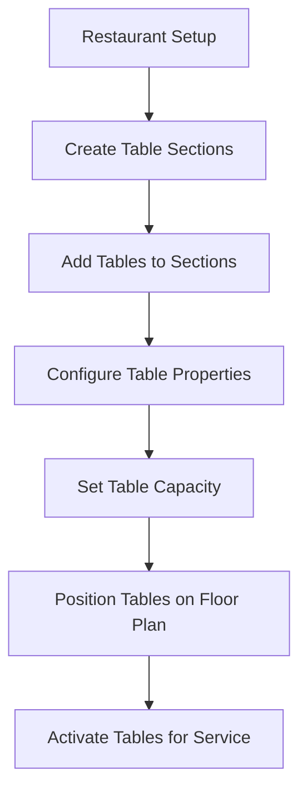

**Process Details:**
- Restaurant manager creates sections (e.g., "Main Dining", "Patio", "Private Room")
- Tables are added to sections with capacity and positioning
- Tables can be arranged visually in floor plan editor
- Tables have status: Available, Occupied, Reserved, Cleaning, Maintenance

### 1.2 Table Status Management
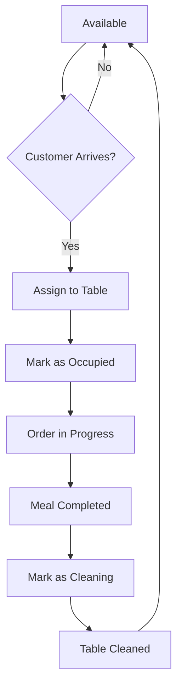

**Key States:**
- **Available**: Ready for seating
- **Occupied**: Currently serving customers
- **Reserved**: Held for future reservation
- **Cleaning**: Being prepared for next guests
- **Maintenance**: Out of service

### 1.3 Table Assignment Process
1. Host/Manager views table availability dashboard
2. System suggests optimal tables based on party size
3. Host assigns table and updates status
4. Waiter is notified of table assignment
5. Customer is seated and waiter takes order

## 2. Reservation Management Workflow

### 2.1 Reservation Creation
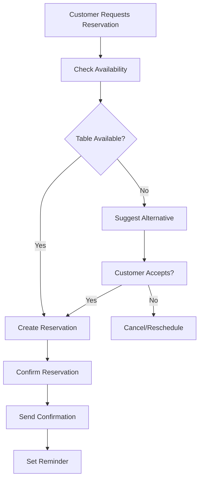

**Process Details:**
- Check table availability for requested date/time
- Consider party size and table capacity
- Handle conflicting reservations
- Send confirmation via SMS/Email
- Set deposit requirements if applicable

### 2.2 Reservation Management
- **Confirmation**: Customer confirms arrival
- **Seating**: Mark reservation as seated when guests arrive
- **Cancellation**: Handle cancellations with deposit policies
- **No-show**: Mark as no-show after grace period

## 3. Order Placement Workflow

### 3.1 Order Taking Process
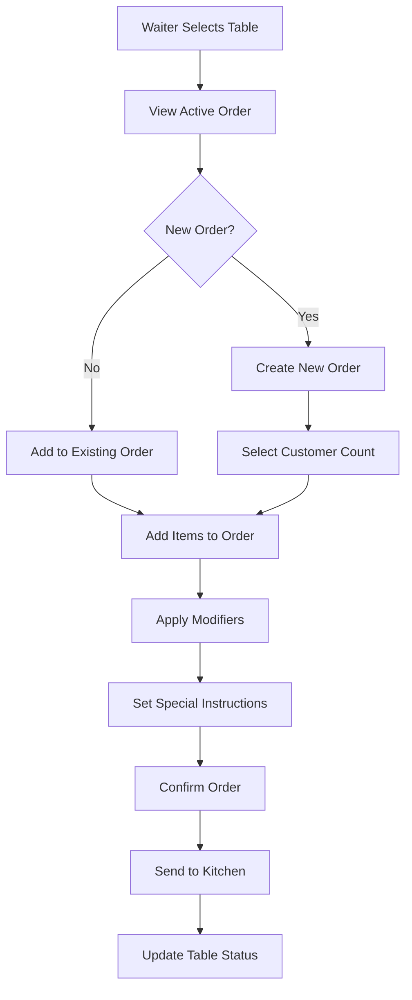

**Key Features:**
- Split items by course (appetizers, mains, desserts)
- Handle modifiers and customizations
- Real-time inventory checking
- Automatic kitchen routing based on item preparation stations

### 3.2 Order Modification Process
1. Waiter selects existing order
2. System checks if order can be modified (status-based)
3. Items can be added, modified, or voided
4. Kitchen receives updates for new/modified items
5. Voided items require manager approval

### 3.3 Order Status Tracking
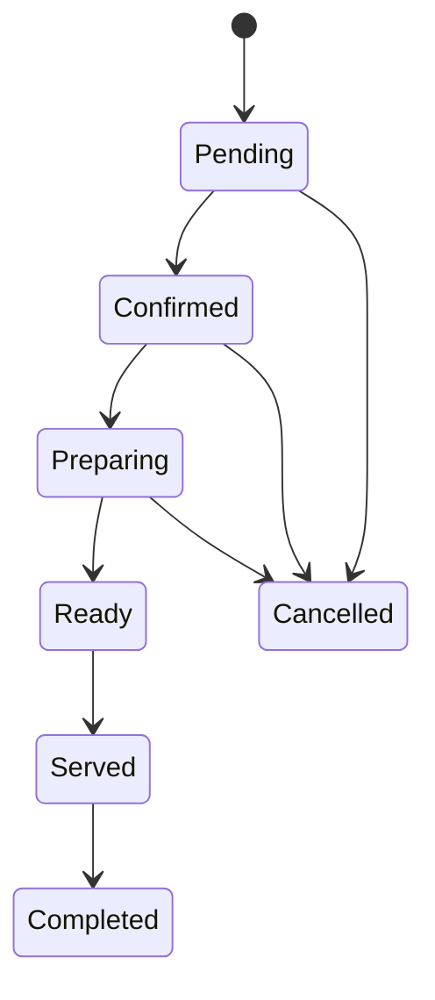

**Status Definitions:**
- **Pending**: Order taken but not confirmed
- **Confirmed**: Order verified and sent to kitchen
- **Preparing**: Kitchen is working on the order
- **Ready**: Food prepared, awaiting service
- **Served**: Delivered to table
- **Completed**: Order finished
- **Cancelled**: Order cancelled (with reason)

## 4. Kitchen Display System Workflow

### 4.1 Order Routing to Kitchen
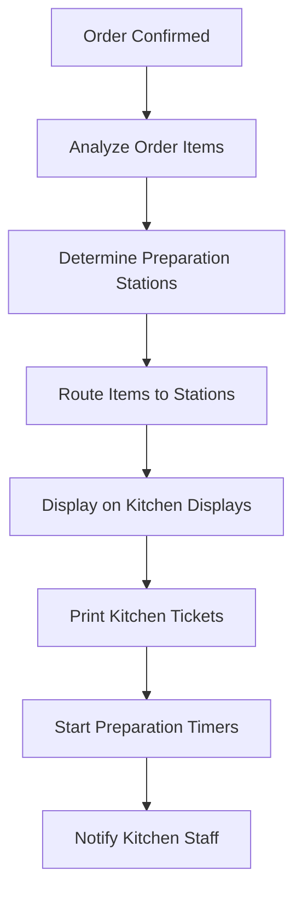

**Station-based Routing:**
- Grill station: Grilled items, steaks
- Bar station: Beverages, cocktails
- Salad station: Salads, cold appetizers
- Fry station: Fried items
- Pizza station: Pizza, flatbreads

### 4.2 Kitchen Queue Management
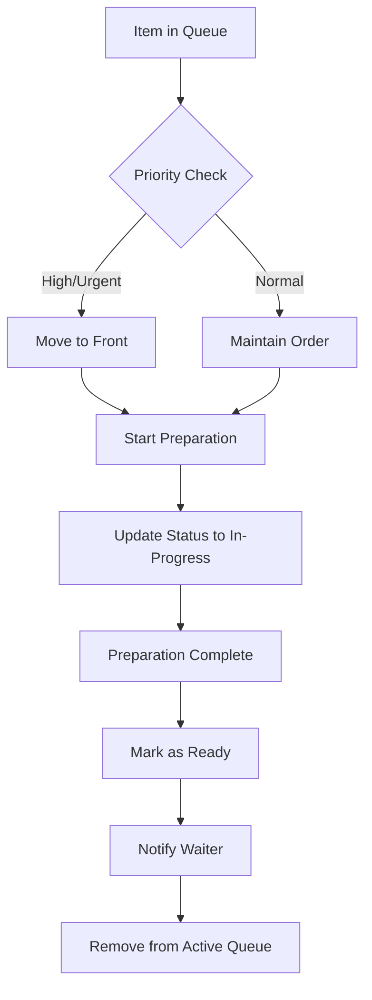

**Queue Features:**
- Priority-based ordering
- Time tracking for each item
- Color-coded status indicators
- Preparation time estimates
- Staff assignment capabilities

### 4.3 Kitchen Communication
- **Preparation Updates**: Real-time status changes
- **Delay Notifications**: Alert waiters about delays
- **Quality Issues**: Report problems with orders
- **Staff Coordination**: Hand-off between stations

## 5. Payment and Checkout Workflow

### 5.1 Standard Checkout Process
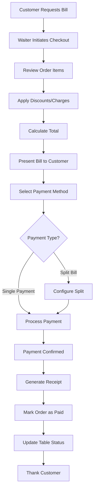

### 5.2 Split Billing Workflow
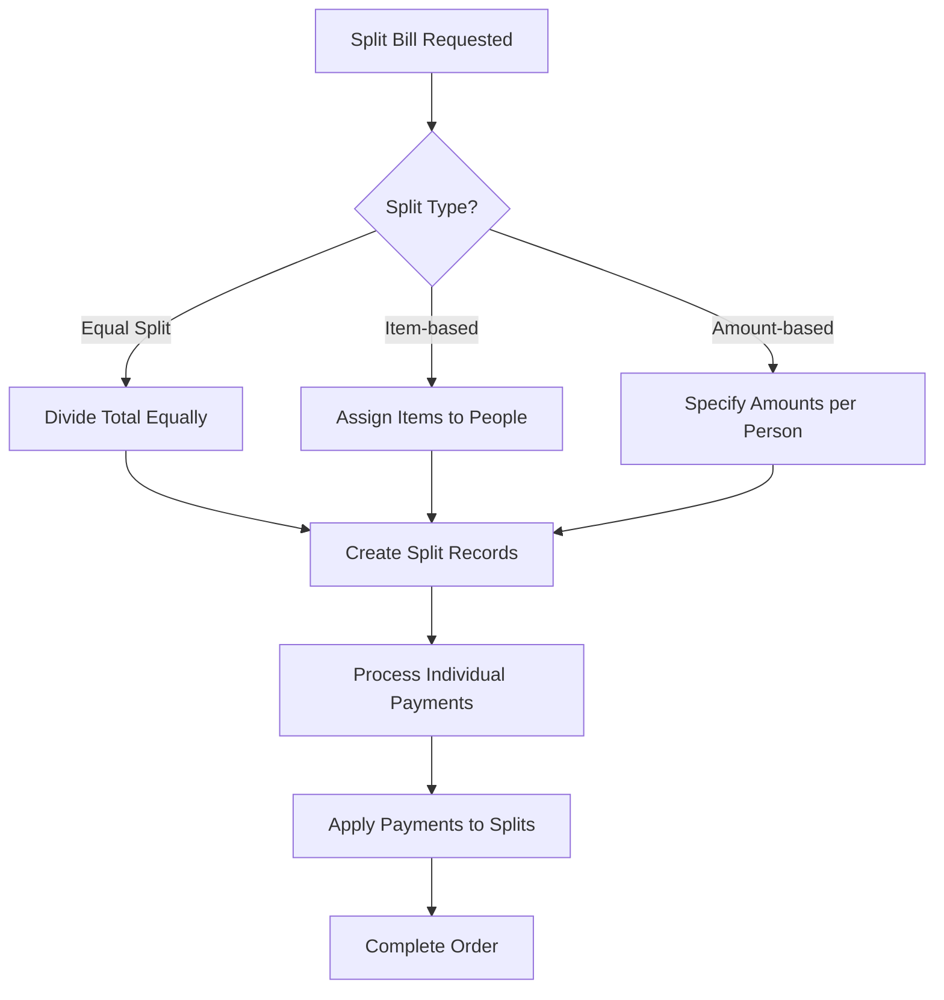

**Split Types:**
- **Equal Split**: Divide total by number of people
- **Item-based**: Assign specific items to each person
- **Amount-based**: Specify amounts for each person

### 5.3 Tip Management
- **Automatic Suggestions**: Percentage-based tip suggestions
- **Split Tips**: Distribute tips among staff
- **Tip Reporting**: Track tip allocation by role
- **Cash vs Card**: Handle different tip payment methods

## 6. Order Type Management

### 6.1 Dine-in Orders
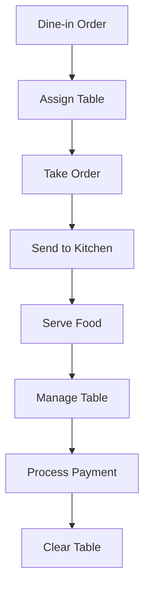

**Features:**
- Table assignment and management
- Course sequencing
- Waiter service tracking
- Table-side ordering capabilities

### 6.2 Takeaway Orders
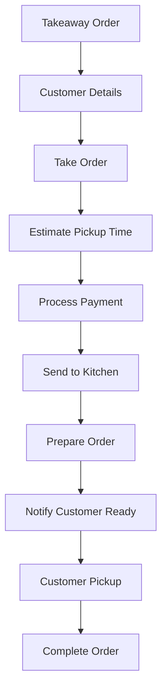

**Features:**
- Customer contact information
- Pickup time estimates
- Packaging requirements
- Order staging area

### 6.3 Delivery Orders
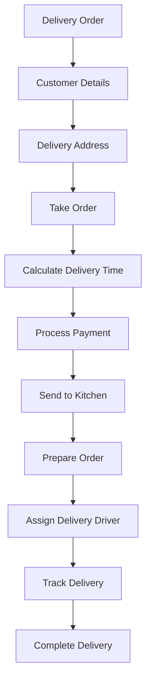

**Features:**
- Delivery address validation
- Delivery time estimates
- Driver assignment and tracking
- Delivery confirmation

## 7. Inventory Integration Workflow

### 7.1 Real-time Inventory Updates
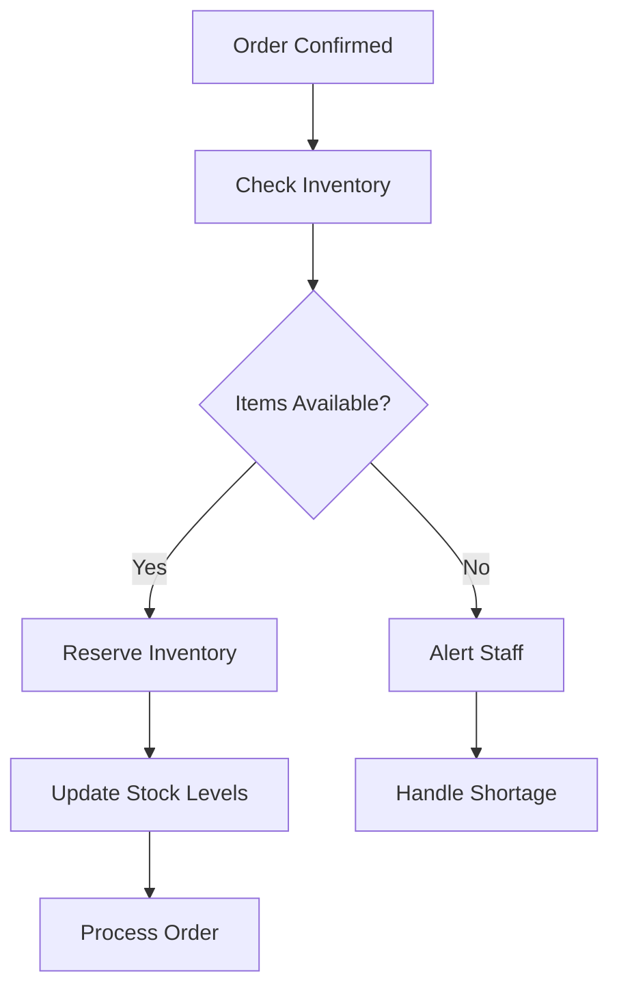

**Integration Points:**
- Real-time stock level checking
- Automatic inventory reservation
- Low stock alerts
- Waste tracking for voided items

### 7.2 Waste and Spoilage Management
- Track voided items and reasons
- Monitor preparation waste
- Record spoilage incidents
- Generate waste reports

## 8. Staff Management Workflow

### 8.1 Role-based Access Control
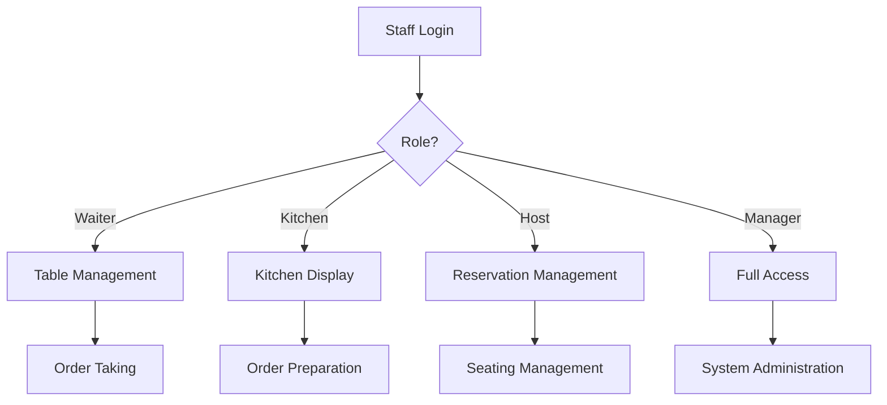

### 8.2 Shift Management
- Clock in/out functionality
- Shift handover procedures
- Cash drawer management
- Tip distribution tracking

## 9. Reporting and Analytics Workflow

### 9.1 Real-time Dashboard
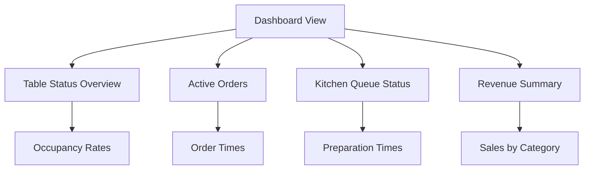

### 9.2 End-of-Day Processing
- Daily sales reports
- Tip distribution reports
- Inventory usage reports
- Staff performance metrics
- Financial reconciliation

## 10. Error Handling and Recovery

### 10.1 System Failure Procedures
- Offline mode capabilities
- Data synchronization protocols
- Backup and recovery procedures
- Emergency order processing

### 10.2 Order Error Handling
- Incorrect item entry
- Payment processing errors
- Kitchen communication failures
- Table assignment conflicts

## 11. Integration Points with Existing POS

### 11.1 Shared Components
- Product management (extended for restaurant use)
- Customer management (enhanced for reservations)
- Payment processing (extended for splits and tips)
- Inventory management (enhanced for real-time updates)
- Reporting (extended for restaurant metrics)

### 11.2 Data Flow Integration
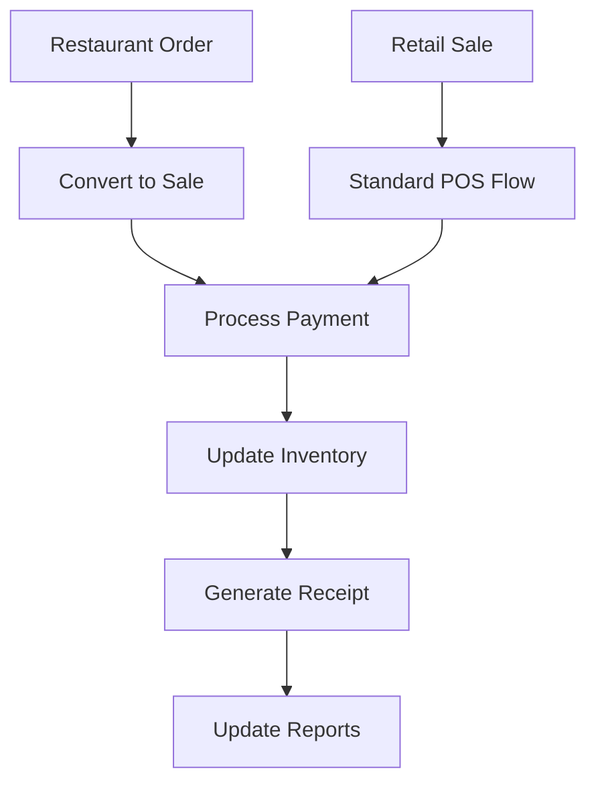

## 12. Performance Optimization

### 12.1 Database Optimization
- Indexed queries for fast table lookups
- Optimized kitchen queue queries
- Efficient order status updates
- Cached menu data

### 12.2 Real-time Communication
- WebSocket connections for live updates
- Push notifications for order status changes
- Efficient kitchen display updates
- Minimal latency table status updates

These workflows provide a comprehensive foundation for restaurant operations while maintaining seamless integration with the existing InfoShop POS system.